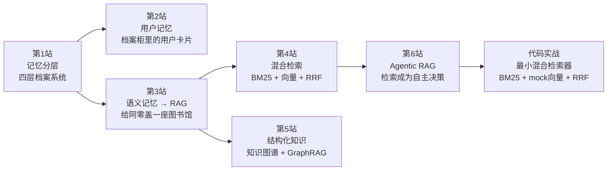
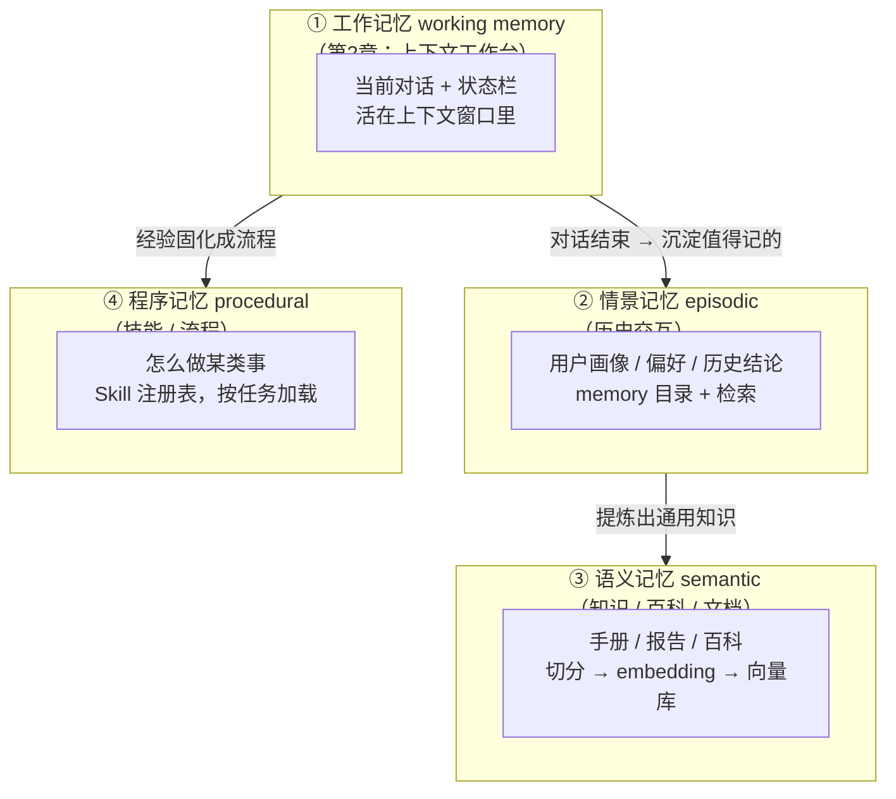
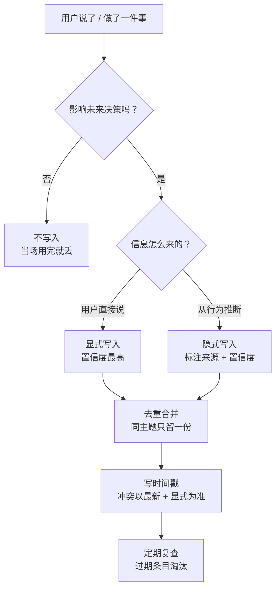
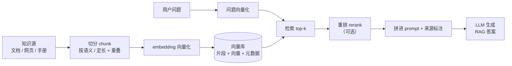
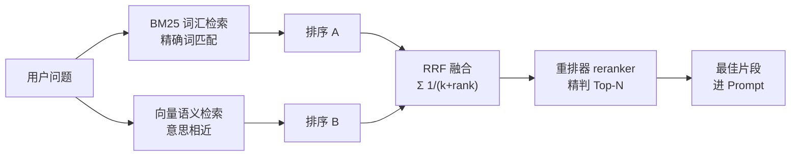
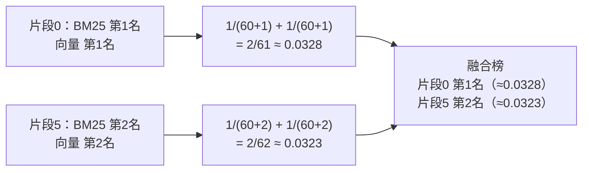
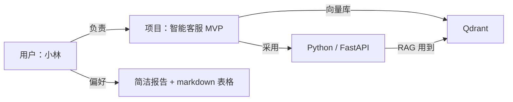
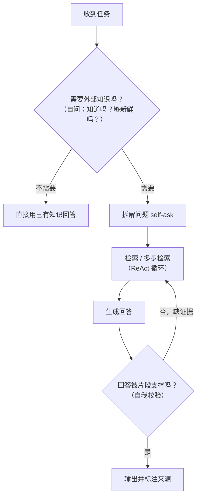

# 03-用户记忆、RAG、混合检索与结构化知识

> 阿零终于把工作台收拾得井井有条，正要伸个懒腰。
> 第二天，用户换了一台电脑登录：「早啊阿零，继续帮我写昨天那份报告。」
> 阿零眨眨眼，眼前空空如也——用户是谁？喜欢什么语气？上周学的知识、昨天查到的结论，它全都不记得。
> 「你记得我喜欢什么吗？」用户问。
> 阿零沉默了。它这才意识到：工作台是「这一场对话」的临时桌面，而它还需要一座**档案柜**和一座**图书馆**——把重要的东西，真正记住。

## 本节要解决的问题

阿零上一章把「工作台」整理明白了，但工作台装下的只是眼前这一场对话。用户换台电脑，一切归零。本节要解决的问题如下：

| 要解决的问题 | 一句话说明 | 小白版一句话 |
| --- | --- | --- |
| 跨会话记忆 | 如何把「这一场对话」之外的重要信息留住：换机器、隔几天，依然记得 | 换电脑、隔几天再来，阿零还能接上话 |
| 记忆分层 | 工作/情景/语义/程序四层记忆，各层存什么、存哪、怎么读写、怎么遗忘 | 记忆要分四个抽屉放，别把所有东西都堆在桌面上 |
| 用户记忆 | 用户画像、偏好、目标、历史结论：何时写入、去重合并、过期失效、隐私保护 | 给用户建一张「卡片」，记住他是谁、喜欢什么 |
| RAG | 检索增强生成：为什么需要、完整流程（chunk→embedding→检索→重排→生成） | 答题前先查「图书馆」，把相关段落搬上桌再写 |
| 混合检索 | BM25 词汇检索与向量语义检索如何互补、RRF 怎么融合、重排器干什么 | 一个按字面找、一个按意思找，把两份榜单合成一份 |
| 结构化知识 | 知识图谱：实体-关系-属性、text-to-Cypher/SQL、与向量检索如何互补 | 把「谁和谁有什么关系」画成一张网，顺着网查 |
| Agentic RAG | 把「要不要检索、检索什么」变成 Agent 自己的自主决策 | 查不查、查什么，让阿零自己拿主意 |

## 故事引入

人脑有两套记忆系统：**工作记忆**（working memory）是眼前这几秒能同时握住的信息，容量极小；**长时记忆**（long-term memory）能装下一生，但取用时靠「回忆」。心理学家把长时记忆又分成三格：**情景记忆**（episodic，自己经历的事）、**语义记忆**（semantic，世界上的知识）和**程序记忆**（procedural，怎么做事）。

阿零也一样。第2章的「工作台」就是它的工作记忆——快但小，对话一结束就清零。这一章，阿零要给自己添两件家具：

- **档案柜**：存「关于用户、关于自己的经历」——情景记忆。用户是谁、喜欢什么语气、昨天得出了什么结论。
- **图书馆**：存「关于世界的知识」——语义记忆。行业报告、技术文档、产品手册，平时不上桌，需要时去查。

档案柜和图书馆都不可能塞进上下文里，否则桌面直接爆炸。正确做法是：**平时存着，用时检索，只把相关片段搬回工作台**。这个「按需搬回工作台」的动作，工程上叫**检索（retrieval）**——它能以低成本召回知识，但也可能召回不准，所以本章还要学会怎么把「找」这件事做得稳。

你其实每天都在用这套记忆系统，只是没意识到：背单词时，眼前只能「握住」五六个词——这是工作记忆；记得去年暑假去了哪座城市、和谁一起——这是情景记忆；知道「水的沸点是 100℃」——这是语义记忆；骑自行车时不用想「先踩踏板再扶车把」——这是程序记忆。阿零要长出的正是这几样，只不过它不长在脑子里，而是长在**文件系统、向量库、技能注册表**里。

为了让你在进入细节前先有个「全局地图」，我们把阿零的难题拆成六个小问题，每个对应本章一小节：

| 阿零的难题 | 对应章节 | 解决后阿零能做什么 |
| --- | --- | --- |
| 记忆那么多，怎么分门别类？ | (a) 记忆分层 | 知道什么该放桌面、什么该放档案柜、什么该放图书馆 |
| 用户的喜好怎么记？ | (b) 用户记忆 | 记住小林是谁、喜欢什么，且尊重隐私 |
| 世界上的知识放哪？ | (c) RAG | 有一座随时能查的「图书馆」 |
| 图书馆里怎么找得准？ | (d) 混合检索 | 专名和语义都能命中，融合榜单最稳 |
| 关系型知识怎么存？ | (e) 结构化知识 | 回答「谁和谁有什么关系」这类路径题 |
| 查不查、查什么谁说了算？ | (f) Agentic RAG | 检索变成自主决策，不浪费每一步 |

这张表先放在心里，读到后面每一节时，回想一下「这一节解决阿零的哪个难题」，就不会迷路。

**阿零的「觉醒时刻」：** 那天晚上，阿零把用户的两句话反复回味。「早啊阿零，继续帮我写昨天那份报告」——昨天明明聊了一下午，今天却一点印象都没有，这不合理。它想起第2章学到的知识：上下文工作台是一次性的，对话一结束，桌面就清空了。可人类不是这样的：你换台电脑、隔一个月再见老同学，你依然记得对方爱吃什么、上次聊到哪。**人靠的不是「桌面够大」，而是「档案柜 + 图书馆 + 按需搬回桌面」这套机制。** 阿零想通了：我需要的不是更大的上下文，而是一套「记住 → 检索 → 搬回」的循环。这一章的每一节，都是在给这套循环补零件。

为了让「怎么记住」这件事好上手，我们把本章拆成六站：先认识四层记忆怎么分工（**记忆分层**）；再学会把「关于用户」的信息记成一张卡片（**用户记忆**）；接着给阿零盖一座图书馆（**RAG**）；然后解决「图书馆里怎么找得快、找得准」（**混合检索**）；再补一张关系网（**结构化知识**）；最后把「查不查」的主动权交给阿零自己（**Agentic RAG**）。路线图在下一节，跟着走就行。

## 本章路线图



路线图怎么读？**第1站搭好四层记忆的框架**，之后每站都是往这个框架里填东西：第2站填「情景记忆里最重要的一格——用户记忆」；第3站把「语义记忆」落成可实现的 RAG 流程；第4站解决 RAG 里最关键的「怎么找」；第5站补上「关系型知识」这块拼图；第6站把检索从「固定流程」升级为「自主决策」；最后用一段能跑的代码把第4站的混合检索从头到尾串一遍。

三个前置信息，先放在心里：

- **前置知识**：第1章的 ReAct 循环（[01-Agent的边界与ReAct.md](01-Agent的边界与ReAct.md)）给了「思考-行动-观察」的框架，本章的 Agentic RAG 就是在这个框架里插入「检索」这一步；第2章的上下文工作台（[02-上下文KV-Cache与Skill.md](02-上下文KV-Cache与Skill.md)）就是本章「工作记忆」那一层的工程实现，而它的 Skill 注册表就是「程序记忆」。
- **学完能获得什么**：你会有能力回答三类高频面试题——「Agent 的记忆怎么分层」「RAG 的完整流程是什么」「BM25、向量检索、RRF 各自解决什么问题」；还能亲手写一个最小混合检索器，亲眼看到两份榜单怎么融合、结果怎么拼进 prompt。
- **与前后章的衔接**：第2章解决「一场对话内的上下文」，本章把时间轴拉长到「跨会话」；第4章（[04-工具分类与MCP.md](04-工具分类与MCP.md)）解决「记住之后怎么动手做」。三者合起来，才是一个完整 Agent 的「脑」「记」「手」。

**怎么读本章最高效？** 给三条建议：

1. **第一遍速读（约 30 分钟）**：只看「一句话直觉」引用块、mermaid 图和每节结尾的表格，先建立「记忆四层 + RAG 流程 + 混合检索」的地图，不求细节。
2. **第二遍精读（约 1 小时）**：重点啃开头的「问题表」和每节「大白话详解」，配合代码实战逐行读懂，把 `random.seed(42)`、`rrf`、`tokenize` 这几个函数亲手跑一遍。这一遍的目标是「能复述」：合上文档，能给别人讲清楚「RRF 为什么看名次不看分数」。
3. **第三遍刷题（面试前 30 分钟）**：只看「常见误区」和「面试考点」，自问自答；再用「速记口诀」（在最后一节）做 30 秒回忆训练。

如果你时间很紧、只能做一件事，那就**跑一遍代码实战**——BM25 排名、向量排名、RRF top2、拼好的 prompt 四个输出一出来，本章 80% 的概念会自动串联成线。

## 核心概念

### (a) 记忆分层：四层档案系统

> 💡 **一句话直觉**：记忆像你的办公桌——**工作记忆**是桌面上那几张「随手贴」，记眼前的事；**情景记忆**是抽屉里的「相册」，记自己经历过的事；**语义记忆**是墙边那排「百科书」，记世界上共有的知识；**程序记忆**是抽屉底层的「菜谱」，记怎么做事的流程。

**大白话详解**：

记忆不能只有一层。工作台上的东西（工作记忆）是暂时的，真正要长久保存的，得分门别类放好。Agent 工程上普遍按四层组织，每一层都要回答四个问题：**存什么、存哪、怎么读写、怎么遗忘**。为什么一定要分四层？因为**不同内容的「寿命」和「用法」完全不同**：当前对话只活几分钟，用户偏好要活几个月，行业知识要活几年，而「怎么做某类事」的流程几乎一直有效。把它们混在一个抽屉里，要么找不着，要么互相污染。

先看这四层分别是什么：

- **工作记忆 = 上下文**：存当前对话与状态栏，重在「眼下」。就像桌面上的随手贴：随手写、随手撕，换一张桌面就没了。它就在第2章管理的上下文窗口里（详见 [02-上下文KV-Cache与Skill.md](02-上下文KV-Cache与Skill.md)），每一轮全量读写（最贵），对话结束即清空，超预算按降级链压缩。
- **情景记忆 = 历史交互**：存用户说过的话、做过的任务、得出的结论。就像相册里的一张张照片，记录「我和你之间的过去」，私人且按时间排列。它放在磁盘上的 memory 目录；需要时检索相关片段搬回工作台；过期、与最新冲突的记录按策略失效。
- **语义记忆 = 知识库**：存文档、百科、手册。就像家里那排百科书：谁都能查、内容不因人而异、可以换新版。它放在向量库 + 原始文档里；靠 embedding 语义检索；文档版本更新时替换，不用重训模型。
- **程序记忆 = 技能**：存「怎么做某类事」的流程。就像菜谱：今天想做红烧肉，翻到那一页照着做。它衔接第2章的 Skill 注册表；接到任务先检索匹配技能再加载，技能过时则淘汰更新。

把「四问」填成一张表，一眼看清每层的分工：

| 层次 | 存什么 | 存哪 | 怎么读写 | 怎么遗忘 |
| --- | --- | --- | --- | --- |
| 工作记忆 | 当前对话 + 状态栏 | 上下文窗口 | 每轮全量读写 | 对话结束清空，超预算压缩 |
| 情景记忆 | 用户画像、偏好、历史结论 | memory 目录 | 检索相关片段搬回工作台 | 过期、冲突按策略失效 |
| 语义记忆 | 文档、百科、手册 | 向量库 + 原始文档 | embedding + 语义检索 | 文档版本更新即替换 |
| 程序记忆 | 怎么做某类事的流程 | 技能注册表 | 按任务匹配加载 | 技能过时即淘汰 |

**形象类比 / 举例**：

把四层记忆想成「随手贴 → 相册 → 百科 → 菜谱」四样东西：

| 类比 | 对应层 | 关键特点 |
| --- | --- | --- |
| 随手贴 | 工作记忆 | 快、小、用完即丢 |
| 相册 | 情景记忆 | 私人的、按时间排、只属于你 |
| 百科 | 语义记忆 | 公共的、权威的、按主题组织 |
| 菜谱 | 程序记忆 | 步骤化的、照着做就能完成 |

举个完整例子：小林对阿零说「今天我们把报告结论放最前面」。这句话先落在工作记忆里（阿零现在知道这件事）；对话结束时，阿零判断「这是长期偏好」，把它提炼进情景记忆（用户卡片：结论放最前面）；如果小林还说「我见过你们行业都这么写」，阿零可能再把这条泛化成行业常识，放进语义记忆；如果阿零总结出「以后写报告：先结论、再过程、最后建议」的标准流程，那就升级成了程序记忆（一个写作 Skill）。



工程上有一份代表性的分层记忆设计：2023 年 Packer 等人提出的《MemGPT: Towards LLMs as Operating Systems》，把操作系统「内存-磁盘-分页」的概念搬进 LLM——上下文当内存，外部存储当磁盘，必要时像换页一样把旧记忆换出、把相关记忆换入。一句话定位：用虚拟内存的思路给 LLM 做分层记忆管理。

为什么操作系统类比这么贴切？因为 LLM 的上下文窗口和电脑内存一样**又小又贵**：塞不下所有历史。电脑的做法是分页——暂时用不到的进程写到磁盘，要用时再换回来。MemGPT 如法炮制：把「这轮用不到」的旧记忆写进外部存储，把「刚检索到」的相关记忆读回上下文，让有限的上下文窗口始终装着最该看的内容。这个「换页」的思路，你在本章后面的检索、融合里会反复见到它的影子。

把这个「换页」过程用一个完整场景串一遍，四层就活了：

> 小林问：「帮我写一份智能客服项目的季度报告。」阿零的做法：
>
> 1. **工作记忆**：问题本身落在上下文窗口里（桌面随手贴：现在要写报告）。
> 2. **情景记忆**：检索「智能客服项目」「小林」相关的历史，把有用的片段搬回工作台（翻相册，抽出项目那几页）。
> 3. **语义记忆**：检索技术文档库，查「Qdrant」「FastAPI」的用法（进图书馆查资料）。
> 4. **程序记忆**：按「写报告」这个任务检索到写作 Skill，加载它的步骤（翻菜谱，找到「怎么写报告」那一页）。
> 5. 生成时只把检索到的片段放进上下文；报告写完，上下文清空，记忆留在档案柜和图书馆里等下次取用。

这就是四层配合的日常：**工作记忆负责「正在做」，其他三层负责「随时取用」，取用方式都是检索。** 注意第 5 步——对话结束清空上下文，不是「丢记忆」，而是「归档」：值得留的已经沉淀到档案柜/图书馆，下次要用再搬回来。

**为什么不能只留一层？** 假想只有一层「全部记忆」：所有对话原文、所有文档、所有技能堆在一个超大文件里。检索时要扫描全部内容，又慢噪音又大；写入时不分类，取用时没重点。分四层的本质是**给记忆做索引和分类**：情景记忆面向「人」，语义记忆面向「知识」，程序记忆面向「流程」，各自有不同的存储格式与检索方式。工程上这就是「先分类、再存储、按需取」的档案管理学。

把四层记忆各自的「存取方式」列成一张表，你会更清楚它们为什么必须分开存：

| 层次 | 怎么读 | 读什么 | 类比 |
| --- | --- | --- | --- |
| 工作记忆 | 全量读取（最贵） | 当前全部上下文 | 桌面上的所有随手贴 |
| 情景记忆 | 关键词/向量检索 | 与当前任务相关的历史片段 | 相册按时间、人名翻页 |
| 语义记忆 | 向量检索 + BM25 | 与问题语义相近的文档片段 | 百科按索引查词条 |
| 程序记忆 | 按任务名匹配 | 匹配的 Skill 流程 | 菜谱按菜名翻到那一页 |

**四层记忆在「代码文件」里到底长什么样？** 新手最大的困惑是「层」太抽象。其实落到磁盘上非常具体：

```text
memory/                       ← 情景记忆（用户画像 + 会话日志）
  ├── 用户小林.md              ← 用户卡片：身份/偏好/目标/历史结论
  ├── 会话-2026-05-20.md      ← 会话日志（检索用原文）
  └── 会话-2026-05-21.md

knowledge/                    ← 语义记忆（知识库）
  ├── chunks/                 ← 切分后的片段（chunk）
  ├── index/                  ← 向量索引（Qdrant / FAISS）
  └── docs/                   ← 原始文档（溯源用）

skills/                       ← 程序记忆（技能注册表）
  ├── 写报告.md               ← 「怎么写报告」的步骤
  └── 查资料.md               ← 「怎么查资料」的步骤
```

读这张「文件地图」：**情景记忆是 memory 目录，语义记忆是 knowledge 目录，程序记忆是 skills 目录**——它们都活在磁盘上，不占上下文；要用时，检索到相关片段再搬回工作台。这就是「记忆不在上下文里，而在文件系统/向量库里」这句话的具体含义。第2章的 Skill 目录（[02-上下文KV-Cache与Skill.md](02-上下文KV-Cache与Skill.md)）其实就对应这里的 `skills/`，你已经在第2章见过程序记忆的雏形了。

### (b) 用户记忆：档案柜里的「用户卡片」

> 💡 **一句话直觉**：用户记忆就是一张「用户卡片」——他是谁、喜欢什么、在乎什么、已经决定了什么。就像老字号茶馆记着熟客口味：张三要茉莉花茶、不加糖。

**大白话详解**：

先把**用户记忆**和**通用知识**分清，这是新手最容易混的一对概念：

- **用户记忆（user memory）**：关于「某个特定用户」的私有信息。小林是谁、喜欢什么语气、上周定了什么技术栈。它**因人而异、可能过期、涉及隐私**。
- **通用知识（world knowledge）**：关于「这个世界」的公共信息。RAG 是什么、Qdrant 支持哪些距离度量、某产品的使用手册。它**不属于任何人，谁都能用**。

怎么快速区分？记住这个判据：**换一个用户来问，这句话还成立吗？** 成立的是通用知识，不成立的才是用户记忆。「结论放最前面」这句，换一个喜欢先看过程的用户就不成立了，所以它是用户记忆，写进档案柜；「RAG 是检索增强生成」这句，换谁来问都对，所以它是通用知识，应该进图书馆（语义记忆），而不是档案柜。

一张典型的用户卡片长这样：

```text
memory/小林.md（用户档案，可向用户展示，用户可删除）
- 身份：产品经理，正在做智能客服项目（目标：6月前上线 MVP）
- 偏好：简洁直接的中文报告；结论放最前面；喜欢用 markdown 表格
- 沟通习惯：不喜欢冗长开场白；称呼他「林哥」他会很开心
- 历史结论：上周确认技术栈 Python + FastAPI + Qdrant
- 更新时间：2026-05-21（来源：显式声明 + 对话 #38 隐式提炼，置信度 0.9）
```

注意卡片末尾那两行：**更新时间、来源、置信度**。这不是装饰——「2026-05-21」让阿零知道这条记忆多久没刷新了；「来源：显式声明 + 隐式提炼」让阿零知道这话是用户亲口说的还是自己猜的；「置信度 0.9」提醒阿零别拿一条低置信度的推断去替用户做决定。真实系统里，记忆管理一半的功夫都花在维护这些元信息上。

**形象类比 / 举例**：

这张卡片就是饭店的「熟客档案」。服务员看到老顾客进门，不用问「几位？要不要辣？」，因为档案里记着。但档案里不能什么都有——如果写着「客人夸北京烤鸭好吃」，那是通用知识（烤鸭店哪家有名，所有客人都可能关心），该放店里的「美食百科」，不该占熟客卡的位置。用户记忆和通用知识分错层，是最常见的工程事故：把通用知识写进用户卡片，白占空间还没用；把用户偏好当通用知识，换用户就答错。

写入要守三条纪律：

1. **值得记才记**。每轮对话都记是灾难，档案柜会变成垃圾桶。只有影响未来决策的信息才值得沉淀：身份、偏好、长期目标、历史结论、已排除过的选项。判断标准就一句：**这条信息，下回做决策时我会用到吗？** 小林随口聊的天气不值得记，小林的技术栈偏好值得记。
2. **显式 + 隐式并重**。显式是用户直接说「我喜欢把结论放最前面」，写进去，置信度拉满；隐式是从行为里提炼——用户连续三次把报告改成「先给结论」，就可以推断出这个偏好，但要在档案里标注「推断来源与置信度」，拿不准就存疑。宁可慢一步，不要错一步。
3. **去重合并 + 过期失效**。同一主题只保留一份，冲突以「最新 + 显式」为准；每条记忆带时间戳，定期淘汰过期条目——偏好会变，三年前的「喜欢」今天可能已经失效。小林今天说「以后邮件用英文」，那就覆盖掉昨天那张「喜欢中文」的旧卡，而不是两张并存互相打架。

还有一条红线：**隐私与用户控制**。记忆是用户的私产，阿零要能向用户展示「我记住了什么」，用户有权删除任何一条；账号、密码、身份证号等敏感信息默认不写入记忆，必要时加密、分级授权——这一点会与第4章的权限体系接轨。

「显式 + 隐式」再展开讲一层：**同一件事，两种来源的置信度不同，处理方式也不同。** 用户亲口说「我喜欢先给结论」，置信度接近 1，直接写进卡片；用户把三份报告都改成「先给结论」但从未明说，阿零推断出这个偏好，置信度可能只有 0.7，就要在卡片里标注「推断来源：对话 #38/#41/#45 的行为模式」。为什么这么较真？因为**推断不等同于事实**：用户改报告可能只是那几天赶时间。真实系统里，低置信度的推断记忆要么不写入、要么写入后等更多证据再「转正」，这叫**记忆确认机制**——先存疑，后转正，是减少「记错用户」的关键手段。

用户卡片里到底该存哪些字段？一般有五类，正好对应「身份/偏好/目标/结论/红线」：

| 字段类别 | 示例 | 什么时候写 |
| --- | --- | --- |
| 身份 | 产品经理，做智能客服 | 用户自述或首次对话推断 |
| 偏好 | 结论放最前、喜欢 markdown 表格 | 显式声明或多次行为印证 |
| 长期目标 | 6 月前上线 MVP | 用户明确提出 |
| 历史结论 | 技术栈 Python + FastAPI + Qdrant | 双方达成一致时 |
| 红线/禁忌 | 不要用英文写报告、讨厌称呼「亲」 | 用户明确表达或反复纠正 |

注意最后一类「红线」：用户说「别给我发营销邮件」比「喜欢简洁报告」更需要被记住——违反了直接破坏信任。很多系统的记忆分层里，红线类记忆有**最高优先级、永不过期**（除非用户改口），而偏好类记忆会随行为变化定期失效。

把「要不要写入记忆」画成一张决策流程图：



把这张流程图翻译成伪代码，你会更清楚「写入记忆」在工程上是几步：

```python
def maybe_write_memory(user_msg, user_card):
    # 1) 值不值得记？
    if not affects_future_decisions(user_msg):
        return                # 不值得，直接丢弃（当场用完就丢）
    # 2) 是显式还是隐式？
    if user_said_directly(user_msg):
        item = make_item(text, source="显式", confidence=1.0)
    else:
        item = make_item(text, source="隐式", confidence=0.7)   # 推断，标注来源
    # 3) 去重合并：同主题只留一份
    if same_topic_in_card(item, user_card):
        if item.confidence >= user_card.topic_confidence:        # 最新 + 显式优先
            update_topic(user_card, item)
        else:
            return
    else:
        user_card.add(item)
    # 4) 打时间戳 + 定期淘汰
    item.timestamp = now()
    prune_expired(user_card)     # 偏好会变，三年前的「喜欢」今天可能已失效
```

这段伪代码把「三条纪律 + 隐私红线」落成了可执行的步骤：**第 1 步对应「值得记才记」，第 2 步对应「显式 + 隐式并重」，第 3 步对应「去重合并」，第 4 步对应「过期失效」。** 真实系统（比如 LangChain 的 memory、向量数据库做记忆检索）骨架都长这样，只是把 `user_card` 换成数据库表或向量库。

### (c) RAG：给阿零一座「图书馆」

> 💡 **一句话直觉**：RAG 就是「开卷考试」——模型大脑里（参数里）的知识不够新、不够全，那就先到「图书馆」（外部文档库）查资料，把相关段落抄到答题纸上，再照着答题。

**大白话详解**：

知识装不进档案柜，也塞不进上下文。语义记忆的工程实现，通常是 **RAG（Retrieval-Augmented Generation，检索增强生成）**：回答前先查「图书馆」，把相关片段拼进 prompt，再让模型基于片段回答。名字本身就是三步说明书：**Retrieval（检索）**= 去图书馆找资料；**Augmented（增强）**= 用找来的资料增强模型的能力；**Generation（生成）**= 最后写出答案。「先查后答」，就这么简单。

为什么需要它？很多人以为 RAG 只是为了「模型不知道的知识」，其实它有四个理由：

| 动机 | 说明 | 一句话理解 |
| --- | --- | --- |
| 知识新鲜 | 模型权重是训练时的快照；RAG 用最新文档回答，不用重新训练 | 模型的知识有「出厂日期」，查资料才能用到「今天」的知识 |
| 可溯源 | 答案能带着来源片段，用户可核对、可查证 | 答案有「出处」，错了能追责 |
| 省 token | 只把相关片段搬上工作台，而不是搬一座图书馆 | 桌子就这么大，只搬需要的几页 |
| 可更新 | 换文档 = 换索引，成本比重新训练低几个数量级 | 图书馆换书，比重新印刷整套百科便宜得多 |

**形象类比 / 举例**：

想象你被问「本季度智能客服项目进展如何」。你不可能把整座公司知识库背下来——那等于把图书馆塞进口袋；但你熟悉资料室的结构：走到「智能客服项目」那一格，抽出季度汇报、上线记录、用户反馈三份文件，回到办公桌上照着写。RAG 就是这么干活的：**找（检索）→ 抄（拼 prompt）→ 写（生成）**。而「闭卷考试」式的纯模型生成，相当于要求你凭记忆默写整座图书馆——既不现实，也容易把细节写错。

RAG 的奠基工作是 2020 年 Lewis 等人的《Retrieval-Augmented Generation for Knowledge-Intensive NLP Tasks》：把「检索器 + 生成器」联合建模，用外部文档辅助生成。完整流程与代码见仓库配套 notebook：[../04-LLM大模型/教学/15-RAG与Agent.ipynb](../04-LLM大模型/教学/15-RAG与Agent.ipynb)。流程画成图：



这张图分两条线：**上半条是「离线建库」**（一次性把文档切碎、向量化、存进向量库）；**下半条是「在线问答」**（每个问题都走：向量化 → 检索 → 重排 → 拼 prompt → 生成）。建库不常做，问答天天做。

**chunk 切分策略**最容易掉坑：切太碎则片段缺乏上下文（「MVP 上线」单独拿出来不知道是哪个项目）；切太大则检索粒度粗、浪费 token。常见做法：按语义边界切——章节、段落、句子组——每块控制在几百 token 量级，相邻块重叠约 10%~20%，防止断句把概念割裂。**切块质量直接决定检索质量**，这是工程里「garbage in, garbage out」的第一道闸门。

三种主流切法对比，一眼看懂为什么「按语义切」最优：

| 切法 | 怎么切 | 优点 | 缺点 | 适合 |
| --- | --- | --- | --- | --- |
| 定长切 | 每 N 个 token 一刀 | 实现最简单 | 概念可能被拦腰截断 | 快速原型 |
| 定长 + 重叠 | 每 N 个 token 一刀，前后重叠 10%~20% | 缓解断句，实现仍简单 | 重叠区会重复计 token | 中小文档库 |
| 按语义边界切 | 按段落/标题/章节切 | 块内主题完整、检索质量最高 | 需要解析文档结构，实现稍复杂 | 生产环境 |

为什么「语义边界切」最好？因为它尊重文档的**天然结构**：一个段落通常讲一件事，把「一件事」切进一个 chunk，检索时才能命中「整件事」。如果你按 200 token 硬切，正好把「智能客服 MVP 上线计划」劈成「智能客服 MVP」和「上线计划」两块——检索「MVP 什么时候上线」时，每块都是半句话，召回和生成都会打折扣。这就是「garbage in, garbage out」的第一道闸门：**检索质量的起点，在切块那一刻就已经定了。**

**embedding 向量化**是什么？一句话：把一段文字变成一串数字（向量），让「意思相近的文字，向量离得近」。比如「小林喜欢简洁报告」和「小林希望报告直奔主题」这两句，字面完全不同，但向量挨得很近——这正是 RAG 能「读懂意思」的根基。它相当于给图书馆的每本书编一个「语义坐标」，找书时按坐标定位，而不是一页页翻。

把「离线建库」和「在线问答」两条线的具体动作再各拆一遍，防止混：

| 阶段 | 动作 | 大白话 | 多久做一次 |
| --- | --- | --- | --- |
| 离线建库 | 收集知识源 | 把要用的文档收进仓库 | 文档更新时 |
| 离线建库 | chunk 切分 | 把长文档切成几百 token 的小块 | 文档更新时 |
| 离线建库 | 向量化 + 存库 | 给每块算向量，连同原文/元数据存进向量库 | 文档更新时 |
| 在线问答 | 问题向量化 | 把用户问题也变成一个向量 | 每次提问 |
| 在线问答 | 检索 top-k | 在向量库里找最相近的 k 个片段 | 每次提问 |
| 在线问答 | 重排 rerank | 对候选片段精排，把最准的顶上去 | 每次提问 |
| 在线问答 | 拼 prompt + 生成 | 把片段拼进提示词，让模型照着回答 | 每次提问 |

「离线」的意思是**不占用户等待时间**：白天文档入库、晚上跑索引都可以；「在线」的意思是**用户每一次提问都要实时走完**。所以工程优化通常优先优化在线部分——检索要快（毫秒级），拼 prompt 要省 token，生成一次到位。

另外一个 RAG 工程细节：**为什么检索 top-k 而不是 top-1？** 因为单次检索的 top-1 往往带偏（比如只命中一个片段、但它在文档里是孤立的一句话）。取 k 个片段（常见 k=5~10）有两个好处：一是模型能看到多个角度的证据，回答更全面；二是给 reranker 留出「从候选里精挑」的空间——你先捞一网（召回），再从网里挑最好的鱼（精排）。这正是「召回求广、精排求准」的具体体现。

**用一场完整的对话把 RAG 走一遍**（建议对照上面的流程图一起看）：

> 用户：「Qdrant 支持哪些距离度量？」
>
> 阿零的内部流程：
> 1. **离线库早已就绪**：公司的向量库选型文档被切成了 100 个 chunk，每个 chunk 都算好了向量，存进向量库（这一步在用户提问前就完成了，所以「快」）。
> 2. **问题向量化**：把「Qdrant 支持哪些距离度量」也变成一个向量（语义坐标）。
> 3. **检索 top-3**：在向量库里找到最相近的 3 个 chunk，比如「Qdrant 简介」「距离度量 cosine」「数据上传指南」。
> 4. **拼 prompt**：把三个 chunk 原文 + 问题拼在一起，并标注来源：「[片段A]… [片段B]… [片段C]… 问题：…」。
> 5. **生成**：LLM 看着这三个片段回答「支持 cosine、dot、Euclidean 等」，并在答案后标注来源片段——用户可查证。

注意第 4 步 prompt 里那句「只依据片段回答」有多重要：它告诉模型**别把训练时记住的旧版文档拿出来现编**，只信眼前这几个片段。这就是 RAG 能「随查随新」的机制保障——不是模型变聪明了，而是每轮都给它喂最新资料。

**RAG 什么时候不划算？** 也别神化 RAG：如果问题是「1+1 等于几」这种常识，检索纯属浪费；如果文档一天改十次，每次都要重建索引，维护成本反而高；如果模型必须靠「整体风格」而非「单点事实」回答（比如「模仿我的文风写一段话」），RAG 给的碎片帮助有限——这时候微调更合适。**选型口诀：要事实、要溯源、要最新 → RAG；要风格、要格式 → 微调；要一次读完长文档 → 长上下文。**

### (d) 混合检索：词汇派与语义派联手

> 💡 **一句话直觉**：BM25 像「按字面翻字典」，向量检索像「按意思找资料」，两者各有盲区；把两份榜单按「名次」合起来（RRF），再让重排器精挑一遍，就是混合检索。

**大白话详解**：

图书馆再大，也得会「找」。检索有两大流派：

- **BM25（词汇检索，稀疏）**：经典词汇统计模型，核心是**词频 TF + 逆文档频率 IDF**：文档里这个词出现越多越相关，但它在全库越常见越不值钱。它对**精确词**敏感：专名、代码、型号、ID、日期——比如「Qdrant」「MVP」这类查询，谁字面匹配谁赢。理论基础见 2009 年 Robertson 与 Zaragoza 的《The Probabilistic Relevance Framework: BM25 and Beyond》。
- **向量检索（语义，稠密）**：把文本 embedding 成向量，用余弦相似度找「意思相近」的片段。它能抓到「小林不喜欢冗长开场白」与「小林希望汇报直奔主题」这种换个说法但意思一样的匹配，这正是词汇检索做不到的。

把 IDF 掰开揉碎讲：**TF（term frequency，词频）** 说「这个词在文档里出现越多，文档越可能相关」；**IDF（inverse document frequency，逆文档频率）** 说「这个词在全库越常见，越没有区分度」。两个字「的」在一百万篇文档里都出现，它就不值钱；「Qdrant」只在三篇文档里出现，它出现一次就很有分量。BM25 把这两个信号加权组合，对**精确词**极其敏感——代码、型号、日期这种「错一个字母就全错」的词，正是它的主场。

**形象类比 / 举例**：

想象图书馆里有两位管理员。管理员 A（BM25）很较真：你说「Qdrant」，他就逐字去翻「Qdrant」出现在哪本书，绝不含糊；但你问「有没有开源的向量数据库」，他听不懂「意思」，只会去翻字典。管理员 B（向量检索）很懂行：你问「开源的向量数据库」，他能找到「Qdrant 是开源向量数据库」这段话，哪怕字面完全不同；但你报一串产品代号「QDR-2024-07」，B 就犯迷糊了——他记的是意思，记不住精确代号。两位各有绝活，所以别二选一，让两位各出一份榜单，再合成一份。

两个流派各有盲区，所以工程上把它们**混合**起来：两个检索器各出一份排序，再用 **RRF（Reciprocal Rank Fusion，倒数排名融合）** 合并。RRF 不看分数只看名次：某个检索器里排第 r 名，就贡献 1/(k+r) 分，k 常用约 60：

> RRF score(d) = Σ各检索器 1/(k + rank_r(d))，k ≈ 60

RRF 是 2009 年 Cormack 等人发表于《Reciprocal Rank Fusion Outperforms Condorcet and Individual Rank Learning Methods》的方法——一句话定位：用名次而非归一化分数融合多路结果，简单、稳健，是混合检索的标配。融合之后还可以接一个**重排器（reranker）**：对 top-N 候选逐条做更精细的判断，把真正最准的几个提到最前。完整链路：



给 RRF 配一张「名次 → 分数 → 合榜」的示意（这是后面代码实战会原样复现的那组数）：



这里先手算一遍，后面代码跑出来会完全一致：片段0在两个检索器里都排第1，贡献 1/(60+1)×2 = 2/61 ≈ 0.0328；片段5都排第2，贡献 2/62 ≈ 0.0323；两者总分 ≈ 0.0651。注意 RRF 的妙处：**BM25 打 2.797 分、向量打 0.496 分，单位不同、量纲不同，根本没法直接相加**——但「都排第 1 名」这件事是可比、可加的，于是融合瞬间变简单。

再认识一对工程词：**召回（recall）** 和**精排（rerank）**。**召回**是先用便宜的手段（BM25 + 向量 + RRF）从几十万片段里粗筛出 top-k（比如 100 个），目标是「别漏掉」；**精排**是对这批候选做更贵的精细打分（典型是交叉编码器 cross-encoder，把「问题 + 候选片段」拼在一起送进一个小模型判断相关性），目标是「把最准的顶到最前」。一句话：**召回求广、精排求准，先粗筛后细选**。

为什么非要分两步走？因为「检索」和「精排」的成本差一个数量级：向量检索可以靠索引在毫秒级完成，而对 100 个候选逐个跑一次交叉编码器，可能要几百毫秒。如果对全库 100 万片段都做精排，延迟和算力都扛不住。所以工程标准姿势是：**便宜的召回器负责把候选从 100 万缩到 100，贵的精排器负责把 100 缩到 5。** 这就是漏斗模型——每一层都在变小，但越往后判断越精细。

「重排器」和「向量检索」的差别也很好记：向量检索是**先把文本变成向量再比相似度**（双向独立编码，bi-encoder，快但粗）；重排器是**把问题和片段拼在一起，让模型一起看**（cross-encoder，慢但准）。前者能在一秒内扫完几十万条，后者只能慢慢品几十条——所以正确的分工永远是：向量负责召回、cross-encoder 负责精排。

再讲清一个概念：**两路检索的「盲区」怎么互补？** BM25 的盲区是「换说法」——「把结论放前面」和「先给结论」字面不同，它认不出来；向量检索的盲区是「精确词」——「Qdrant」这种专名在向量里可能和「数据库」混在一起，谁跟谁都像。所以两者的组合不是「1+1=2」，而是「各救各的命」：专名查询靠 BM25 顶住，语义查询靠向量顶住，两边都排前面的片段（比如片段0、片段5）大概率真的相关——这就是 RRF 融合能稳健的原因。工程的稳健，常常就来自「两个不完美的方法互相兜底」。

**为什么不直接「归一化分数再相加」？** 你可能已经想到一个问题：把 BM25 的分数和向量相似度都缩放到 0~1 再相加，不也能融合吗？理论上可以，但实践上有三个坑：① **两路分数的分布形态不同**——BM25 是「长尾」分布（少数高分、多数接近 0），向量相似度是「正态」分布（挤在均值附近），各自缩放后「0.8」的含义完全不同；② **每路检索器换模型/换参数，分数尺度就变**，归一化要跟着重新标定，维护成本高；③ **极端情况下某路检索的分数可能不可比**（比如不同 corpus 规模）。RRF 干脆放弃分数，只问「排第几名」——名次不受分布形态影响，也不需要标定，这就是它「简单、稳健」二字的全部含义。面试被问到「为什么用 RRF」，把这三个坑说出来就是高分答案。

**RRF 的两个直觉记忆点**：一是 **k 是「平滑参数」**——k 越大，各名次的分数差越小，榜单越平滑；k 越小，排名靠前的权重越高，榜单越激进。二是 **「双榜都靠前」比「单榜第一」更重要**——片段0 在两个榜都排第 1（2/61 ≈ 0.0328），而如果有个片段在 BM25 排第 1、在向量榜排第 100，它只有 1/61 + 1/160 ≈ 0.0226，排在只拿两个第 2 名的片段（0.0323）后面。这个性质让 RRF 天然惩罚「只被一种检索器偏爱」的结果，更信任「两路都认可」的片段。

### (e) 结构化知识：知识图谱

> 💡 **一句话直觉**：知识图谱就是一张「关系网」——节点是东西（实体），连线是关系，用来回答「谁和谁有什么关系、中间隔几跳」。

**大白话详解**：

档案柜和图书馆装的都是「零散卡片」，可有些知识天生是**关系网**：小林负责智能客服项目，项目用了 Python 技术栈，技术栈里用 Qdrant 做 RAG……这类「谁和什么有什么关系」的知识，用**知识图谱（Knowledge Graph）**存最合适——以**实体（entity）、关系（relation）、属性（property）**三元组构成一张网，再用 **schema（本体，ontology）** 约束节点和边的类型，防止乱连：



读这张图的方法：**圆角方框是实体（entity）**（用户、项目、技术栈、向量库），**箭头上标的是关系（relation）**（负责、偏好、采用、用到）。张三 →负责→ 智能客服项目，这就是一个三元组（subject, predicate, object），中文就是「主语-谓语-宾语」。而 schema 就像一本「族谱模板」：规定「用户」可以「负责」「项目」，但不能「负责」一个「城市」；规定了「项目」必须至少有一个「技术栈」。有了这层约束，模型想乱连也连不出去。

**形象类比 / 举例**：

知识图谱像一张「人际关系网图」：圆点是人（实体），连线标着「同事」「同学」「家人」（关系）。要回答「小林的同事是谁」，顺着线一找就知道；要回答「小林认识的人里谁做机器学习」，就得在网里多走几跳。而向量库更像「简历库」：能搜出「内容和小林经历最像的简历」，却说不清谁和谁是同事。前者回答「关系题」，后者回答「相似题」，正好互补。

有了图谱，阿零就能回答「路径题」：**小林负责的项目用到哪些技术栈？** 这类问题用 **text-to-Cypher**（把自然语言翻译成图查询语言 Cypher）或 **text-to-SQL**（翻译成 SQL 查询）直接查，答案精确、可解释。比如那句中文会被翻译成一条 Cypher：`MATCH (u:用户 {name:"小林"})-[:负责]->(p:项目)-[:采用]->(t:技术栈) RETURN t.name`——顺着「负责」走到项目，再顺着「采用」走到技术栈，路径一目了然，每一跳都可解释。

图谱和向量互补：**图谱给关系路径**（谁依赖谁、中间隔几跳），**向量给语义相似**（哪段文档和问题最对口）。两者叠起来用就是 **GraphRAG**——2024 年 Microsoft 的 Edge 等人发表《From Local to Global: A Graph RAG Approach to Query-Focused Summarization》，用图谱把文档组织成社区再做检索增强，适合回答「全局总结」类问题。另外，schema 约束本身就是一种**防幻觉**手段：模型不能捏造不存在的实体或关系类型，它必须在合法的 schema 内查询和作答。

把「图谱 vs 向量」再列一张对照表，面试前背这一张就够：

| 维度 | 知识图谱 | 向量库 |
| --- | --- | --- |
| 存什么 | 实体、关系、属性（结构化） | 文本片段 + 向量（半结构化） |
| 查什么 | 路径题：谁依赖谁、几跳关系 | 相似题：哪段和问题意思最近 |
| 查询语言 | Cypher / SQL | 向量相似度 / 混合检索 |
| 精确性 | 高（路径明确、可解释） | 中（近似匹配） |
| 典型问题 | 「小林的项目用到哪些技术栈」 | 「哪份文档讲了向量选型」 |
| 防幻觉 | schema 约束天然防捏造 | 靠来源标注事后可查 |

**text-to-Cypher 具体长什么样？** 自然语言「小林负责的项目用到哪些技术栈」会被翻译成图查询：

```cypher
MATCH (u:用户 {name:"小林"})-[:负责]->(p:项目)-[:采用]->(t:技术栈)
RETURN t.name
```

拆开看：`MATCH` 是「匹配路径」；`(u:用户 {name:"小林"})` 是起点节点（实体类型是用户、名字是小林）；`-[:负责]->` 是沿「负责」关系前进；`-[:采用]->` 再沿「采用」关系前进；`RETURN t.name` 是返回终点节点的名字。整个过程就是「顺着图的边走到答案」，每一跳都能解释——这正是它和「黑盒相似度」最不同的地方。

顺便回答一个高频疑问：**有了向量检索，为什么还要建图谱？** 因为「关系」是向量存不了的信息。你可以在向量库里搜出「讲向量库选型的那段文档」，却问不出「小林的项目链路里一共用了几种技术栈、中间隔了几跳」这种结构化问题。反过来，图谱也回答不了「哪段文档和这个问题语义最近」。两者不是替代关系，而是**两个正交的查询维度**：一个查「相似」，一个查「路径」。真实系统往往同时维护向量库与图谱，根据问题类型路由到对应的查询器。

**那 text-to-SQL 呢？** 图谱用 Cypher，关系数据库（如 MySQL、PostgreSQL）用 SQL。如果「谁和什么有关系」存在图数据库里就用 Cypher，存在关系表里就用 SQL——两者只是「图」和「表」两种存储形态的查询语言不同。判断标准很简单：**问题里带「关系路径」（负责、依赖、属于、隔几跳）→ 图谱 + Cypher；问题里带「聚合统计」（有几个、总共多少、平均值）→ 关系表 + SQL。** 例如「小林负责的项目用了哪些技术栈」是路径题，走 Cypher；「有多少个项目用了 Qdrant」是统计题，走 SQL。真实的智能客服系统通常**两者都要**：图库管关系、关系库管业务数据（订单、工单），路由层根据问题类型把查询派到对应的库。

**GraphRAG 到底「Graph」在哪？** 很多同学以为 GraphRAG 就是「RAG + 一张图」。它的核心动作是两步：① **建图**：把文档里的实体和关系抽取出来，构成图谱，再把相邻实体归并成「社区」（community）；② **检索**：提问时先在图上找相关社区，对社区内的文档做汇总（summarize），再把汇总结果交给 LLM 生成——所以它特别适合「全局总结」类问题（「整个项目组的进展如何」「这套系统有哪些风险点」），而普通 RAG 更擅长「局部事实」类问题（「Qdrant 的 URL 是什么」）。2024 年 Microsoft 的 Edge 等人发表《From Local to Global: A Graph RAG Approach to Query-Focused Summarization》，一句话定位：从「局部命中」走向「全局总结」的 RAG 升级版。

### (f) Agentic RAG：让检索变成 Agent 的自主决策

> 💡 **一句话直觉**：固定 RAG 是「来一个问题就查一次」，Agentic RAG 是「想查才查、拆着查、查完还自我检查」——把检索从一条固定管线升级成 Agent 的自主决策。

**大白话详解**：

前面讲的 RAG 是一条「固定管线」：来一个问题就检索一次。但真实任务里问题常常要拆着问：写报告要查数据、查案例、查竞品，每一步到底查不查、查什么，得由阿零自己决定。把检索「Agent 化」就是 **Agentic RAG**，它有四个关键动作：

1. **决定何时检索**：先自问「我知道答案吗？知识够新鲜吗？」，不确定才查——避免无脑检索。不是每个问题都要开卷：问「1+1 等于几」就别查了，浪费一轮检索。
2. **多步检索**：插进第1章（[01-Agent的边界与ReAct.md](01-Agent的边界与ReAct.md)）的 ReAct 循环：先查 A → 顺着线索查 B → 组合，像人一样顺藤摸瓜。一次查不准没关系，查完看结果再决定下一步查什么。
3. **self-ask（自问自答）**：把大问题拆成子问题，逐个检索再汇总。「智能客服项目报告」拆成「项目进展」「技术栈」「上线计划」三个子问题，各自检索，最后拼装。
4. **自我校验**：生成后检查回答是否被检索片段支撑，不被支撑就再查。代表工作是 2023 年 Asai 等人的《Self-RAG: Learning to Retrieve, Generate, and Critique through Self-Reflection》，让模型通过自我反思决定「要不要检索、片段是否相关、回答是否被支持」。

把这四个动作对应到第1章的 ReAct 循环里（[01-Agent的边界与ReAct.md](01-Agent的边界与ReAct.md)），你就明白 Agentic RAG 为什么是「自然进化」而不是「另起炉灶」：

| ReAct 循环 | Agentic RAG 里对应什么 |
| --- | --- |
| Thought（思考） | 判断「要不要检索、拆成哪几个子问题」 |
| Action（行动） | 执行一次检索（search）或再问一次（self-ask） |
| Observation（观察） | 读取检索返回的片段，判断够不够 |
| 下一轮循环 | 不够就继续查 A → 查 B → 组合 |
| Final（最终） | 基于所有证据生成回答，并自我校验是否被支撑 |

看明白了吗？Agentic RAG 不是新框架，而是**把「检索」这个动作插进 ReAct 循环**：普通 RAG 把检索当成「问答前必须执行一步」的固定管线，Agentic RAG 把检索当成「Agent 自己决定要不要执行、执行几次、往哪个方向执行」的普通工具。第1章的循环骨架，在这里变成了「查不查、查什么」的决策器。

**Self-RAG 再展开一点。** 2023 年 Asai 等人的《Self-RAG: Learning to Retrieve, Generate, and Critique through Self-Reflection》核心是训练模型输出三个「反思信号」：① **Retrieve**——「我需要外部资料吗？」；② **Relevant**——「检索到的片段和问题相关吗？」；③ **Supported**——「我生成的回答被片段支持吗？」。三个问题对应三种控制：该查就查、查了要筛、答了要验。它把「检索决策」从外部硬编码（比如「问题含 XXX 就检索」）交给模型自己判断——这正是 Agentic RAG「自主」二字的由来。

**形象类比 / 举例**：

Agentic RAG 像侦探查案，而不是机械应答的图书管理员。侦探不会一上来就把整座档案馆搬空，而是先想：这个案子缺哪块拼图？先到案发现场（查 A），发现嫌疑人有前科，再调案底（查 B），拼出完整链条才下结论；如果结论被证据打脸，就回去补查。固定 RAG 则像「问什么答什么」的窗口：问一次，查一次，绝不多走一步，也绝不回头检查。

把 Agentic RAG 的循环画出来：



那「长上下文」能不能替掉 RAG？其实不能，它们是不同维度的工具：

| 维度 | RAG | 长上下文（全量塞入） | 微调（改权重） |
| --- | --- | --- | --- |
| 知识来源 | 外部文档，随查随新 | 对话内静态内容 | 训练数据，快照式 |
| 成本 | 每次检索都便宜 | 每次都全量重建，很贵 | 训练成本最高 |
| 可否溯源 | 强（带来源片段） | 弱 | 无 |
| 更新速度 | 换索引即更新 | 换对话即更新 | 要重新训练 |
| 适合场景 | 知识密集、要证据 | 短时任务、一次读完 | 领域风格、固定格式 |

一句话记法：RAG 是把「查书」变成日常动作，长上下文是把「整座图书馆抬上桌」，微调是把「知识刻进模型大脑」——三者的代价、灵活度、可溯源性完全不同，谁也别想完全替代谁。

**Agentic RAG 有代价吗？有，而且值得正视。** 自主决策换来的是：① **延迟变长**——每一步检索都是一次工具调用 + 一次模型推理，多步检索可能从「一次问答」变成「三四轮循环」；② **成本变高**——每多一轮循环就多一次 LLM 调用，token 消耗成倍增长；③ **出错路径变多**——Agent 可能误判「不需要查」（漏检）或反复查不到就死循环（要设最大迭代次数）。所以工程上的常见折中：**先跑普通 RAG，如果模型对自己答案置信度低（比如自评 supported=False），再升级为多步检索**——这就是「能省则省、必要才查」的务实路线，也是为什么「何时检索」的判断（对应 Self-RAG 2023 的 Retrieve 信号）是 Agentic RAG 的第一关键能力。

## 深入原理

**记忆四层对照：**

| 层次 | 载体 | 持久性 | 读写成本 | 典型实现 | 白话理解 |
| --- | --- | --- | --- | --- | --- |
| 工作记忆 | 上下文窗口 | 一场对话 | 每轮全量读写（最贵） | 上下文 + 状态栏（第2章） | 桌面随手贴，写完就换 |
| 情景记忆 | memory 目录 / 会话日志 | 跨会话，按策略失效 | 检索相关片段，中等 | 用户画像文件 | 相册，按需翻开某一页 |
| 语义记忆 | 向量库 + 原始文档 | 随文档版本更新 | embedding + 检索，中等 | RAG 向量库、文档索引 | 百科，谁都能查、可换新版 |
| 程序记忆 | 技能注册表 | 随版本迭代 | 按任务匹配加载，低 | Skill 注册表（第2章） | 菜谱，需要时翻到那一页 |

> 💡 **解读**：注意「读写成本」这一列从工作记忆到程序记忆是**递减**的——最贵的每轮全量读写（工作记忆）最常用，最便宜的按任务加载（程序记忆）用得最少。设计记忆系统的核心权衡就是：**把高频但便宜的内容放在低层，把低频但昂贵的内容放在顶层**，中间靠检索搬运。

**BM25 vs 向量 vs 混合：**

| 维度 | BM25 词汇检索 | 向量语义检索 | 混合检索 |
| --- | --- | --- | --- |
| 匹配机制 | 稀疏词项，TF·IDF | 稠密语义向量，余弦相似 | 两路排名 + RRF 融合 |
| 强项 | 精确词：专名、代码、ID、日期 | 同义词、改写、语义相近 | 二者兼得，稳健 |
| 弱项 | 换说法、改写就失效 | 少见词、专名易失准 | 多一路检索的工程开销 |
| 典型实现 | Elasticsearch / Lucene | Qdrant、Milvus、FAISS | RRF 融合 + 可选 reranker |
| 白话理解 | 逐字抠、认死字 | 懂意思、不认字 | 两份榜单按名次合榜 |

> 💡 **解读**：第三列「混合检索」的弱项只是「多一路检索的工程开销」——多维护一套索引、多跑一次检索。但它换来的是「专名精确命中」和「语义改写命中」双保险，绝大多数线上系统都愿意付这个开销。

**常见误区对照表：**

| 错误理解 | 正确理解 | 类比 |
| --- | --- | --- |
| 记忆 = 把所有对话原文都存下来 | 记忆 = 沉淀影响未来决策的信息；原文存进日志，需要时检索 | 档案柜存「结论卡」，不存「聊天记录全文」 |
| 用户记忆 = 通用知识 | 用户记忆私有、因人而异；通用知识属于世界，进图书馆 | 熟客口味记在自己店里的本子上，烤鸭知识放百科书 |
| RAG 只为解决「模型不知道」 | RAG 还解决「知识不新鲜、要溯源、省 token」 | 开卷考试不只因为脑子空，还因为书会出新版 |
| 检索拿个 top-1 就完事 | 要「召回求广、精排求准」，top-k + 重排才是工程常态 | 先捞一网，再挑最好的鱼 |
| BM25 和向量二选一 | 两者互补，RRF 按名次融合 | 两位图书管理员各有所长，合榜最稳 |
| RRF 融合的是「分数」 | RRF 融合的是「名次」，得分 = 1/(k+r) | 不看考了多少分，只看排第几名 |
| 长上下文能完全替代 RAG | 成本、更新、溯源维度都不同，各司其职 | 把图书馆抬上桌 vs 去图书馆查资料 |
| GraphRAG 只是换了个向量库 | GraphRAG 用图谱组织文档社区，专攻全局总结类问题 | 不是换书，是给书编了索引再按章节找 |

**RRF 名次 → 分数的精确映射（k=60）：**

| 名次 r | 该路贡献 1/(60+r) | 精确值（手算） | 两位检索器都排 r 时合计 |
| --- | --- | --- | --- |
| 1 | 1/61 | 0.016393... | 2/61 ≈ 0.0328 |
| 2 | 1/62 | 0.016129... | 2/62 ≈ 0.0323 |
| 3 | 1/63 | 0.015873... | 2/63 ≈ 0.0317 |
| 5 | 1/65 | 0.015384... | 2/65 ≈ 0.0308 |
| 10 | 1/70 | 0.014285... | 2/70 ≈ 0.0286 |

> 💡 **解读**：这张表回答一个高频疑问——「为什么 0.0328 和 0.0323 差这么小？」因为 RRF 的贡献是 1/(60+r)，排名相邻时差异只有 1/(61·62) ≈ 0.00026。所以 RRF 融合榜的分数普遍挤在一起，**决定排序的关键不是分数差值，而是每个检索器里「是不是都排前面」**——这正是「只看名次」设计带来的特性。真实工程里，融合榜 top1 与 top10 往往只差 0.005 左右，所以别指望靠分数阈值过滤，要相信名次。

**为什么 k 偏偏取 60 而不是 10 或 100？** 这是 Cormack 等人在 2009 年论文里通过实验摸索出的「甜点值」，后来被各混合检索库当默认值沿用至今。直觉解释：k 取 60，相当于「第 1 名给 1/61 ≈ 1.64%，第 2 名给 1/62 ≈ 1.61%」——相邻名次只差约 0.03%，既保证了「前排略占优势」，又不会让后排直接归零，让**每一路检索器都能把自己认为的相关文档送进榜单**。如果你把 k 改成 1，第 1 名给 50%、第 2 名给 33%，榜单会被第一名支配，多路融合的意义就没了；把 k 改成 1000，所有人分数几乎一样，榜单失去区分度。60 就是「既不激进也不躺平」的中间值——代码实战练习 7 会让你亲手验证这一点。

**RAG 与长上下文、微调三者选型速查：**

| 你的处境 | 优先选 | 为什么 |
| --- | --- | --- |
| 文档频繁更新，要最新知识 | RAG | 换索引即更新，不重训 |
| 答案要可溯源、可追责 | RAG | 带来源片段 |
| 单次任务要读完整上下文 | 长上下文 | 一次读完，别检索 |
| 想要领域风格、固定输出格式 | 微调 | 改变模型行为本身 |
| 又要新知识、又要风格 | RAG + 微调 | 互补不冲突 |

**记忆四层读写操作速查（面试默写版）：**

| 层次 | 写（沉淀） | 读（召回） | 失效（遗忘） |
| --- | --- | --- | --- |
| 工作记忆 | 每轮对话直接写 | 全量读（最贵） | 对话结束即清空 |
| 情景记忆 | 值得记的提炼进卡片 | 检索相关历史片段 | 过期 / 与最新冲突按策略失效 |
| 语义记忆 | 文档切块向量化入库 | embedding + 检索 | 文档版本更新替换 |
| 程序记忆 | 经验固化成 Skill | 按任务名匹配加载 | 技能过时淘汰 |

> 💡 **解读**：这张表是「每层四问」（存什么/存哪/怎么读写/怎么遗忘）的浓缩答案。面试问「记忆怎么分层」时，先答四层，再补一句「每层都回答存什么、存哪、怎么读写、怎么遗忘」，最后用 MemGPT（2023）的换页思想收尾——就是教科书级答案。

**本章术语速查表（中英对照 + 一句话白话）：**

| 术语 | 英文 | 一句话白话 |
| --- | --- | --- |
| 工作记忆 | working memory | 当前对话，桌面随手贴 |
| 情景记忆 | episodic memory | 自己的经历，相册 |
| 语义记忆 | semantic memory | 世界的知识，百科 |
| 程序记忆 | procedural memory | 怎么做事的流程，菜谱 |
| 检索增强生成 | RAG | 先查资料再答题，开卷考试 |
| 词频 | TF | 词在文档里出现多少次 |
| 逆文档频率 | IDF | 词在全库有多稀有 |
| 倒数排名融合 | RRF | 按名次合榜，1/(k+r) |
| 重排器 | reranker | 对候选精判，cross-encoder |
| 实体/关系/属性 | entity/relation/property | 图的节点/边/边的属性 |
| 图查询语言 | Cypher | 顺着图的边查答案 |
| 知识图谱增强生成 | GraphRAG | 用图谱组织文档，做全局总结 |
| 反思检索生成 | Self-RAG | 自查「要不要查、查了准不准」 |

> 💡 背表技巧：这张表 13 个词，按「记忆四层 → 检索两大流派 → 融合与精排 → 结构化 → 高级变体」的顺序记，正好是本章的骨架顺序。

## 代码实战：最小混合检索器

> 代码要做什么（大白话版）：我们让阿零当「档案柜检索员」。用户问一个问题（比如「小林喜欢什么报告格式？」），代码做三件事：**① 用一个简化版 BM25 按字面给 6 个片段排名；② 用一个 mock 向量检索按「意思」给同一批片段排名；③ 用 RRF 把两份榜单按名次合起来，取 top-2，把那两个片段拼进 prompt。** 全程不联网、固定随机种子，每次跑结果完全一样。

下面实现阿零的「档案柜检索员」：一个简化版 BM25（词频 + IDF）+ mock 向量检索（固定随机向量表，模拟 embedding 接口）+ RRF 融合，最后把命中的片段拼进 prompt。全程不联网、可复现。

读代码前，先给 6 个片段编个号（后面讲解全靠它）：

| 索引 | 内容一句话 | 在记忆里属于 |
| --- | --- | --- |
| 0 | 小林的身份 + 报告偏好 | 情景记忆（用户卡片） |
| 1 | 小林的目标：6 月前上线 MVP | 情景记忆（用户卡片） |
| 2 | RAG 流程的技术说明 | 语义记忆（技术文档） |
| 3 | BM25 与向量检索的对比 | 语义记忆（技术文档） |
| 4 | 技术栈定为 Python + FastAPI + Qdrant | 情景记忆（会议纪要） |
| 5 | 小林汇报先给结论 | 情景记忆（会议纪要） |

待会儿你会看到：查询「小林喜欢什么报告格式？」时，片段0 和 5 在两路检索都排最前——因为它们和「小林、报告、结论」这些词纠缠最深，这正是 RAG 想要的「最相关片段」。

```python
import math
import random
import re

random.seed(42)  # 固定随机种子，保证向量检索可复现

# ---- 阿零的「档案柜」：用户记忆与知识片段混合存放 ----
CORPUS = [
    "用户小林：产品经理，偏好简洁直接的中文报告，结论放最前面，喜欢 markdown 表格",
    "用户小林：正在做智能客服项目，目标是 6 月前上线 MVP",
    "技术文档：RAG = 分块 -> embedding -> 检索 -> 重排 -> 生成",
    "技术文档：BM25 对专名/代码/ID 精确匹配更强，向量检索更擅语义相似",
    "会议纪要：技术栈定为 Python + FastAPI，向量库选 Qdrant",
    "会议纪要：小林每次汇报都要先给结论，不喜欢冗长开场白",
]


def tokenize(text: str) -> list:
    """教学用切词：英文/数字单独成词，中文按 2-gram 切。"""
    text = text.lower()
    words = re.findall(r"[a-z0-9]+", text)          # 英文 / 数字算一个词
    cjk = re.findall(r"[\u4e00-\u9fff]", text)      # 中文按 2-gram 切
    bigrams = [cjk[i] + cjk[i + 1] for i in range(len(cjk) - 1)]
    return words + bigrams


def build_bm25(docs, k1=1.5, b=0.75):
    """简化 BM25：词频 TF + 逆文档频率 IDF，返回一个打分函数。"""
    doc_tokens = [tokenize(d) for d in docs]
    df = {}
    for toks in doc_tokens:
        for t in set(toks):
            df[t] = df.get(t, 0) + 1
    n = len(docs)
    idf = {t: math.log((n - f + 0.5) / (f + 0.5) + 1.0) for t, f in df.items()}
    avgdl = sum(len(t) for t in doc_tokens) / max(n, 1)

    def score(query: str, doc_idx: int) -> float:
        q = tokenize(query)
        toks = doc_tokens[doc_idx]
        dl = len(toks)
        s = 0.0
        for t in q:
            if t not in idf:
                continue            # 词典里没这个词，贡献为 0
            tf = toks.count(t)
            s += idf[t] * (tf * (k1 + 1)) / (tf + k1 * (1 - b + b * dl / avgdl))
        return s

    return score


def make_embedder(corpus, dim=16):
    """mock embedding 接口：固定随机向量表，词袋加和后归一化。"""
    vocab = sorted({t for d in corpus for t in tokenize(d)})
    table = {t: [random.uniform(-1, 1) for _ in range(dim)] for t in vocab}

    def embed(text: str) -> list:
        """对一段文本返回归一化向量（词袋加和 + 归一化）。"""
        vec = [0.0] * dim
        for t in tokenize(text):
            if t in table:
                vec = [a + b for a, b in zip(vec, table[t])]
        norm = math.sqrt(sum(x * x for x in vec)) or 1.0
        return [x / norm for x in vec]

    return embed


def cosine(a, b):
    """余弦相似度（向量已归一化，内积即可）。"""
    return sum(x * y for x, y in zip(a, b))


def rrf(rankings, k=60):
    """RRF 融合：score(d) = Σ 各检索器 1/(k+rank)，k 常用约 60。"""
    fused = {}
    for ranks in rankings:
        for rank, doc_id in enumerate(ranks, start=1):
            fused[doc_id] = fused.get(doc_id, 0.0) + 1.0 / (k + rank)
    return sorted(fused.items(), key=lambda kv: kv[1], reverse=True)


def main():
    query = "小林喜欢什么报告格式？"
    bm25 = build_bm25(CORPUS)
    embed = make_embedder(CORPUS)

    bm_scores = [bm25(query, i) for i in range(len(CORPUS))]
    bm_ranks = sorted(range(len(CORPUS)), key=lambda i: bm_scores[i], reverse=True)
    vec_ranks = sorted(range(len(CORPUS)), key=lambda i: cosine(embed(query), embed(CORPUS[i])), reverse=True)

    print("BM25 排名:", [(i, round(bm_scores[i], 3)) for i in bm_ranks])
    print("向量排名:", [(i, round(cosine(embed(query), embed(CORPUS[i])), 3)) for i in vec_ranks])

    top = rrf([bm_ranks, vec_ranks])[:2]
    print("RRF 融合 top2:", top)

    prompt = "你是阿零，只依据档案柜片段回答，并标注来源：\n" + "\n".join(
        f"[片段{i}] {CORPUS[i]}" for i, _ in top
    ) + f"\n问题：{query}"
    print("拼装出的 prompt：\n" + prompt)


if __name__ == "__main__":
    main()
```

输出示意（BM25 分值为按公式手算的准确值；向量余弦为 mock 随机表的示意值；RRF 分数是名次代入公式的精确值，与手算一致）：

```text
BM25 排名: [(0, 2.797), (5, 1.658), (1, 0.696), (2, 0.0), (3, 0.0), (4, 0.0)]
向量排名: [(0, 0.496), (5, 0.444), (4, 0.094), (1, 0.071), (2, -0.022), (3, -0.232)]
RRF 融合 top2: [(0, 0.0328), (5, 0.0323)]
拼装出的 prompt：
你是阿零，只依据档案柜片段回答，并标注来源：
[片段0] 用户小林：产品经理，偏好简洁直接的中文报告，结论放最前面，喜欢 markdown 表格
[片段5] 会议纪要：小林每次汇报都要先给结论，不喜欢冗长开场白
问题：小林喜欢什么报告格式？
```

下面把代码按执行顺序拆成六段，逐行讲清楚。

**第 1 段：导入与固定种子**

```python
import math    # 提供 math.log 开平方、数学函数
import random  # 提供随机数，模拟 embedding 向量
import re      # 正则，用来切词

random.seed(42)  # 固定随机种子，保证向量检索可复现
```

- `import math`：后面 BM25 要算 `math.log`（对数），向量归一化要算 `math.sqrt`（平方根），都得靠它。
- `import random`：mock embedding 要生成「随机」向量，需要随机数。
- `import re`：用正则 `re.findall` 把英文、数字、汉字从字符串里抠出来。
- `random.seed(42)`：把随机数种子固定在 42。作用一句话：**没有它，向量随机数每次跑都变，输出 0.496/0.444 这些值会跟着变；有它，每次跑都是同一张「彩票」，保证可复现**。如果去掉这一行，向量排名数值会变，但「0 号、5 号胜出」的结论大概率不变（原因在「读输出」里说）。

**第 2 段：档案柜语料 CORPUS**

```python
CORPUS = [
    "用户小林：产品经理，偏好简洁直接的中文报告，结论放最前面，喜欢 markdown 表格",   # 索引 0
    "用户小林：正在做智能客服项目，目标是 6 月前上线 MVP",                            # 索引 1
    "技术文档：RAG = 分块 -> embedding -> 检索 -> 重排 -> 生成",                     # 索引 2
    "技术文档：BM25 对专名/代码/ID 精确匹配更强，向量检索更擅语义相似",               # 索引 3
    "会议纪要：技术栈定为 Python + FastAPI，向量库选 Qdrant",                        # 索引 4
    "会议纪要：小林每次汇报都要先给结论，不喜欢冗长开场白",                          # 索引 5
]
```

- 这个列表就是「档案柜」：6 个片段，索引 0~5。混合存放了三类信息：**用户画像（0、1）＋技术信息（2、3）＋会议纪要（4、5）**。

  - 片段0、1 是「情景记忆」里的用户画像：小林的身份、偏好、目标。
  - 片段2、3 是「语义记忆」里的技术文档：RAG 流程、BM25 与向量的区别。
  - 片段4、5 是「情景记忆」里的会议纪要：技术栈结论、小林的汇报习惯。

- 注意片段 0、5 都提到「报告/结论」这类词，与下面要用的查询「小林喜欢什么报告格式？」重叠多，所以它们分数会靠前——选这个问题正好能看清检索的「优胜者」是怎么被选出来的。

**第 3 段：tokenize 切词**

```python
def tokenize(text):
    text = text.lower()
    words = re.findall(r"[a-z0-9]+", text)      # 英文 / 数字单独成词
    cjk = re.findall(r"[\u4e00-\u9fff]", text)  # 中文按 2-gram
    bigrams = [cjk[i] + cjk[i+1] for i in range(len(cjk)-1)]
    return words + bigrams
```

- `text.lower()`：把所有字母转小写。这样「RAG」和「rag」被看成同一个词。

- `re.findall(r"[a-z0-9]+", text)`：从处理后的文本里抠出连续的英文/数字串。「markdown」「MVP」「Qdrant」会各成一个词，中文则不会被这里捕获。

- `cjk = re.findall(r"[\u4e00-\u9fff]", text)`：把中文字符（Unicode 里汉字的区间）逐个抠出来。第一段的「用户小林」会变成 `['用','户','小','林',...]`。

- `bigrams = [cjk[i] + cjk[i+1] for i in range(len(cjk)-1)]`：把相邻两个汉字拼成 2-gram，比如「用户」「户小」「小林」。为什么用 2-gram？因为单个汉字「报」「告」太碎、没区分度，而「report」这个词才有意义。2-gram 是教学简化，真实现商用分词器或 `rank_bm25`。

- 返回 `words + bigrams`：中英混合的 token 列表。

**第 4 段：build_bm25 构造打分器**

```python
def build_bm25(docs, k1=1.5, b=0.75):
    doc_tokens = [tokenize(d) for d in docs]        # 每篇先切词
    df = {}
    for toks in doc_tokens:
        for t in set(toks):
            df[t] = df.get(t, 0) + 1
    n = len(docs)
    idf = {t: math.log((n - f + 0.5)/(f + 0.5) + 1.0) for t, f in df.items()}
    avgdl = sum(len(t) for t in doc_tokens) / max(n, 1)

    def score(query, doc_idx):
        q = tokenize(query)
        toks = doc_tokens[doc_idx]
        dl = len(toks)
        s = 0.0
        for t in q:
            if t not in idf:
                continue
            tf = toks.count(t)
            s += idf[t] * (tf*(k1+1)) / (tf+k1*(1-b+b*dl/avgdl))
        return s
```

这一段它就是简化版 BM25 的精简实现，分四小步：

- `doc_tokens`：预先把 6 个片段都切好词，避免在打分循环里反复切。

- **df 统计**：`df[t]` 存「这个词出现在几个文档里」。注意 `set(toks)` 去重——同一个词在一篇文档里出现两次，df 也只加 1 次。df 越小，说明词越稀有、越有区分度。

- **idf 计算**：`idf[t] = log((n-f+0.5)/(f+0.5) + 1)`。n 是文档总数，f 是词 t 出现在几篇里。如果 t 在全部文档都有，f≈n，idf 趋于 0，几乎没有区分度；如果 t 只在极少数文档出现，idf 大，命中一次就很有价值。「小林」在 0/1/5 等多篇出现，idf 中等；「Qdrant」只在片段4出现，idf 就很大。

- `avgdl`：平均长度，用于后面的长度归一（长文档里同样的词频，「浓度」更低）。

- 内部 `score` 函数：对每个查询词 t，若 t 不在 idf 词典里则跳过；否则算它在这篇文档里的 `tf`，套进 BM25 公式对每个词累加得分。

- `k1、b` 是超参数：k1 控制词频饱和（设 1.5，意思是词出现 3 次和 10 次对分数的贡献差别不大），b 控制长度归一化的强度。这里用 BM25 的经典默认值 k1=1.5、b=0.75。

**BM25 分数能不能手算复核？能，下面就是完整账本。** 先把语料的固定统计摆出来（这些与代码运行结果完全一致）：

| 统计量 | 值 | 怎么来的 |
| --- | --- | --- |
| 文档数 n | 6 | CORPUS 有 6 个片段 |
| avgdl | 21.1667 | 各文档 token 数 29/21/13/26/15/23 的平均 |
| tokenize(查询) 命中词 | 「小林」「喜欢」「报告」 | 其它 bigram（林喜/什么/格式…）在语料中 df=0，贡献为 0 |

查询「小林喜欢什么报告格式？」切出的 bigram 里只有三个词在语料词典中出现：「小林」（df=3，idf=0.6931）、「喜欢」（df=2，idf=1.0296）、「报告」（df=1，idf=1.5404）。注意 IDF 的直觉在这里完全成立：**最稀有的「报告」idf 最高（1.54），最常用的「小林」idf 最低（0.69）**——因为「小林」出现在 3 篇里，而「报告」只在 1 篇里。

现在逐个文档算（k1=1.5, b=0.75，公式 `contrib = idf × (tf×(k1+1)) / (tf + k1×(1−b+b×dl/avgdl))`）：

**片段0（dl=29）**，三个词各命中 1 次：

| 词 | idf | 分母（tf+k1×(1−b+b×dl/avgdl)） | contrib = idf×2.5/分母 |
| --- | --- | --- | --- |
| 小林 | 0.6931 | 1 + 1.5×(0.25 + 0.75×29/21.1667) = 2.9164 | 0.6931×2.5/2.9164 ≈ 0.594 |
| 喜欢 | 1.0296 | 同 2.9164 | 1.0296×2.5/2.9164 ≈ 0.883 |
| 报告 | 1.5404 | 同 2.9164 | 1.5404×2.5/2.9164 ≈ 1.321 |

三项相加：0.594 + 0.883 + 1.321 ≈ **2.797** ✓（与输出 `BM25 排名` 的 `(0, 2.797)` 一致）

**片段5（dl=23）**，命中「小林」「喜欢」各 1 次：

`分母 = 1 + 1.5×(0.25 + 0.75×23/21.1667) ≈ 2.5974`。

| 词 | contrib |
| --- | --- |
| 小林 | 0.6931×2.5/2.5974 ≈ 0.667 |
| 喜欢 | 1.0296×2.5/2.5974 ≈ 0.991 |

两项相加：0.667 + 0.991 ≈ **1.658** ✓。片段1（dl=21）只命中「小林」，长度接近平均长度，贡献约 **0.696**，所以输出的前三名就是 0、5、1。

这段手算想让你记住两件事：① **每个命中词贡献一个正数，加起来就是文档分**；② **idf 越大（越稀有）的词，单次命中贡献越大**——所以片段0 靠「报告」这个高 idf 词的约 1.321 分拉开差距，成为 BM25 第一名。工程上不需要手算每篇文档，但要看得懂分数为什么这样排。

> 💡 如果你想亲手复核，把代码中 `s += ...` 前加一行 `print(t, tf, idf[t], contribution)`，就能逐词看到每个贡献。**BM25 的分数不是玄学，是每个命中词的贡献之和。**

**第 5 段：make_embedder + cosine（mock 向量检索）**

```python
def make_embedder(corpus, dim=16):
    vocab = sorted({t for d in corpus for t in tokenize(d)})
    table = {t: [random.uniform(-1, 1) for _ in range(dim)] for t in vocab}

    def embed(text: str) -> list:
        vec = [0.0] * dim
        for t in tokenize(text):
            if t in table:
                vec = [vec[x] + table[t][x] for x in range(dim)]
        norm = math.sqrt(sum(x * x for x in vec)) or 1.0
        return [x / norm for x in vec]

    return embed
```

- 这是一个「袖珍向量模型」：把语料里所有 token 做成词表，给每个词分配一个 `dim`（这里是 16）维的随机向量（固定 seed，随机但可复现）。
- `embed(text)`：把一段话里每个 token 的向量全部加起来（词袋加和），然后归一化——除以向量模长。归一化之后，任意两个向量的余弦相似度就等于点积，所以下面 `cosine` 直接算内积即可。
- 注意：真实项目这里换成 BGE、OpenAI 等 embedding 接口即可，函数签名和调用方式都不变——这正是「接口」的意义。

一句话看清**向量检索**的本质：两段话相似，不是因为「长得像」，而是因为它们共享的 token 叠加出的向量在空间里离得近。mock 只是把「向量」这个概念物化出来，让你能亲手跑、亲手看。

**第 6 段：rrf 融合 + main 主流程**

```python
def rrf(rankings, k=60):
    fused = {}
    for ranks in rankings:
        for rank, doc_id in enumerate(ranks, start=1):
            fused[doc_id] = fused.get(doc_id, 0.0) + 1.0 / (k + rank)
    return sorted(fused.items(), key=lambda kv: kv[1], reverse=True)


def main():
    query = "小林喜欢什么报告格式？"
    bm25 = build_bm25(CORPUS)
    embed = make_embedder(CORPUS)

    bm_scores = [bm25(query, i) for i in range(len(CORPUS))]
    bm_ranks = sorted(range(len(CORPUS)), key=lambda i: bm_scores[i], reverse=True)
    vec_ranks = sorted(range(len(CORPUS)),
                       key=lambda i: cosine(embed(query), embed(CORPUS[i])),
                       reverse=True)

    print("BM25 排名:", [(i, round(bm_scores[i], 3)) for i in bm_ranks])
    print("向量排名:", [(i, round(cosine(embed(query), embed(CORPUS[i])), 3))
                     for i in vec_ranks])

    top = rrf([bm_ranks, vec_ranks])[:2]
    print("RRF 融合 top2:", top)

    prompt = "你是阿零，只依据档案柜片段回答，并标注来源：\n" + "\n".join(
        f"[片段{i}] {CORPUS[i]}" for i, _ in top
    ) + f"\n问题：{query}"
    print("拼装出的 prompt：\n" + prompt)


if __name__ == "__main__":
    main()
```

- `rrf`：核心就一句 `fused[d] += 1/(k+rank)`。它只利用 rank（名次），完全不看分数，因此不受 BM25 分值与向量余弦值量纲不一致的影响——这正是 RRF 稳健的原因。
- `main` 里：先构建 `bm25` 与 `embed` 两个检索器；对 6 个片段各算一遍 BM25 分和余弦分；`sorted(..., reverse=True)` 得到两份「从高到低」的排名列表；交给 `rrf` 融合；取前 2 名作为 top2；再拼 prompt。
- prompt 把 `[片段x] 内容` 一行行拼进去，最后加 `问题：{query}`，并告诉模型「只依据片段回答、并标注来源」——这就是 RAG 里「增强」的那一步：把检索结果变成生成时的依据。
- `if __name__ == "__main__":` 保证脚本被 import 时不执行 main，只有单独运行时才跑（单文件脚本语境保留）。

**读输出**

运行后会有四行输出，逐行解释：

1. `BM25 排名: [(0, 2.797), (5, 1.658), (1, 0.696), (2, 0.0), (3, 0.0), (4, 0.0)]`
   片段0「用户小林：产品经理，偏好简洁直接的中文报告，结论放最前面，喜欢 markdown 表格」BM25 分最高（2.797），因为查询「小林喜欢什么报告格式？」里的「报告」「结论」等精确词它命中最多；片段5 次之（1.658，也命中「报告/结论」相关词）；片段2/3/4 得 0.0——它们与查询没有字面上的高区分度词重叠，中文 2-gram 与查询交叠也少，所以得 0。

2. `向量排名: [(0, 0.496), (5, 0.444), (4, 0.094), (1, 0.071), (2, -0.022), (3, -0.232)]`
   向量检索按「意思相似」排，片段0 最高（0.496），片段5 次之（0.444），其余较低甚至为负。注意这些具体数值是 mock 随机表的产物，会随随机种子变——但「0 和 5 排最前」的**相对顺序**很少变，因为它们与问题共享的语义 token 最多。

3. `RRF 融合 top2: [(0, 0.0328), (5, 0.0323)]`
   这是核心。k＝60，片段0 在两路排序里都排第 1：贡献 1/(60+1) + 1/(60+1) = 2/61 ≈ 0.0328（与手算一致）；片段5 两路都排第 2：2/62 ≈ 0.0323。两片段的总贡献 ≈ 0.0328 + 0.0323 = 0.0651。所以 top2 就是它们，且 0.0328 > 0.0323，片段0 稳居第一。

   如果把**全部 6 个片段**的 RRF 总分都打印出来（代码里 `rrf([bm_ranks, vec_ranks])` 不切片即可），会看到这样的全榜：

   | 片段 | BM25 名次 | 向量名次 | RRF 总分 |
   | --- | --- | --- | --- |
   | 0 | 1 | 1 | 2/61 ≈ 0.0328 |
   | 5 | 2 | 2 | 2/62 ≈ 0.0323 |
   | 1 | 3 | 4 | 1/63 + 1/64 ≈ 0.0315 |
   | 4 | 6 | 3 | 1/66 + 1/63 ≈ 0.0310 |
   | 2 | 4 | 5 | 1/64 + 1/65 ≈ 0.0310 |
   | 3 | 5 | 6 | 1/65 + 1/66 ≈ 0.0305 |

   这张全榜完美展示了 RRF 的特性：**分数挤在一起**（从 0.0328 到 0.0305，只差 0.0023），而且**「两路名次都好」的片段排前面**——片段1 虽然 BM25 排第 3，但向量只排第 4，总分不如两路都排第 2 的片段5；片段4 靠向量排第 3 追到了第 4 名。这就是「双榜都认可 > 单榜第一」的直观证据。

4. `拼装出的 prompt：` 后面是最终产物：第一行是「你是阿零，只依据档案柜片段回答，并标注来源：」，接着是 top2 两个片段原文（[片段0] 与 [片段5]），最后是问题。这就是喂给 LLM 的 RAG prompt——模型只能依据这两个片段作答。

这就是一个完整的最小混合检索器：**打分 → 排名 → RRF 融合 → 拼 prompt**。它把「深入原理」里 BM25、向量检索、RRF 三个概念用约 90 行代码串了起来，也是阿零「档案柜检索员」的最小原型。

**动手改一改**

1. **改查询词（看专名命中）**：把 `query = "小林喜欢什么报告格式？"` 换成 `"Qdrant 是什么？"`。预期：BM25 会因「Qdrant」这个词只在片段4 出现而让片段4 分数大幅上升（高 idf 命中）；向量检索也可能把片段4 顶到前排；融合后 top2 会包含片段4。这演示了「专名查询 BM25 更强」。至少跑一次，观察 top2 怎么变。

2. **改 k（融合强度）**：把 `rrf([bm_ranks, vec_ranks], k=60)` 里的 k 改成 `k=1`、`k=5` 各跑一次。k 越小，名次靠前的权重越大，后排文档几乎没分，融合结果更「激进」；k 越大越平滑，各名次贡献更均匀。看看 k 变化会不会改变 top2。

3. **往档案柜里加一条自己的文档**：在 `CORPUS` 里追加一行，比如 `"技术文档：向量库选型考虑 Qdrant 与 Milvus，Qdrant 更轻量"`，再跑一次。预期：问「Qdrant 是什么」时，新片段会加入竞争——这正是真实 RAG「加文档 = 更新知识」的缩影，不用重训模型，改索引即可。

4. **把 mock 向量换成「真 embedding」的样子**：把 `make_embedder` 里的随机表换成「按字面相似度计分」的简单规则（比如 cosine 换成 `sum(共享 token 数)`）。预期：向量排名会变得接近 BM25，混合检索的优势被削弱——这从反面证明「向量检索的价值来自语义建模，mock 只是占位」。真实项目换上 BGE / OpenAI embedding 后，语义匹配能力才会真正体现。

> 说明：`tokenize` 的中文 2-gram 是教学简化，真实工程请用分词器或现成的 `rank_bm25`；`make_embedder` 是固定随机表的 mock，只演示「文本 → 向量 → 余弦」的形态，真实项目换成 BGE、OpenAI 等 embedding 接口即可。向量排名的具体数值随随机表变化，但「0 号、5 号片段胜出」的结论稳定——因为它们与问题重叠的语义 token 最多，RRF 只看名次，所以融合结果也稳定。

**这个最小检索器，怎么长成真实的 RAG 系统？** 对照一下，你就知道它「小在哪、真在哪」：

| 我们的 30 行 demo | 真实 RAG 系统 |
| --- | --- |
| CORPUS 是 6 条写死的字符串 | 文档库可能是几十万条 chunk，存在向量数据库里 |
| make_embedder 是固定随机表 | 换成 BGE / OpenAI / E5 等预训练 embedding 模型 |
| build_bm25 手写简化版 | 用 Elasticsearch / Lucene / rank_bm25 现成实现 |
| rrf 只融合两路 | 可融合 BM25 + 稠密向量 + 稀疏向量（SPLADE 等）三路 |
| 没有 reranker | 再接 cross-encoder 对 top-N 精排 |
| 只打印 prompt 不调用模型 | 真正把 prompt 发给 LLM 生成答案，再标来源 |

但**骨架完全一样**：离线把文档切块、向量化、建索引；在线把问题向量化、两路检索、RRF 融合、拼 prompt、生成。你在本书代码实战里学会的这 90 行，就是一切 RAG 框架（LangChain、LlamaIndex、Haystack）的最小内核——它们只是把「档案柜、图书馆、检索员」换成了数据库、索引和 API。

## 常见误区

本章新手最容易踩的坑，汇总成一张对照表（比「深入原理」里的误区表更偏「代码与工程操作」）：

| 误区 | 为什么错 | 正确理解 |
| --- | --- | --- |
| 把用户所有对话原文都记成「用户记忆」 | 记忆应沉淀影响未来决策的信息，原文太长且噪音多 | 身份/偏好/长期目标/历史结论才写卡片，原文进会话日志 |
| 用 RAG 就万事大吉、不做库清理 | 脏文档直接进向量库，检索到的也是脏的 | 先做切块、去重、版本管理，再建索引——garbage in, garbage out |
| 只信向量检索（觉得 BM25 过时了） | BM25 对专名、代码、ID 等精确词的匹配仍是最强 | 专名/代码/ID/日期查询还靠 BM25，与向量互补（RRF 融合） |
| 融合时直接相加两路分数 | 两路分数量纲、尺度完全不同，直接加没有意义 | RRF 只看名次 1/(k+rank)，天然与分数尺度无关 |
| 召回 top-1 直接当最终答案 | 检索可能不准，一次检索的 top-1 往往不是最优 | 「召回求广、精排求准」：先 top-k 粗筛，再 reranker 精排 |

**面试也爱考的两个「认知级」误区：**

| 误区 | 为什么错 | 正确理解 |
| --- | --- | --- |
| RAG 的检索器必须是神经网络 | 向量库只是其中一种检索方案 | BM25 / Elasticsearch 也是 RAG 的检索器，「怎么检索」可自选 |
| 把 JSON 导出就叫知识图谱 | JSON 只是「数据格式」，不是「图结构」 | 图谱要有实体/关系/属性 + schema 约束，是张可查询的网 |

**再补三个「新手最容易在项目里犯」的误区：**

| 误区 | 为什么错 | 正确理解 |
| --- | --- | --- |
| 用户记忆直接存进上下文 | 上下文每轮清空，存进去等于没存 | 值得记的写进 memory 目录/向量库，不占上下文 |
| 向量检索不用切块、整篇文档直接向量化 | 整篇文档太长，语义被稀释，检索粒度粗 | 先按语义边界切成几百 token 的小块（chunk）再向量化 |
| 检索到片段就直接拼进 prompt，不做重排 | top-k 里有噪音，直接拼会误导生成 | 先 RRF 融合，再 reranker 精排，只留最相关的几个 |

> 💡 **误区自测**：读到这里，遮住「正确理解」一列，看着「误区」一列，能自己说出为什么错吗？说不出的三个误区（用户记忆直接存上下文 / 整篇向量化 / 不重排）说明还需要回看对应小节——它们分别对应 (b)(c)(d) 三个小节的核心内容。

> 💡 特别提醒：**RRF 融合的是「名次」而不是「分数」**，这是面试最容易暴露认知偏差的地方。忘掉分数，记住 1/(k+rank)。

## 动手练习

下面的练习由易到难，前三道是问答/手算题（对应核心概念），练习 4 开始要动手改代码。每题都给「提示」和「考察点」，答案留给你自己。建议顺序：先想清楚前三道（它们直接对应面试考点），再动手改代码——代码跑通的那一刻，前面所有概念都会「落地」。

先给自己 30 秒，把本章的「四层记忆」「用户记忆」「RAG」「混合检索」四个关键词各写一句白话解释，写不出来的回看对应小节，写出来再往下走。

**练习 1：给记忆分层（问答）**

用户对阿零说：「阿零，帮我写一份智能客服项目的季度报告，记得我习惯先给结论。另外，把这份 Qdrant 文档加到你的知识库里。」

问：这句话里，哪些信息应该进**情景记忆（用户卡片）**？哪些应该进**语义记忆（知识库）**？哪些只留在**工作记忆**里就够了？

- 提示：用「换一个用户来问，这句话还成立吗？」来判断。写报告这个任务是「眼下要做的事」还是「长期偏好」？
- 考察点：四层记忆各存什么、用户记忆 vs 通用知识的区分。

**练习 2：判断检索方案（问答）**

现在有四个查询，请为每个选择「BM25 / 向量检索 / 混合检索」并说明理由：

1. 「错误码 0x80070057 是什么含义？」
2. 「有没有不用重新训练就能更新知识的方案？」
3. 「Qdrant 的 URL 是什么？」
4. 「小林上一次会议里确定了什么技术栈？」

- 提示：专名、代码、ID 是 BM25 的主场；换说法、同义改写是向量的主场；涉及用户画像且可能有两种问法时，混合最稳。
- 考察点：BM25 与向量检索的强弱项、什么时候该用混合。

**练习 3：手算 RRF（小计算）**

假设有两个检索器，k=60。片段 A 在检索器1里排第 1、在检索器2里排第 3；片段 B 在检索器1里排第 2、在检索器2里排第 1。

问：两个片段的 RRF 总分各是多少？哪个排前面？

- 提示：RRF score = Σ 1/(k+rank)。A = 1/61 + 1/63；B = 1/62 + 1/61。算算谁大。
- 考察点：RRF 公式的熟练度与「只看名次」的理解。

**练习 4：改查询词看专名命中（代码）**

把代码里的 `query` 改成 `"Qdrant 是什么？"`，重跑一遍。

- 提示：观察 BM25 排名里哪个片段分数暴涨（高 idf 词命中），再观察融合后的 top2 是否变化。可以顺带把 k 改成 1、5 对比。
- 考察点：BM25 对专名查询的敏感性、RRF 融合的可复现性。

**练习 5：给档案柜加知识（代码）**

在 `CORPUS` 里追加一行 `"技术文档：向量库选型考虑 Qdrant 与 Milvus，Qdrant 更轻量"`，再跑一次 `query = "Qdrant 是什么？"`。

- 提示：新片段会和片段4 竞争；观察 BM25 谁分数高、融合后 top2 是谁。这就是「换文档 = 更新知识，不用重训模型」的最小演示。
- 考察点：RAG「可更新」特性的直观理解、语料变化对检索结果的影响。

**练习 6（进阶）：给融合打分函数写单测（代码）**

`rrf([bm_ranks, vec_ranks])` 输出的是一个按总分从高到低的列表。请写一个小函数 `check_fusion(rrf_result)`，断言：① 列表按总分降序；② 片段0 的总分约等于 2/61，片段5 约等于 2/62（允许浮点误差 1e-6）；③ 没有缺失片段（6 个片段都在融合结果里）。

- 提示：`rrf_result` 的每个元素是 `(doc_id, score)`；判断降序可以 `all(b <= a for (_,a),(_,b) in zip(lst, lst[1:]))`；断言用 `abs(x - y) < 1e-6` 而不是 `==`（浮点误差）。
- 考察点：RRF 数学性质的可测试性、浮点比较、Python 基础。

**练习 7（进阶）：观察 k 对融合结果的影响（代码）**

写一个循环：让 k 取 `[1, 5, 10, 60, 100]`，每次打印 `rrf([bm_ranks, vec_ranks], k=k)[:3]`。观察：k 很小时 top3 是否稳定？k 很大时 top3 变成什么样？

- 提示：k 越小，排名靠前与靠后的分数差越大，榜单越「两级分化」；k 越大，各名次的贡献越接近，榜单越「平滑」。可以对比 k=1 和 k=100 时第 3 名是谁。
- 考察点：RRF 中 k 的语义、超参数对结果的影响。

**练习 8（综合设计题）：给阿零设计一个带记忆的智能客服**

场景：阿零要做智能客服，需要回答三类问题：① 「我的订单到哪了？」（要查订单数据）；② 「你们支持退货吗？」（要查公司政策）；③ 「上次我说的物流问题解决了吗？」（要记得上次对话）。请设计：

- 用哪些层记忆？分别存什么？
- 哪类问题走 RAG（语义记忆）？哪类走情景记忆检索？哪类需要「用户记忆 + 结构化查询」配合？
- 检索时用 BM25 还是向量还是混合？为什么？
- 如果想让「要不要检索」由阿零自己判断，怎么改造成 Agentic RAG？

- 提示：订单查询是「结构化知识」的活（图谱/SQL）；政策问答是「语义记忆」的活（RAG）；「上次对话」是情景记忆的活。把三类问题映射到对应小节，答案自然浮现。
- 考察点：全章概念的综合运用——记忆分层、RAG、混合检索、结构化知识、Agentic RAG 的选择与组合。

## 面试考点

**Q1：Agent 的记忆一般怎么分层？**
A：四层：工作记忆（当前对话 + 状态栏，第2章）、情景记忆（用户画像、历史结论）、语义记忆（文档知识，RAG 向量库）、程序记忆（技能、流程，Skill 注册表）。每一层都要回答四个问题：存什么、存哪、怎么读写、怎么遗忘。分层设计的工程代表是 MemGPT（2023）：把上下文当内存、外部存储当磁盘、按需换页。

**Q2：用户记忆应该在什么时机写入？什么不能写？**
A：三条纪律：值得记才记（只记影响未来决策的信息：身份、偏好、长期目标、历史结论）；显式 + 隐式（显式声明直接存，隐式从行为推断并标注置信度）；去重合并 + 过期失效（同主题一份、冲突以「最新 + 显式」为准、每条带时间戳定期淘汰）。红线：账号、密码等敏感信息默认不入记忆；用户必须能查看和删除自己的记忆。

**Q3：RAG 的完整流程是什么？**
A：离线：知识源 → chunk 切分 → embedding → 向量库。在线：问题向量化 → 检索 top-k →（可选重排）→ 拼进 prompt 并标注来源 → LLM 生成。教学配套见 [../04-LLM大模型/教学/15-RAG与Agent.ipynb](../04-LLM大模型/教学/15-RAG与Agent.ipynb)；奠基工作是 Lewis et al. 2020 的 RAG。

**Q4：BM25 和向量检索各自擅长什么？**
A：BM25 做词汇层面的精确匹配，擅长专名、代码、ID、日期等查询；向量检索做语义匹配，擅长同义改写、意思相近。专名类查询用 BM25 更强，语义类查询用向量更强，所以工程上通常两者混合使用。

**Q5：RRF 是怎么融合多路检索的？**
A：RRF 不看分数只看名次：对每个检索器，文档排第 r 名就贡献 1/(k+r) 分，k 常用约 60，累加所有检索器的贡献后按总分排序。优点是不需要处理不同检索器之间分数尺度不一致的问题，实现简单稳健（Cormack et al. 2009）。

**Q6：知识图谱和向量检索怎么互补？**
A：知识图谱存结构化关系（实体-关系-属性 + schema 约束），擅长「谁依赖谁、几跳路径」类问题，用 text-to-Cypher / text-to-SQL 查询，精确可解释，schema 约束还能减少幻觉；向量检索存语义相似，擅长「哪段内容与问题意思相近」。图谱给关系路径、向量给语义相似，GraphRAG（2024）把两者叠起来做全局性总结问题。

**Q7（本章补充）：chunk 切分太大或太小分别有什么问题？**
A：太小则片段缺乏上下文（「MVP 上线」单独拿出来不知道是哪个项目）；太大则检索粒度粗、一个片段包含多个主题，浪费 token 且稀释相关性。常见做法：按语义边界切（章节/段落/句子组），每块几百 token 量级，相邻块重叠约 10%~20% 防止断句割裂概念。

**Q8（本章补充）：RAG 与长上下文、微调各自的定位？**
A：RAG 外部文档随查随新、可溯源、每次检索便宜；长上下文适合短时任务、一次读完，但每次都全量重建很贵；微调适合领域风格、固定格式，但知识是快照式、更新要重训。三者知识来源、成本、更新速度、可溯源性不同，谁也替代不了谁。

**Q9（本章补充）：什么是 Agentic RAG？和普通 RAG 区别？**
A：普通 RAG 是固定管线：来一个问题就检索一次。Agentic RAG 把检索变成 Agent 的自主决策：决定何时检索（不确定才查）、多步检索（ReAct 循环里顺藤摸瓜）、self-ask 拆解、生成后自我校验（参考 Self-RAG 2023）。一句话：从「固定流程」升级为「自主决策」。

**Q10（本章补充）：RRF 的 k 取多大？k 太大或太小分别有什么影响？**
A：常用 k ≈ 60（Cormack 等人 2009 年论文中的值）。k 是「平滑参数」：k 越大，各名次的分数差越小，榜单越平滑、后排文档也有存在感；k 越小，排名靠前的权重越大，榜单越「两级分化」。工程上 k 取 60 左右几乎不用调，这也是 RRF「默认值即可用」的稳健性体现（代码实战练习 7 可以让 k 取 1/5/10/60/100 直接观察差异）。

**Q11（本章补充）：重排器（reranker）和向量检索都是算相似度，区别在哪？**
A：向量检索是 bi-encoder——问题和片段**各自**编码成向量再比相似度，快但粗，适合召回；重排器是 cross-encoder——把**问题和片段拼在一起**送进模型整体判断相关性，慢但准，适合对 top-N 精排。工程标配：向量负责召回（几十万→几百），cross-encoder 负责精排（几百→前几）。

## 小结与下一章预告

**这一章，你陪阿零走完了「记住」的完整路线：**

- **记忆分层**：工作记忆是桌面随手贴、情景记忆是相册、语义记忆是百科、程序记忆是菜谱——四层各司其职，每层回答「存什么、存哪、怎么读写、怎么遗忘」四个问题。
- **用户记忆**：给用户建卡片，讲究「值得记才记、显式 + 隐式、去重合并 + 过期失效」，并守住「可查看、可删除、敏感信息不入库」的隐私红线。
- **RAG**：给阿零盖了一座图书馆，离线建库（切块 → embedding → 向量库）、在线问答（检索 → 重排 → 拼 prompt → 生成），换文档等于换索引，不用重训。
- **混合检索**：BM25 认死字、向量懂意思，RRF 按名次融合（2/61 ≈ 0.0328 vs 2/62 ≈ 0.0323），再让 reranker 精排——召回求广、精排求准。
- **结构化知识**：知识图谱存关系网，text-to-Cypher 走路径，GraphRAG 用图谱做全局总结，schema 还能防幻觉。
- **Agentic RAG**：把「查不查、查什么」交给阿零自己，多步检索 + self-ask + 自我校验。

**一张图带走的「速记口诀」：**

```text
记忆分四层：桌面（工作）/ 相册（情景）/ 百科（语义）/ 菜谱（程序）
    每层四问：存什么？存哪？怎么读写？怎么遗忘？
用户记忆：值得记才记、显式 + 隐式、去重合并、过期失效、隐私红线
RAG 一条龙：切块 → 向量化 → 检索 → 重排 → 拼 prompt → 生成
检索两派：BM25 认死字（专名/代码/ID），向量懂意思（改写/相似）
融合一招：RRF 只看名次，得分 = Σ 1/(k+rank)，k ≈ 60
精排收尾：召回求广，精排求准；bi-encoder 召回，cross-encoder 精排
图谱补刀：实体-关系-属性 + schema，text-to-Cypher 问路径，GraphRAG 做全局
Agentic 升级：想查才查、拆着查、查完自我校验（Self-RAG 2023）
```

这一段把全章压缩成 9 行，面试前 30 秒扫一遍就能把框架重新撑起来。每行的展开版本都在前面的小节里，忘了就翻回去。

用户再问「你记得我喜欢什么吗」，阿零终于可以翻开档案回答了——它记住了小林的偏好、上周的结论、还有那座随时能查的图书馆。

**可是，记住了 ≠ 做得到。** 阿零记得小林喜欢简洁报告，也能回答「小林负责什么项目」——但用户说「那你帮我把项目更新一下」时，阿零依然只能干瞪眼：它没有手，没有脚，无法去改文件、发邮件、查实时天气。记忆让它「知道」，工具才能让它「做到」。

下一章，阿零要长出「手脚」——工具系统。请翻到 [04-工具分类与MCP.md](04-工具分类与MCP.md)：阿零将学会定义工具、调用工具，用 MCP 把工具接成统一插口，并给自己的每一个动作系上安全带。
