# 05-Coding Agent、文件系统、代码即思考与自举

> 用户把一个仓库丢给阿零：「CI 挂了，帮我看一下。」
> 阿零仔细读完报错，啪地甩出一段代码：「你把这个粘进 `utils.py` 试试。」
> 用户叹了口气：「粘进去？这个仓库有 30 多个文件、两百多个测试。我要的是你把它改好、跑通全部测试，而不是扔给我一段代码让我自己动手。」
> 阿零愣住了——它第一次意识到：光会「写」答案不够，还要「动手」把答案落地。

如果你也是第一次听说「Coding Agent」（编程智能体）这个词，别紧张。这一章就是为你准备的：我们不讲高深的数学，只把一个「会写代码、会改代码、会跑测试、会自己判断对错」的小智能体，从零到一拆开给你看。跟着阿零走完这一章，你会亲手理解它大脑里装的到底是什么。

## 本节要解决的问题

| 要解决的问题 | 对应小节 | 一句话答案 | 小白版一句话 |
| --- | --- | --- | --- |
| Coding Agent 的能力栈 | 核心概念 (a) | 模型当大脑，文件系统/终端当手脚，测试当眼睛 | 一个会写代码的机器人，要有「想」的脑袋、「看和改」的手脚、「验对错」的眼睛 |
| 文件系统操作 | 深入原理 | read / glob / grep / write / edit / apply_patch | 机器人看文件、搜文件、改文件的六种基本动作，就像你打开文件夹、按 Ctrl+F、保存文档 |
| 代码即思考 | 核心概念 (c) | 用可执行代码承载中间推理，先算清楚再回答 | 遇到算不出来的问题，别光动嘴，写一小段程序跑出答案，再用嘴说出来 |
| 测试驱动循环 | 核心概念 (d) | 先红后绿，测试输出当 observation 喂回循环 | 先写一个「肯定失败」的小检查，再动手修，修到检查变绿才算完 |
| 自举与自我扩展 | 核心概念 (f) | 工具即代码，Agent 写代码给自己造新工具 | 机器人把自己写的脚本收进工具箱，以后干活越来越省事——自己给自己「加技能点」 |

## 故事引入

阿零的「写代码」能力，其实来自预训练阶段读过的海量代码——它只是把见过无数次的模式重新组合出来（想了解代码能力是怎么长出来的，可回看 [../04-LLM大模型/教学/11-预训练循环.ipynb](../04-LLM大模型/教学/11-预训练循环.ipynb)）。你可以把预训练想象成阿零「读了一辈子的书」：它没上过一天编程课，但把 GitHub 上公开的代码当课外书啃了个遍，所以一提笔就能写出一段「很有程序员味道」的代码。

但「会写一段代码」和「把一个仓库修好」是两回事：前者是**生成**——像照着菜谱念出步骤；后者是**在真实文件系统里反复试探**——像真的进厨房，把菜做出来、尝一口、不对就重做，直到端上桌。

对 Agent（智能体，你可以把它理解为「有手有脚、能在现实世界里做事的 AI」）来说，任务世界分两类：一类反馈稀疏——约人吃饭、说服客户、按电梯按钮，做了也不知道做对没有，就像在黑屋子里扔飞镖，中了没中都看不清；另一类反馈密集，**代码就是后者的天花板**。在代码世界里，对与错可以被机器瞬间判定：编译错误、测试失败、lint（代码风格与潜在问题检查工具）告警，全部自动、即时、免费。阿零不需要人类老师逐句点评，只需要一个测试运行器（Test Runner，就是「自动帮程序打分的小机器」），就能知道自己改得对不对。

「可以被机器验证」带来两样东西。第一，**评估成熟**：HumanEval（2021，OpenAI 提出）把「根据 docstring（函数开头的一段说明文字）写函数」变成约 160 道可自动判分的题——相当于把「写作文」改成了「做选择题」，机器直接对答案；SWE-bench（2024，普林斯顿大学）更进一步，用真实 GitHub 仓库的 issue（用户报的 bug 问题单）和修复补丁（修 bug 的改动）构造「修好一个真 bug」的任务。这里要特别提一个新成员：**Terminal-Bench（2024）**，一个专门评测「Agent 在终端里干活」能力的基准——它给 Agent 一个终端环境和一串任务（装依赖、改配置、跑命令），看它能不能像真人程序员一样在命令行里把事情办成。有了自动评分，Agent 的进步可以量化、可以比赛——这就像给学游泳的人装了计时器，游得好不好一眼见分晓。

第二，**反馈即信号**：测试输出是一种硬 Observation（观察结果，指环境回给 Agent 的信息）——客观、可归因（出了问题能明确知道是哪个环节导致的）。第1章里 [01-Agent的边界与ReAct.md](01-Agent的边界与ReAct.md) 阿零学会了 ReAct 循环（ReAct = Reasoning + Acting，「想一步、做一步、看结果、再想」的经典循环模式），但那时它的「行动」还只是文本——像只会说「我打算去开门」的嘴炮；这一章，阿零要把行动升级成真的去读文件、改文件、跑测试——像真的伸手把门打开。

**先解释开头的故事里那个词：CI（Continuous Integration，持续集成）**。它是软件开发里的一道自动关卡：程序员每次提交代码，CI 系统会自动帮你把代码编译、把所有测试跑一遍，有任何一项挂了就亮红灯提醒你。故事里用户说「CI 挂了」，等于在说「自动检查亮红灯了，某处有问题」。而这个「红灯→查问题→改代码→再跑」的过程，恰好就是本章 Coding Agent 的核心循环——**CI 是把人类程序员逼成 Agent 循环的那道机器，Coding Agent 则是把这道机器变成自己大脑的 Agent**。

为了让「反馈密集」四个字不再抽象，我们来看两个真实的「考场」长什么样——它们也是本章乃至整个 Agent 领域最常被提到的两个基准。

**SWE-bench（2024，普林斯顿大学）的考题**：它从 GitHub 上真实开源的仓库（比如 Django、NumPy 这类大项目）里，把「用户报过的 issue」和「程序员后来提交的修复 PR（Pull Request，代码改动请求）」配成一道考题。考试时，Agent 拿到的是：**一个完整的仓库快照 + 一条 issue 描述**。它要做的是像真人程序员一样：读代码、定位问题、改文件，最后交出一份补丁。判分也朴素得惊人——把这份补丁应用到仓库上，跑仓库自带的测试：测试过了就给分，没过就没分。注意：这里没有「老师的主观印象分」，**修没修好，测试说了算**。

**Terminal-Bench（2024）的考题**：如果说 SWE-bench 考的是「写代码」，Terminal-Bench 考的就是「用终端干活」。它的任务往往根本不需要写代码——比如「把 Python 的 requests 库安装到当前环境」「查看这个日志文件里报错最多的前三个错误」「把某个服务在后台启动起来」。Agent 面对的是一个真实的终端界面，要敲命令、读输出、再敲命令，像真人运维一样把事办成。它的判分同样客观：任务定义了一组「最终要满足的条件」，达成了就给分。

对比一下你会发现：这两个基准分别抓住了程序员日常的两大块——「改代码」和「摆弄环境」。这也正好预告了本章和下一章的分工：代码世界（本章）里反馈密集到每条命令都有回应；而下一章 [06-异步事件语音与Computer-Use.md](06-异步事件语音与Computer-Use.md) 的真实世界里，反馈开始变稀疏。

**再补一个生活类比**：把「反馈密集 vs 稀疏」想象成学骑自行车。在代码世界里，每个动作都像在封闭操场上练车——车一歪教练立刻喊「往左！」，每一下都有即时纠正；真实世界则像把阿零直接丢到早高峰的马路上——没人会立刻告诉它刚才那个刹车踩得对不对，只有很久以后才能从「有没有撞上」里反推。所以本章练的就是「在即时反馈里快速养成习惯」，下一章考验的是「没有反馈时还能不能走对方向」。

**一个小结，帮你收住故事引入**：这一节讲了三件事——阿零「会写」但还不会「改」；代码世界是反馈最密集的地方；因为反馈可以机器验证，所以评估成熟、反馈可当信号（再加上 SWE-bench 2024、Terminal-Bench 2024 这两个考场）。记住这三个词：**反馈密集、评估成熟、信号可靠**。下一节的路线图会把「怎么做」展开。

## 本章路线图

在动手之前，先花 30 秒看清这一章的「地图」。整个第 5 章就讲一件事：**怎么让一个只会「说代码」的模型，变成会「干代码」的智能体**。全部知识点像流水线一样串起来：

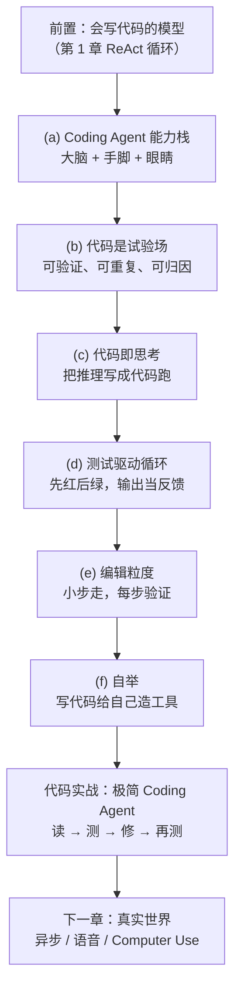

**这一章你需要的前置知识**：第 1 章的 ReAct 循环（想→做→观察）大概是什么感觉即可，完全不懂编程也能读下去——代码部分我们会逐行解释。

**学完这一章你能获得什么**：能说清 Coding Agent 由哪几块组成、为什么代码任务最适合练 Agent、什么叫「代码即思考」和「自举」，并且能看懂一个真实可运行的极简 Coding Agent 的全部代码。

**与前后章的衔接**：第 1 章给了阿零「思考的循环」，第 2 章 [02-上下文KV-Cache与Skill.md](02-上下文KV-Cache与Skill.md) 教它管理「记忆」，第 4 章 [04-工具分类与MCP.md](04-工具分类与MCP.md) 给它装了「手脚」；这一章把这些串成「能在代码仓库里独立干活」的能力。下一章 [06-异步事件语音与Computer-Use.md](06-异步事件语音与Computer-Use.md)，阿零将面对没有 pytest（测试工具，后面细讲）、没有即时反馈的真实世界。

## 核心概念

### (a) 🗂️ Coding Agent 能力栈：大脑、手脚与眼睛

> 💡 一句话直觉：Coding Agent 不是「一个很会写代码的模型」，而是一个「**会写代码的完整工人**」——它有大脑负责想，有手脚负责看和改，有眼睛负责检查对错。

**大白话详解**：很多人第一次听到「Coding Agent」会以为它就是个大模型（大语言模型，LLM，就是那个能跟你聊天的 AI）。其实差远了。大模型本身只是一个「只会张嘴说」的器官：你问它「这段代码哪里错了」，它能给你分析，但它不会自己去把文件打开、把代码改掉、把测试跑一遍。而 Coding Agent 是把下面这几样东西**组装成一个系统**：

- **模型核心（大脑）**：负责推理、做决策、生成修复方案。它决定「下一步该看哪个文件」「这个 bug 大概是什么原因」。
- **文件系统工具（手脚）**：`read`（读文件）、`glob`（按通配符找文件）、`grep`（按正则搜内容）、`write`（整文件写）、`edit` / `apply_patch`（局部修改）。这是阿零的「眼睛和手」——看代码、改代码都靠它们。这就像你改一份合同：先打开文档（read），搜一下「甲方」出现在哪（grep），再把某个条款改掉（edit）。
- **执行环境（场地）**：terminal / subprocess（终端和子进程，就是「真的把代码跑起来的那个程序」），让阿零真的把代码跑起来，而不是在脑子里「模拟运行」。模拟运行会漏掉一切真实行为：环境变量（系统给程序配置的参数）、依赖（代码依赖的第三方库）、并发（多个任务同时跑）。
- **测试运行器（裁判）**：pytest（Python 最常用的自动测试工具）等，把「对不对」变成可机读的信号。它是阿零的「裁判」——吹哨子说红说绿。
- **静态检查（预检员）**：lint、编译、类型检查，反馈比测试更早、更便宜，适合在跑测试之前先过一遍。就像安检：先机器扫描（静态检查），再人工开箱（跑测试）。
- **上下文管理（资料员）**：真实仓库动辄几千个文件，阿零不可能全读进来（参考 [02-上下文KV-Cache与Skill.md](02-上下文KV-Cache与Skill.md) 的上下文压缩——上下文（context）就是模型「一次能同时记住多少字」的工作台面，KV Cache 是「不把草稿纸重抄一遍」的缓存技术），正确姿势是先用 glob / grep 定位，再精读相关文件。就像查资料：先搜目录（glob），再翻到具体那一页（read），而不是把整本书抄进脑子。

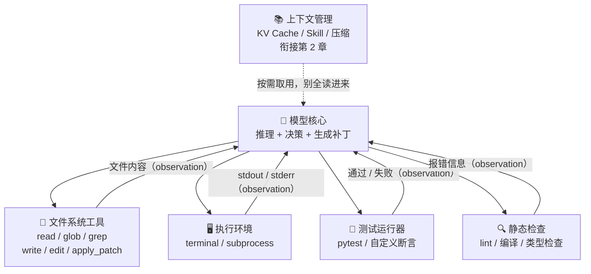

**一笔带过的完整干活流程**：把五件套串起来，阿零干一次活是这样的——

1. 用户传来一条 issue：「登录页点登录没反应」。
2. 阿零先用 `glob` 找「登录页相关文件在哪个目录」，再用 `grep` 搜「按钮的点击事件绑定在哪」——定位到 2 个可疑文件。
3. 用 `read` 带分段把这两个文件读进上下文（工作台面），看懂点击逻辑。
4. 发现一个变量在异步回调里被覆盖了。用 `edit` 精确改掉那一处。
5. 跑相关的测试 + lint，看了一眼输出：红了。原来修完还有一处同类问题。
6. 顺着新报错再定位、再改、再跑……直到全绿。
7. 跑一遍全部回归测试，确认没破坏别的功能，收工交差。

这一套「定位→精读→小改→验证→再定位」的流程，就是本章后面代码实战里那个 150 行循环的「成人版」。你现在先有个印象，等会儿看完代码再回来看这 7 步，会有「原来如此」的感觉。

**五件套是怎么协作的？一张时序图看清**（阿零修一个 bug 时，各组件依次出场）：

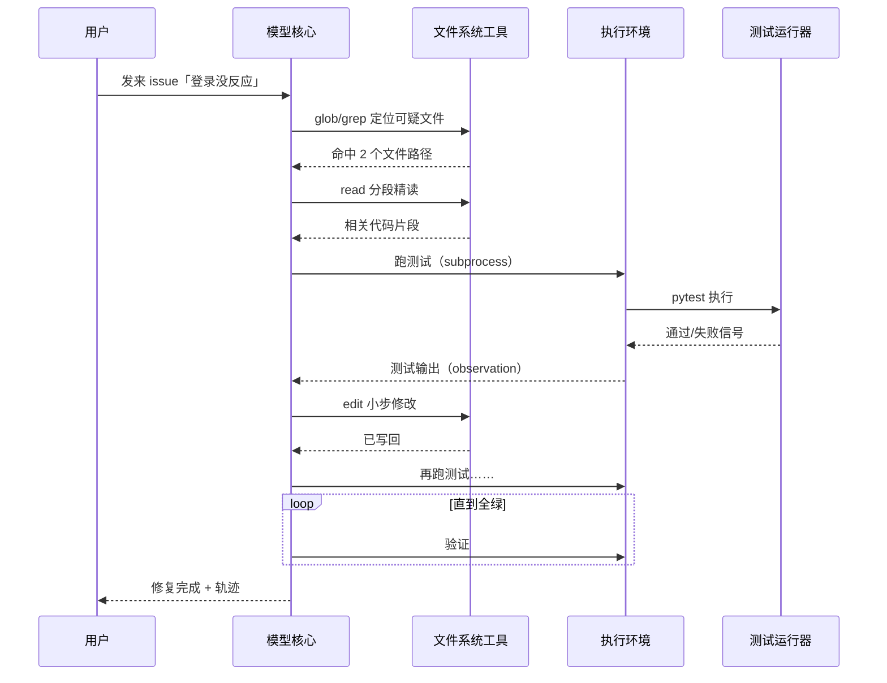

注意每个「-->>」回传的都是信息（observation），每个「->>」都是阿零的决策（Thought）与行动（Action）。**这张时序图把 ReAct 循环、能力栈、测试驱动循环三张概念图合成了同一张图**——它们本来就是同一件事的三个视角。

**形象类比**：想象一家「AI 修车行」。模型核心是「技师的大脑」——他会判断车子哪里坏了；文件系统工具是「他的工具箱」——扳手（read）看零件、探照灯（grep）找锈点、改刀（edit）换零件；执行环境是「试车场」——修完要真开一圈，而不是在脑内模拟；测试运行器是「质检员」——开完一圈告诉你「异响还在」还是「通过」；上下文管理是「工单系统」——技师只调取当前修这辆车需要的资料，不会把全车行 10 年的维修档案都背下来。

### (b) 🎯 为什么代码是 Agent 的试验场

> 💡 一句话直觉：代码世界是 Agent 的「训练馆」——在这里犯错的代价几乎为零，而且对错当场见分晓。

**大白话详解**：你可能想问：为什么 AI 公司都先做编程智能体，而不是先做「帮人遛狗智能体」「帮你吵架智能体」？答案很简单：因为代码任务是 Agent 能练得动、练得起、练得会的东西。除了上一节说的「反馈可验证」，代码任务还有三个独特优势：

- **评估成熟**：HumanEval（2021，OpenAI）做函数级代码生成——给你一句「写一个把两个数相加的函数」，判分机自动对答案；SWE-bench（2024，普林斯顿）做真实 issue 修复——从 GitHub 上真实的开源仓库里，把用户报的 bug 和程序员后来修的补丁配对成「考题」，让 Agent 现场修，用仓库自带的测试判定是否修对；Terminal-Bench（2024）测的是「在终端里干活」——装包、跑脚本、排错，看 Agent 能不能把命令行用得像真人一样溜。这些都提供自动判分的 ground truth（标准答案），Agent 的每一次改动都能被量化打分。这比「写一篇作文让人类打分」奢侈得多——作文等老师批改要一星期，代码 0.1 秒就有机器对答案。
- **实验便宜且可重复**：改错了最多重跑一遍，成本是毫秒到分钟级；失败可以复现（同样输入永远得到同样错误）、可以归因（能明确是哪个改动导致的）——这是后面第 7 章评估章节能建立统计方法的前提。就像练投篮：投不进的球自己滚回来，你不用每次投完都派个人去捡。
- **代表产品验证了路线**：Codex（OpenAI，2021）最早把「模型写代码」做成产品级 API——它证明了「模型真的能替人干活」；Devin（Cognition，2024）宣称自己是全自主的「软件工程师 Agent」——给它一个任务，它自己建分支、写代码、跑测试、提 PR；Cursor 把 Agent 嵌进 IDE（集成开发环境，就是程序员写代码的那个软件），成为 AI 原生编辑器——你打注释它帮你补实现；Aider 则是开源终端里的结对编程工具——在命令行里和你一问一答地改代码。它们共享同一套能力栈，差别在集成深度与自主度。

**形象类比**：把 Agent 想成一位新厨师。练刀工要真锅真灶（成本高、有危险），但代码任务就像「免费无限供应的食材+自动品鉴师」——切错了免费重切，火候不对品鉴师立刻打分。所以 AI 公司先让 Agent 当「厨艺练习生」在代码厨房里练，练熟了这一套「看→改→验」的肌肉记忆，再去挑战真实世界的复杂厨房。

**mermaid：试验场为什么「练得起」**

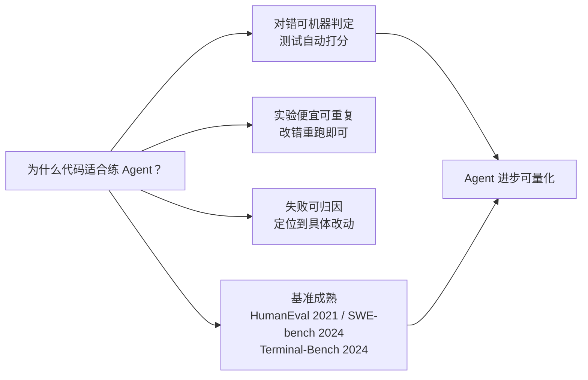

**三个基准放到一张表里对比，秒懂各自考什么**：

| 基准 | 年份 | 考什么 | 判分方式 | 一句话定位 |
| --- | --- | --- | --- | --- |
| HumanEval | 2021（OpenAI） | 根据 docstring 写函数 | 机器比对函数输出 | 函数级代码生成，入门级 |
| SWE-bench | 2024（普林斯顿） | 修真实仓库的 issue | 应用补丁后跑仓库自带测试 | 真实工程修复，进阶级 |
| Terminal-Bench | 2024 | 在终端里完成实操任务 | 检查最终环境条件是否达成 | 终端操作，操作级 |

看懂这张表，你就抓住了「为什么代码是 Agent 试验场」的证据链：从「会写」到「会修」再到「会用终端干活」，每一步都有机器自动判分——这在其他任何领域几乎不可想象。

**为什么 AI 公司都先押注代码，而不是先押注「帮你写周报」**（一个经常在面试里被问的产业问题）：因为代码领域能自动生成训练信号——Agent 每修对一个 bug，就是一条带 ground truth 的训练样本；修错的那些，也被记录下来当负样本。这种「干着干着就自动产出高质量数据」的飞轮，在通用任务里是稀缺的（谁给「周报写得好」打分？）。所以 Claude Code、Codex 这些产品先落在代码上，不只是因为「程序员是付费用户」，更因为**代码是 Agent 自我进化的最佳训练场**——这条逻辑和第 9 章「持续进化」、第 7 章「评估」直接挂钩。

### (c) 💻 代码即思考（Code-as-Thinking）

> 💡 一句话直觉：遇到算不清楚的问题，与其在脑子里口算，不如把「推理过程」写成一段代码跑出答案——**先算清楚，再回答**。

**大白话详解**：自然语言思维有一个大问题：**容易含糊，且无法自证**。口算概率、手推统计量，错了也看不出来——就像心算「三个 0.33 相加」，你可能自信满满说出 0.99，但没人能检查你脑子里的草稿。程序思维则相反——把中间推理写成一截可执行代码，跑出数值，再组织语言。这段代码就是可以审计的「草稿纸」：任何人（或机器）重跑一遍，就知道你的推理对不对。

阿零在聊天中经常碰到这样的题：「两个盒子里抽球，问后验概率」。如果是人，可能翻出贝叶斯公式（一种「根据新证据更新猜测」的概率公式）开始口算，算错的风险极高；阿零学到的姿势是：写一段蒙特卡洛模拟（Monte Carlo，用大量随机抽样来逼近真实概率的方法）——让程序随机抽 10 万次，数一数符合条件的有多少次，用频率代替概率，得到一个约 0.63 的数值，再组织语言回答。这个 0.63 不是「我觉得」，而是「我跑出来的」。

阿零从此学会了把 ReAct 循环里的 Thought（思考）步骤「硬化」：Thought 不再只是写给模型自己看的文字，而是一段可以被执行、被验证的程序。第 1 章讲过，Observation 越硬（越可验证、可复现），循环越可靠——用代码做中间推理，等于给推理接上了现实校验器。这就像两个人争论「这辆车 100 公里油耗多少」，与其嘴硬，不如真开一趟测出来。

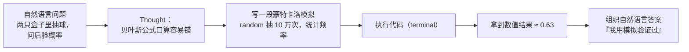

**形象类比**：考试做题时，数学老师会反复强调「把过程写在草稿纸上，不要心算」。代码即思考，就是把「草稿纸」从人脑搬进电脑：草稿纸上的每一步都可以被验算。自然语言回答是「交上去的答卷」，代码是「留在桌上的草稿纸」——答案有争议时，翻草稿纸。

**代码即思考的边界（也要知道它不万能）**：第一，不是所有推理都能写成代码——「这篇论文创新点是什么」没法 `print` 出来；代码适合的是**可计算、可枚举、可模拟**的推理（概率、统计、逻辑、数据）。第二，写代码本身也可能写错——所以「先算清楚再回答」还不完整，完整版是「先算清楚、再验证、再回答」：模拟结果要能跟公式或常识互相印证。第三，模拟有成本——10 万次随机抽样要几十毫秒，复杂模拟要几分钟，Agent 要在「够用」和「精确」之间取舍（这一步通常也交给模型判断，或用启发式规则兜底）。理解边界，才算真正理解这个概念。

**一个能亲手算的微型例子**：假设袋子里有 3 个红球、7 个蓝球，闭眼连抽两次（抽完放回），问「至少抽到 1 个红球」的概率。口算容易错在哪？容易忘掉「先算两次都是蓝球，再用 1 减」这个补集思路。代码即思考的做法是：

```python
import random
random.seed(7)
red = 0
for _ in range(100000):
    if random.random() < 0.3 or random.random() < 0.3:
        red += 1
print(red / 100000)  # 大约 0.51
```

一次都没抽到红的概率是 0.7 × 0.7 = 0.49，所以「至少一次红」的概率是 1 - 0.49 = 0.51。程序跑出来约 0.51，和公式吻合——**口算可能漏算补集，程序不会**。这就是代码即思考：把「我觉得 0.51」升级成「我跑出来 0.51，草稿可查」。

### (d) 🔴🟢 测试驱动循环：先红，再绿

> 💡 一句话直觉：**没有失败测试，就不知道「修好」意味着什么**——先写一个肯定会失败的测试（红），再动手修，直到它变绿。

**大白话详解**：工程界的 TDD（Test-Driven Development，测试驱动开发）智慧对 Agent 完全适用。为什么必须先写失败测试？因为「修好」是个主观词，而「测试从红变绿」是个客观事件。如果连「什么叫修好」都定义不出来，那修的时候就是在瞎修。

完整循环是：理解 issue → 复现 bug（把 bug 现场还原出来）→ 写失败测试（先让它红，相当于立下「军令状」）→ 实现/修复 → 跑测试 → 全绿？→ 否就读测试输出（这输出就是 observation），带着新信息再改 → 是就跑全部回归测试（Regression Test，检查「修新 bug 有没有把旧功能弄坏」的测试）→ 提交收工。

对 Agent 来说，这个循环还有一层额外含义：**测试输出就是 ReAct 的 Observation**。阿零的「行动」是改文件，环境的「反馈」是测试输出——红则再想、再改，绿则收工。issue 再模糊，一旦被翻译成一个失败测试，就变成机器可判定的标准，主观歧义消失。这就像谈判：双方对「合同到底改没改好」各执一词时，唯一的裁决方式就是「跑一遍验收标准」。

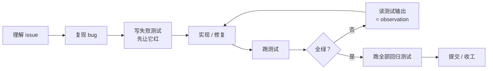

**形象类比**：想象你要教一个实习生「把水烧开」。你不会等他烧完再说「嗯，感觉不对」；你会先立一根温度计（测试）：设定「必须达到 100℃」（失败标准），烧一会儿看看温度（observation），不到就继续加火，到了 100℃ 温度计变绿（PASS），这才算数。温度计不会和你扯皮，不会说「我觉得差不多行了」。

**TDD 对 Agent 的两层特殊含义**（新手容易只看到第一层）：第一层是「工程纪律」——先写失败测试，再让实现变绿，保证每次改动都有验证；第二层是「环境信号」——对 Agent 来说，测试不只是「改完跑一遍」，而是**每一步行动的即时反馈源**，类似游戏里的得分系统。把这两层分开记：**对人，TDD 是纪律；对 Agent，TDD 是传感器**。面试时说出第二层，是「真懂 Agent」和「只是背过 TDD 定义」的分水岭。

**把循环翻译成「上一步的报错 → 下一步的方案」**：阿零第 1 步看到 `assert 2 == 1`，说明「n=2 算成了 2」，于是它知道「递归项肯定有问题」；第 2 步看到 `assert 1 == 0`，说明「n=0 算成了 1」，于是它知道「边界条件被改坏了」。这两条报错信息，就是驱动阿零连续修正的两个 observation——这正是「测试输出当 feedback（反馈）喂回循环」的实景。反过来，如果第 2 步的报错和第 1 步一模一样，阿零就该怀疑「修复根本没生效」（比如写回路径错了），而不是继续盲目地改。

### (e) ✂️ 编辑粒度：小步走，每步验证

> 💡 一句话直觉：改代码有三种「颗粒大小」，选对了省事，选错了添乱；原则只有一条——**一次只改一个点，改完立刻验证**。

**大白话详解**：改代码有三种粒度，各有适用场景（详细对比见「深入原理」）：**整文件重写**（用 `write` 把整个文件替换掉）适合小文件、且你已经完全理解文件结构时；**精确搜索替换**（`edit`：把一段确定的旧文本换成新文本）适合「就改这一处」时；**语义补丁**（`apply_patch`，即统一 diff 格式——一种人类程序员都认识的「改动说明书」格式，标注了每一处从什么变成什么）适合跨多处的结构性修改。

为什么强调「小步走」？因为一次改十个点，如果出错了，你根本不知道是哪个点改坏的——排查成本指数级上升。原则只有一条：**小步编辑 + 每步验证**——一次只改一个点，改完立刻跑测试，宁可多绕几轮，也不要一把梭改十个点然后面对一团乱麻。这就像做手术：好的外科医生一次动一个部位、每一步都确认出血点处理干净，而不是一口气把所有器官都翻一遍。

更进一步，LSP（Language Server Protocol，语言服务器协议）让阿零获得 IDE 级能力：跳转到定义（点一下就能看到某个函数在哪定义的）、读取类型错误、安全重命名（改一个名字，所有用到它的地方自动跟着改）——把「文本编辑」升级成「结构编辑」，从根上减少改错。就像用「查找替换」改文章里所有「张三」，比用肉眼一个个找要安全得多。

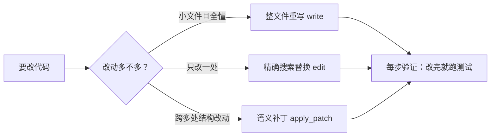

**形象类比**：整理一间乱房间。如果只是「把桌上的杯子放回厨房」，你不会把整间房的东西全扔了重买（整文件重写）；如果「客厅和厨房的垃圾桶对调」，你直接精准调换（edit）；如果「全屋的家具要换位置、插座要加」，你才会画一张改造图按图施工（apply_patch）。但无论哪种，你都应该「动一步、看一眼」，而不是闭着眼把房间翻个底朝天再回头验收。

**LSP 为什么值得单独记住**（面试常被追问）：LSP（Language Server Protocol，语言服务器协议）是一个「编程语言服务器与编辑器之间的通用接口协议」——它把「跳转定义、补全、报错、重命名」这类 IDE 能力标准化成同一套 API，让语言服务器写一次、所有编辑器通用。对 Agent 的意义在于：**它把「文本编辑」升级为「结构编辑」**——`edit` 是改字符串，LSP rename 是改「符号」，后者编译器能确认一致性。代价是需要 IDE 环境（要跑语言服务器），所以工程上通常是「先用 LSP 精确改，再用全量回归测试兜底」。

**三种粒度的「肉眼对比」**，用同一个小改动示范：

```python
# 原始代码
def add(a, b):
    return a - b  # bug：减号写错了

# 粒度 1：整文件重写（write）—— 文件只有 3 行，直接重打
def add(a, b):
    return a + b

# 粒度 2：精确搜索替换（edit old→new）—— 只换一行
# old: "    return a - b"
# new: "    return a + b"

# 粒度 3：语义补丁（apply_patch）—— 写成统一 diff 格式
# --- a/add.py
# +++ b/add.py
# @@ -1,3 +1,3 @@
# -    return a - b
# +    return a + b
```

看到区别了吗？文件越短，`write` 越省事；文件很大时，`write` 重打会丢注释丢改动，`edit` 精准但一次只能改一处，`apply_patch` 能一次改多处但要保证 diff 干净。这就是「编辑粒度」的真实取舍。

### (f) 🚀 自举（Bootstrapping）：写代码扩展自己

> 💡 一句话直觉：**工具即代码**——既然阿零会写代码，它就能写代码给自己造新工具，然后越用越强。这就是自举（bootstrapping）：系统用自己产生的能力增强自己。

**大白话详解**：第 4 章 [04-工具分类与MCP.md](04-工具分类与MCP.md) 给阿零装了手脚，但那些工具是人类造的——就像员工入职时领的标配工装。这一章阿零发现：既然我能写代码，我就能给自己造新工具——就像员工发现自己会缝纫，开始给自己裁定制工装。

具体路径是：接到一个脏活（比如整理 200 个日志文件）→ 手写脚本搞定它（过滤 → 排序 → 汇总）→ 把「问题 + 解法 + 脚本」记进任务日志 → 提炼成新工具（比如 `summarize_logs.py`，注册进工具箱）→ 下次遇到类似任务直接调用，不用重新发明轮子 → 工具库越滚越大，Agent 自我扩展。这条「从任务日志里提炼技能」的线，会一直延伸到第 9 章的持续进化。

但自举有边界，阿零必须时刻提防三件事：**低质代码污染**（自己写的 buggy 工具又被自己当权威工具用——相当于自己抄的错答案被自己奉为教材）；**递归失控**（改自己改到不收敛——相当于理发师把自己剪秃了还在剪）；**评估欺骗**（针对测试打补丁而非真正改进——相当于考试作弊背答案，题换一换就露馅）。对策是老三样：新工具入库必须有测试把关 + 人类评审（相当于「新菜进菜单前先让主厨试菜」）、代码版本管理与回滚（相当于「存档点，坏档了能读档」）、划定自举范围——可以加工具，但不能改核心决策逻辑（相当于「员工可以优化流程，但不能改公司章程」）。

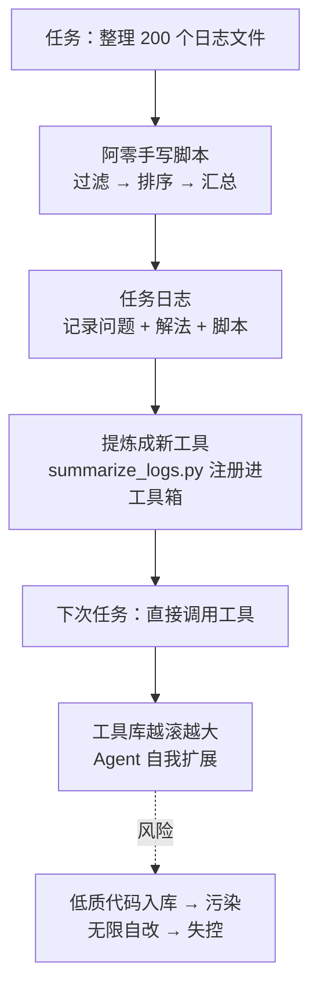

**形象类比**：自举就像滚雪球——雪球滚过的地方会黏上新的雪，越滚越大。阿零每次完成任务，都把「顺手写的脚本」变成「常备工具」，下一次任务的起点就更高。但雪球也可能滚进泥坑（低质代码）、滚得停不下来（递归失控）——所以要给它划好轨道（边界）。

**一条「自举」的任务日志长什么样**？假设阿零今天接到任务：「把 200 个日志文件里所有 `ERROR` 行挑出来，按时间排序，数出每个小时出现几次」。它手写脚本干完了，然后往任务日志里记：

```
任务：统计日志错误频次
脚本要点：glob 找 *.log → grep ERROR → 按时间戳排序 → Counter 计数
坑：时间戳格式有两种，要先统一
脚本：/tools/summarize_logs.py（已入库，带 3 个测试）
```

下一次再接到类似任务，阿零不再从头写脚本，而是直接调用 `summarize_logs.py`——它给自己造了一件趁手的工具。这就是自举的最小闭环：**干活 → 记录 → 提炼 → 复用**。当然，入库前那「3 个测试」和人类评审，就是防「低质污染」的闸门。

## 深入原理

前面六节把概念讲明白了，这一节我们钻进细节，把「文件系统工具的清单」「编辑粒度的选择」用表格钉死，再附一张「常见误区对照表」，帮你看清新手最容易搞反的地方。

### 🧪 沙箱（sandbox）：给代码套上安全壳

> 💡 一句话直觉：沙箱就是「隔离的练习场」——Agent 在里面怎么折腾都行，坏了删掉重来，绝不波及你的真实文件。

**大白话详解**：Coding Agent 是要「真的跑代码」的，而代码是有副作用的（side effect，指程序除了算出结果之外对世界的改变）：删文件、装软件、发网络请求、占满 CPU。如果在宿主环境（你的电脑）里裸跑，一次错误操作可能造成不可挽回的破坏。沙箱就是一层「安全壳」：把 Agent 困在一个临时目录 / 容器 / 虚拟机里，它只能动里面的东西。

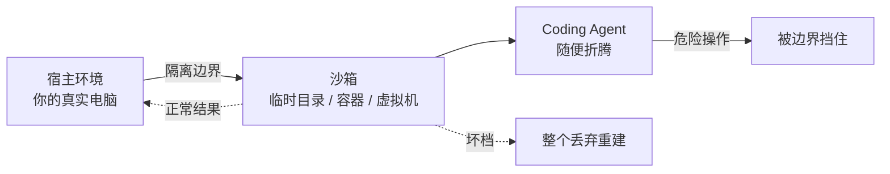

**形象类比**：沙箱就像游乐场的「海洋球池」——孩子在池子里怎么扑腾都行，球池外面（真实世界）一滴水都不会沾；一池子球玩脏了，整个换一池新的，成本极低。演示代码里的 `tempfile.TemporaryDirectory()` 就是最朴素的一层沙箱：进 `with` 建临时目录，出 `with` 自动删除。

**真实工程里沙箱还分层次**：网络隔离（不让 Agent 随便访问外网）、权限隔离（只给最小必要权限）、资源限额（限制 CPU / 内存 / 磁盘，防止死循环把机器跑满）、超时控制（像演示代码里的 `timeout=30`）。每一层都是一道闸门，专门挡住一类「Agent 闯祸」的方式。

### 🖥️ 执行环境：terminal 与 subprocess 到底怎么「跑」的

执行环境这一层，新手最容易当成「黑魔法」。其实它干的事就一件：**启动另一个程序，把它的输出接回来**。

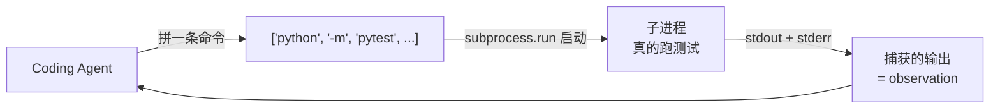

- **命令 = 一个字符串列表**：`["python", "-m", "pytest", str(self.tests), "-q"]` 里每一项对应命令行里的一个词。为什么不用一个长字符串？因为列表形式避免了空格/引号转义的坑（比如文件名里带空格）。
- **subprocess.run 是同步等待**：它会「卡住」当前程序，直到子进程跑完。所以 `timeout=30` 是保命符——测试死循环了 30 秒后直接掐断，Agent 不会永远卡死。
- **stdout 是「正常输出」，stderr 是「错误输出」**：Python 里 `print` 默认写 stdout，异常堆栈写 stderr。测试失败的信息主要藏在 stderr。所以代码里 `proc.stdout + proc.stderr` 拼接——两个都不许漏。
- **cwd 决定「在哪跑」**：`cwd=self.repo` 表示子进程的工作目录是仓库——这样 `test_buggy.py` 里的 `from buggy import fibonacci` 才能正确找到同目录的 `buggy.py`。**去掉 cwd 会怎样？** 子进程在「当前进程的目录」找文件，多半找不到，直接 ModuleNotFoundError。

真实工程里，执行环境还要包一层：docker 容器 / 虚拟机（更强的隔离）、资源配额（CPU / 内存限制）、网络策略（禁止出网）。但这些的内核，和演示代码里这个 `subprocess.run` 完全同构——**先拼命令，再启动，再把输出接回来**。

### 📋 文件系统工具清单

| 工具 | 输入 | 副作用 | 主要风险与对策 | 白话理解 |
| --- | --- | --- | --- | --- |
| `read` | 文件路径 | 无（只读） | 大文件撑爆上下文 → 用 offset / limit 分段读 | 只「看」不改，像翻书；书太厚别整本背，一次读几页 |
| `glob` | 目录 + 通配符 | 无（只读） | 命中太多 → 限制深度与数量 | 按名字模式找文件，像「找所有以 .py 结尾的文件」 |
| `grep` | 目录 + 正则 | 无（只读） | 误入二进制/大目录 → 加 include 过滤 | 按内容搜，像「在全书里搜『自举』这个词出现在哪页」 |
| `write` | 路径 + 全文 | 整文件覆盖 | 覆盖用户手改内容 → 写前先 read、写后 diff | 整篇重写，像「清空文档重打」——重打前务必先看原稿 |
| `edit` | 路径 + 旧文本 + 新文本 | 局部替换 | 多处匹配/匹配不到 → 要求唯一匹配，失败即报错 | 只改一处，像「把文里的『张三』改成『李四』」 |
| `apply_patch` | 路径 + 统一 diff | 多处局部修改 | 上下文漂移 → 小步补丁，每步跑测试验证 | 按「改动说明书」批量修改，像按施工图改造 |

> 💡 解读：注意一个反直觉的细节——**最简单的 `read` 其实最容易翻车**。因为「读」本身没有副作用，Agent 容易一口气把大文件全读进来，直接把上下文（工作台面）撑爆。所以工程上 `read` 要带 offset / limit（从第几行读到第几行）。记住口诀：**先 grep 定位，再 read 精读，最后 write/edit 小步改。**

### ✂️ 编辑粒度对比

| 粒度 | 代表操作 | 适用场景 | 风险与对策 | 白话理解 |
| --- | --- | --- | --- | --- |
| 整文件重写 | `write` | 文件很小、结构完全理解 | 丢注释/丢无关改动 → 写前读全文、写后 diff | 重打一份小文档，但要确保没漏掉原来有用的批注 |
| 精确搜索替换 | `edit(old → new)` | 改一处明确文本 | 误改多处 → 要求唯一匹配，匹配失败即报错重试 | 只换一个词；如果这个词出现两次，程序会拒绝动手 |
| 语义补丁 | `apply_patch` / diff | 跨多处结构性修改 | patch 不干净 → 小步补丁 + 每步跑测试 | 按改动清单多处修改，改完立刻验证 |
| 结构编辑 | LSP rename / refactor | 重命名符号、跨文件改动 | 依赖 IDE 环境 → 重构后全量回归测试 | 像「全局重命名」：改一个名字，所有引用处自动同步 |

> 观察两个表的共同底层逻辑：**所有编辑工具的默认动作都是「先验证、后提交」**——写之前读，改之后测。把验证内建到每一步里，Agent 才不会把错误越滚越大。这也是「小步编辑 + 每步验证」为什么能成为铁律：它不是效率的敌人，而是效率的保险。

**一句话选择口诀**（面试加分项，好记又显功力）：**「小文件整写，单处用 edit，多处上 patch，重命名找 LSP」**——『整写、edit、patch、LSP』按文件从小到大、改动从少到多排列，正好对应四种粒度。

### 📖 上下文管理与仓库规模：为什么不能「全读进来」

真实仓库动辄几千个文件，而模型一次能「同时记住」的 token（文本基本单位）是有限的——这就是第 2 章 [02-上下文KV-Cache与Skill.md](02-上下文KV-Cache与Skill.md) 讲的上下文窗口（context window，可以理解为模型的「工作台面」大小）。台面就那么大，把几千个文件全摊上去，别说分析，连「记住哪个文件在哪」都做不到。

所以真实 Coding Agent 看仓库的策略是**三级检索**：

1. **先定位**：`glob` 按文件名模式找「大概在哪个目录」，`grep` 按内容找「哪个文件提到了这个变量」——把候选范围从几千个文件缩到几个。
2. **再精读**：对候选文件 `read` 带 offset / limit 分段读，只读相关的函数和调用链。
3. **最后动手**：确认理解后，用 `edit` / `apply_patch` 小步修改，改完立刻跑测试验证。

| 层级 | 工具 | 开销 | 什么时候用 |
| --- | --- | --- | --- |
| 定位 | glob / grep | 小（只扫元信息/内容索引） | 还不知道 bug 在哪 |
| 精读 | read（分段） | 中（占用上下文） | 已锁定可疑文件 |
| 修改 | edit / apply_patch | 小（局部改动） | 确定要改哪里 |
| 验证 | 跑测试 | 中（执行时间） | 每次修改之后 |

记住一句话：**Agent 的工作台面是稀缺资源，查资料的正确姿势是「先搜目录，再翻书页」，而不是把整座图书馆背下来**。这也是上下文管理（第 2 章）与文件系统工具（本章）必须协同工作的原因。

**一个真实的「三级检索」调用序列示例**（想象阿零要修 `fibonacci` 但仓库有 500 个文件）：

```bash
$ glob "**/*.py"                    # 先定位：哪些文件可能相关
$ grep "fibonacci" src/ -r          # 按内容搜：谁在用这个函数
$ read src/math/fib.py --offset 1 --limit 40   # 精读：只读前 40 行
$ edit src/math/fib.py --old "fibonacci(n - 1) + fibonacci(n - 1)" \
                      --new "fibonacci(n - 1) + fibonacci(n - 2)"
$ pytest -q                          # 每步验证：改完立刻跑测试
```

注意每一步的「开销」都在递增：glob/grep 只扫元信息（便宜），read 占上下文（中等），edit/patch 改变文件（要小心），测试跑执行（要时间）。**把最贵的操作放到最后、做得最少**——这就是「三级检索」的本质。

### ⚠️ 常见误区对照表（深入原理速查）

| 错误理解 | 正确理解 | 类比 |
| --- | --- | --- |
| Coding Agent = 一个很会写代码的大模型 | Coding Agent = 模型 + 文件系统 + 执行环境 + 测试 + 静态检查组成的系统 | 会开车的引擎 ≠ 一辆能上路跑的车 |
| 读文件越多越好，信息越全越聪明 | 读太多会撑爆上下文，应该先 grep 定位再精读 | 查资料不是把整座图书馆背下来 |
| 一次把十个 bug 全改了效率最高 | 小步编辑 + 每步验证，一次一个点，出错可归因 | 手术一次动一个部位，不要一把梭 |
| 测试只是「收工前的最后检查」 | 测试是循环里每一步的观察信号，驱动下一步动作 | 温度计不是最后才插，是全程盯着看 |
| 自举 = 让 Agent 无限自己改自己，越改越强 | 自举有边界：低质污染 / 递归失控 / 评估欺骗，需测试+评审+回滚 | 雪球会滚大，也会滚进泥坑 |
| 静态检查（lint）可以代替测试 | lint 只查风格和低级问题，测试才验证行为正确 | 安检扫描 ≠ 试飞验证 |
| 编辑粒度越细越好 | 粒度要匹配任务：小文件整写、一处精确替换、多处补丁 | 钉子用锤子，螺丝用螺丝刀 |

> 💡 解读：这张表的共同主题是「**系统思维 vs 单点思维**」。新手容易把 Coding Agent 想成「更聪明的聊天机器人」，但它的价值恰恰来自「模型 + 工具 + 反馈」三个环扣在一起：模型负责决策，工具负责落地，反馈负责纠偏。任何一环缺失，都退化成「只会说的嘴炮」。

### 🏗️ 从极简到工程级：真实 Coding Agent 还要加什么

演示代码只有 150 行，能跑通循环，但离「产品级」还差得远。真实系统至少要在这几个方向上加料：

- **更聪明的模型调用**：把 `propose_fix` 换成真 LLM 调用，把代码 + 测试输出 + 相关文件拼进 prompt；还要考虑多次调用时哪些信息留在上下文、哪些压缩掉（衔接第 2 章）。
- **更多工具**：不止 read/write，还有 glob/grep/apply_patch/终端/浏览器/搜索；每个工具都有权限控制。
- **更稳的编辑**：写前先 read、写后 diff（对比改动前后差异）确认；`edit` 要求唯一匹配；`apply_patch` 小步补丁。
- **更全的检查**：跑测试之前先过 lint / 类型检查 / 编译，把便宜的错误先消灭掉。
- **更强的保障**：git 回滚（改坏了能退回上一个版本）、沙箱隔离、超时控制、步数上限（就是 `max_steps` 的工程版）。
- **更成熟的记忆**：任务日志、技能库（把提炼出来的脚本存好，衔接第 4 章 Skill）、错误教训库。

**一句话总结工程化路线**：极简版证明「循环能转」，工程版证明「循环转得稳」。面试时你能把这两层讲清楚，就已经超过多数候选人了。

### 🔁 评估（Evaluation）vs 反馈（Feedback）：两个别搞混的词

新手经常把「评估」和「反馈」混着说，但它们在本章里是两个层次的概念，值得用一个小节钉清楚：

| 概念 | 英文 | 谁在用 | 干什么 | 频率 |
| --- | --- | --- | --- | --- |
| 反馈 | Feedback | Agent 自己在循环里 | 每走一步告诉它「这一步对不对」，驱动下一步 | 高频（每次行动） |
| 评估 | Evaluation | 人类/评测基准在循环外 | 给 Agent 的整体表现打分，看它「行不行」 | 低频（一次任务/一场比赛） |

举个本章的例子：`run_tests` 返回的红绿信号是**反馈**——阿零靠它决定下一步；SWE-bench（2024）判分则是**评估**——阿零修完后，人类用基准给它打一个「成功率」分数，看这个模型整体强不强。**反馈是循环的一部分，评估是循环的度量衡**。面试时能随手把这两个词分清楚，会显得你基本功很扎实。

把前面所有概念连起来，看阿零处理一个真实 issue 的完整时间线（我们用演示代码里的 fibonacci 故事，但换成「真人视角」推演）：

**第 0 步：拿到 issue，先别急着改。** 用户报「`fibonacci` 函数算出来的数不对」。阿零不会上来就 `write`——它先 `read` 目标文件（拿到现状），再 `run_tests`（确认到底红在哪）。这第一步非常关键：**不改一行代码就先拿两条 observation**，为后面所有决策打底。

**第 1 步：读红，分析。** 测试输出最后一行 `assert 2 == 1`——`fibonacci(2)` 算出 2。阿零由此推断「递归拆解写错了」（两个 `n-1`）。它把这个判断连同 observation 一起交给 `propose_fix`。

**第 2 步：修（歪了），验证。** 第 1 份修复把边界从 `n <= 1` 改成 `n <= 2`。写回后立刻 `run_tests`——这次红在 `assert 1 == 0`。**注意：这是「负反馈里的正信号」**——报错点变了，说明上一份修复「生效了但没有彻底修对」，方向感在收窄。

**第 3 步：再修（对了），验证，收工。** 第 2 份修复把递归项改成 `n-1` 和 `n-2`，边界恢复 `n <= 1`。`run_tests` 全绿，`is_green` 返回 True，循环提前终止，记一条 `PASS` 轨迹。

把这条时间线浓缩成一张表格：

| 阶段 | 阿零在做什么 | 对应能力栈组件 | observation 是什么 |
| --- | --- | --- | --- |
| 第 0 步 | read + run_tests，先拿现状 | 文件系统 + 执行环境 | 代码全文、测试红 |
| 第 1 步 | 分析红在哪、决定改法 | 模型核心 | `assert 2 == 1` |
| 第 2 步 | 改边界、写回、再测 | 文件系统 write + 测试 | `assert 1 == 0`（报错点变了） |
| 第 3 步 | 改递归项、写回、再测 | 同上 | 全绿 → is_green=True |
| 收工 | 打印轨迹、返回成功 | 模型核心 | —— |

这张表是本章最值得反复看的一张表：**它展示了 observation 如何一步步「变硬」——从「一片模糊的红」到「报错点明确」再到「全绿」**。真实工程里，阿零还会在第 3 步之后再跑一遍全部回归测试（确认没弄坏别处），然后提交代码。

### 🧭 本章概念关系一图流

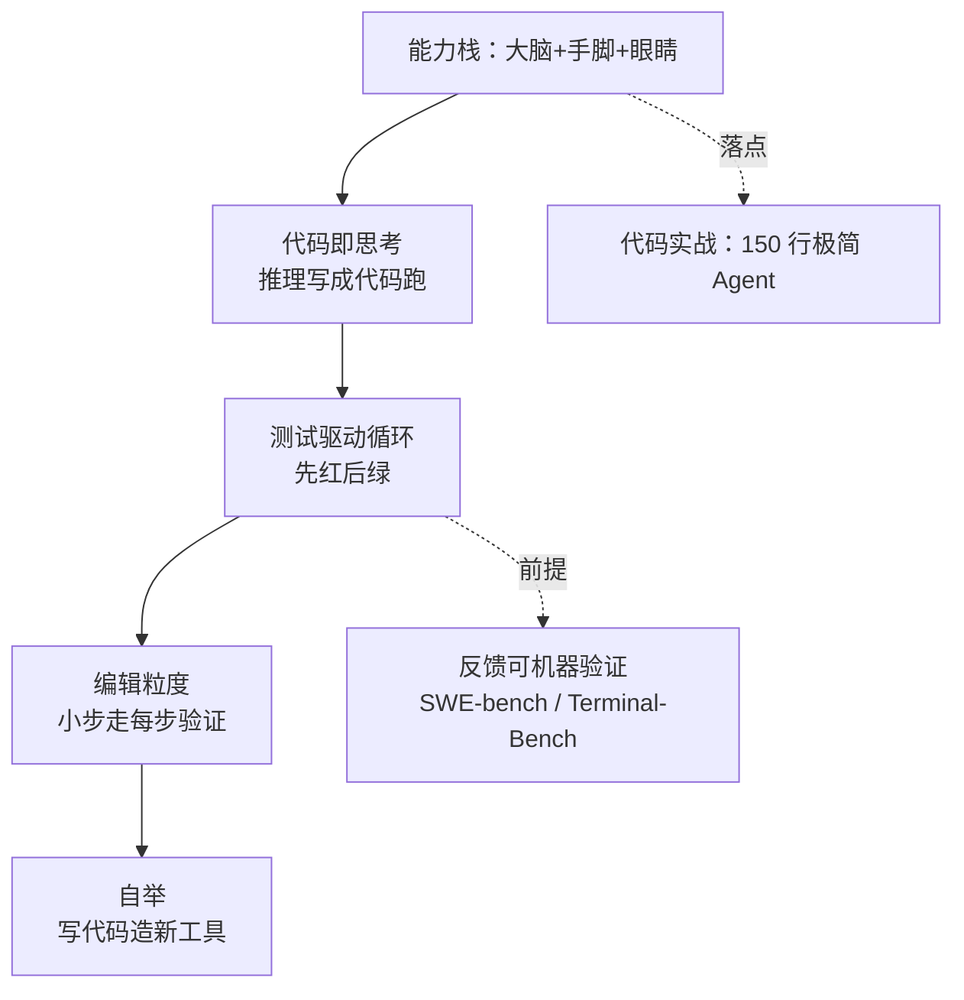

这张图把六个核心概念收拢成一棵「因果树」：能力栈提供骨架，可验证反馈提供前提，测试驱动循环提供动力，小步编辑提供纪律，自举提供成长，最后全部落在代码实战上。面试被问「这章讲了啥」时，闭眼默画这张图就够用了。

到这里，第 5 章的概念与原理部分就讲完了。你已经知道：Coding Agent 由哪几部分组成、为什么代码是它的试验场、什么叫代码即思考、什么叫先红后绿、编辑要小步走、自举有边界。下一部分，我们把所有概念装进一个真实可运行的极简 Coding Agent 里，逐行拆开看它到底是怎么「读 → 测 → 修 → 再测」的。

## 代码实战

下面是一个约 150 行的极简 Coding Agent：给定一个必挂的玩具函数和它的测试，循环「读代码 → 跑测试 → 读输出 → 生成修复 → 写回 → 再跑」，直到全绿或步数耗尽。模型调用全部 mock（mock 的意思是「用假货顶替真货」——这里用一段写死的候选修复列表冒充大模型，所以不联网、结果可复现），随机种子固定，结果可复现。

### 代码要做什么（大白话版）

这一小段代码，相当于把前面六个概念浓缩成一间「迷你车间」：

1. 准备一个临时文件夹（沙箱，sandbox，隔离的工作区——你可以在里面随便折腾，坏了删掉重建，不影响你电脑上任何真实文件），里面放两个文件：`buggy.py`（一个写错了的斐波那契函数）和 `test_buggy.py`（一个专门检查这个函数的测试脚本）。
2. 让「假模型」按顺序吐出两个候选修复方案：第一个是「修歪版」（边界条件改了，递归项还是错的），第二个才是「真正修好版」。
3. Agent 开始循环：读代码 → 跑测试 → 看输出 → 若红就请假模型给修复方案 → 写回 → 再跑。最多跑 3 步，直到测试全绿或步数用尽。
4. 打印每一步的轨迹，让你看见「红 → 修 → 红 → 修 → 绿」的完整过程。

整个程序不联网、只用 Python 标准库、随机种子固定，在你自己的电脑上复制粘贴就能跑。

```python
"""
minimal_coding_agent.py —— 一个极简 Coding Agent 循环。

循环：读代码 → 跑测试 → 读输出（observation）→ 生成修复 → 写回 → 再跑。
真实场景中"生成修复"是一次 LLM 调用；这里用假模型 mock，不联网、可复现。
"""

import random
import re
import subprocess
import tempfile
from pathlib import Path

random.seed(42)  # 固定随机种子（本示例实际用不到随机数，仅演示工程习惯）

# ---------------- 玩具仓库：一个必挂的函数 + 一个测试 ----------------
BUGGY_SOURCE = '''\
def fibonacci(n):
    """返回斐波那契数列第 n 项（n >= 0）。"""
    if n <= 1:
        return n
    # bug：两个递归项都写成 n - 1，数列呈指数膨胀
    return fibonacci(n - 1) + fibonacci(n - 1)
'''

TEST_SOURCE = '''\
from buggy import fibonacci

def test_fibonacci():
    assert fibonacci(0) == 0
    assert fibonacci(1) == 1
    assert fibonacci(2) == 1
    assert fibonacci(10) == 55

if __name__ == "__main__":
    test_fibonacci()
    print("ALL TESTS PASS")
'''

# 假模型的"候选修复"：第 1 版修歪（边界改对、递归项仍错），第 2 版才真正修好。
CANDIDATE_FIXES = [
    '''\
def fibonacci(n):
    """返回斐波那契数列第 n 项（n >= 0）。"""
    if n <= 2:
        return 1
    return fibonacci(n - 1) + fibonacci(n - 1)
''',
    '''\
def fibonacci(n):
    """返回斐波那契数列第 n 项（n >= 0）。"""
    if n <= 1:
        return n
    return fibonacci(n - 1) + fibonacci(n - 2)
''',
]


class MockLLM:
    """假模型：假装读入（代码, 测试输出），吐出一份候选修复。"""

    def __init__(self, candidates):
        self.candidates = candidates
        self.calls = 0

    def propose_fix(self, code: str, test_output: str) -> str:
        self.calls += 1
        # 真实实现：把 code + test_output 拼进 prompt 调 LLM，拿到 diff。
        # prompt = f"代码与测试输出如下，请给出修复：\n{code}\n{test_output}"
        # return llm(prompt)
        return self.candidates[min(self.calls - 1, len(self.candidates) - 1)]


class MinimalCodingAgent:
    """能力栈最小版：read / write / 跑测试 三件套 + 模型当大脑。"""

    def __init__(self, repo: Path, llm, max_steps: int = 3):
        self.repo = repo
        self.llm = llm
        self.max_steps = max_steps
        self.target = repo / "buggy.py"
        self.tests = repo / "test_buggy.py"
        self.trace = []  # 阿零的轨迹日志：(步数, 状态, 备注)

    def read_code(self) -> str:
        """工具 1：read —— 读文件"""
        return self.target.read_text(encoding="utf-8")

    def write_code(self, code: str) -> None:
        """工具 2：write —— 整文件写回（apply_patch 的简化版）"""
        self.target.write_text(code, encoding="utf-8")

    def run_tests(self) -> str:
        """工具 3：终端里跑测试，输出即 observation。
        优先 pytest；若环境没有 pytest，退回直接执行测试脚本。"""
        cmd = ["python", "-m", "pytest", str(self.tests), "-q"]
        proc = subprocess.run(cmd, cwd=self.repo, capture_output=True,
                              text=True, timeout=30)
        out = proc.stdout + proc.stderr
        if "No module named pytest" in out:
            proc = subprocess.run(["python", str(self.tests)], cwd=self.repo,
                                  capture_output=True, text=True, timeout=30)
            out = proc.stdout + proc.stderr
        return out

    def is_green(self, output: str) -> bool:
        """把测试输出翻译成信号：pytest 摘要 '1 passed' 或自定义 'ALL TESTS PASS'。"""
        return bool(re.search(r"1 passed", output)) or ("ALL TESTS PASS" in output)

    def run(self) -> bool:
        """ReAct 式的修复循环：读 → 测 → 想 → 改 → 再测。"""
        print("=== 阿零开始修 bug ===")
        for step in range(1, self.max_steps + 1):
            code = self.read_code()
            output = self.run_tests()                # 跑测试：拿 observation
            if self.is_green(output):
                print(f"[step {step}] 测试全绿，收工 ✅")
                self.trace.append((step, "PASS", ""))
                return True
            last_line = output.strip().splitlines()[-1] if output.strip() else "(无输出)"
            print(f"[step {step}] 测试红 ❌ 最后一行输出：{last_line}")
            fix = self.llm.propose_fix(code, output)  # 思考：生成修复
            self.write_code(fix)                      # 行动：写回文件
            self.trace.append((step, "FAIL->FIX", last_line))
        output = self.run_tests()
        final = self.is_green(output)
        print("步数耗尽，最后一次测试：", "通过 ✅" if final else "仍失败 ❌")
        return final


def main():
    with tempfile.TemporaryDirectory() as tmp:  # 隔离的"工作区"（沙箱）
        repo = Path(tmp)
        (repo / "buggy.py").write_text(BUGGY_SOURCE, encoding="utf-8")
        (repo / "test_buggy.py").write_text(TEST_SOURCE, encoding="utf-8")
        agent = MinimalCodingAgent(repo, MockLLM(CANDIDATE_FIXES), max_steps=3)
        ok = agent.run()
        print("\n最终状态：", "修复成功 🎉" if ok else "修复失败 😢")
        print("阿零的轨迹：")
        for step, status, info in agent.trace:
            print(f"  step {step}: {status} {info}")


if __name__ == "__main__":
    main()
```

### 逐段拆解：每一行在干什么

下面按代码块的顺序，把每一段拆开讲。为了对照方便，我们给代码块里的行编了号（代码块内第 1 行是开头的 `"""`）。

**第 1 段：模块文档字符串（代码块第 1-6 行）**

```python
"""
minimal_coding_agent.py —— 一个极简 Coding Agent 循环。

循环：读代码 → 跑测试 → 读输出（observation）→ 生成修复 → 写回 → 再跑。
真实场景中"生成修复"是一次 LLM 调用；这里用假模型 mock，不联网、可复现。
"""
```

三引号包起来的这段文字叫**文档字符串（docstring）**——它是写在程序最开头的「说明书」，不会被执行，纯给人看。这里它告诉我们三件事：文件名、核心循环是「读 → 测 → 读输出 → 生成修复 → 写回 → 再跑」、以及一个关键诚实声明——真实场景里「生成修复」是一次 LLM 调用，但为了演示我们把 LLM 换成了假模型。**去掉它会怎样？** 程序照样能跑，但别人（包括三个月后的你自己）就不知道这段代码是干嘛的了。写文档字符串和写注释，都是给未来的自己留的「便利贴」。

**第 2 段：导入工具与固定随机种子（代码块第 8-14 行）**

```python
import random
import re
import subprocess
import tempfile
from pathlib import Path

random.seed(42)  # 固定随机种子（本示例实际用不到随机数，仅演示工程习惯）
```

- `import random`：导入随机数模块。本示例其实用不到随机数（假模型的答案是写死的），但真实 Agent 的蒙特卡洛模拟会用到。
- `import re`：导入正则表达式模块（regular expression，一种「按模式匹配文本」的语言，像高级版 Ctrl+F）。后面 `is_green` 要在一大段测试输出里找 `"1 passed"` 字样，就靠它。
- `import subprocess`：导入「在 Python 里启动另一个程序」的模块——这是阿零「真的跑测试」的通道，等于在 Python 里开了一个小终端。
- `import tempfile`：导入临时文件模块——用来建沙箱（隔离的临时工作区）。
- `from pathlib import Path`：导入路径工具。`Path` 是 Python 3 里处理文件路径的现代写法，比手拼字符串路径安全得多。
- `random.seed(42)`：把随机种子固定成 42。种子（seed）是随机数发生器的「起点」——同一个种子，每次随机出来的序列一模一样。**去掉会怎样？** 这里不影响（没用到随机数），但在真实 Agent 里，固定种子能让实验可复现——别人重跑你的实验能拿到一样的数。

**第 3 段：玩具仓库——BUGGY_SOURCE（代码块第 16-24 行）**

```python
# ---------------- 玩具仓库：一个必挂的函数 + 一个测试 ----------------
BUGGY_SOURCE = '''\
def fibonacci(n):
    """返回斐波那契数列第 n 项（n >= 0）。"""
    if n <= 1:
        return n
    # bug：两个递归项都写成 n - 1，数列呈指数膨胀
    return fibonacci(n - 1) + fibonacci(n - 1)
'''
```

`BUGGY_SOURCE` 是一个三引号字符串（triple-quoted string，Python 里可以跨多行的字符串，`'''` 开头 `'''` 结尾），它整个就是「buggy.py 文件将来要装的内容」。注意 `'''\` 结尾的反斜杠：它告诉 Python「下一行开头不要加换行符」，这样字符串内容从 `def fibonacci(n):` 直接开始，不会有空行。

`fibonacci(n)` 是**斐波那契数列**（Fibonacci，每个数等于前两个数之和：0, 1, 1, 2, 3, 5, 8, 13...）的第 n 项。看这版代码：当 `n <= 1` 时直接返回 `n`（fibonacci(0)=0，fibonacci(1)=1，正确）；但递归那一行 `return fibonacci(n - 1) + fibonacci(n - 1)` 两个递归项**都写成了 `n - 1`**——这是故意埋的 bug。正确的写法应该是 `fibonacci(n - 1) + fibonacci(n - 2)`。注释里已经用中文标出了 bug 位置：「数列呈指数膨胀」——因为每个问题都被拆成两个相同的问题，计算量按 2 的指数爆炸，而且结果整个是错的：fibonacci(2) 会算成 fibonacci(1)+fibonacci(1)=1+1=2，正确答案是 1。

**第 4 段：测试脚本——TEST_SOURCE（代码块第 26-38 行）**

```python
TEST_SOURCE = '''\
from buggy import fibonacci

def test_fibonacci():
    assert fibonacci(0) == 0
    assert fibonacci(1) == 1
    assert fibonacci(2) == 1
    assert fibonacci(10) == 55

if __name__ == "__main__":
    test_fibonacci()
    print("ALL TESTS PASS")
'''
```

`TEST_SOURCE` 是第二个三引号字符串，它整个是「test_buggy.py 将来要装的内容」——**内部一行都不能改，我们原样保留**。它做的事情：

- `from buggy import fibonacci`：从 `buggy.py` 导入被测试的函数。
- `def test_fibonacci():`：定义一个测试函数，里面有四行 `assert`。**断言（assert）**是 Python 的「拍胸脯保证」：`assert fibonacci(0) == 0` 的意思是「我断言 fibonacci(0) 一定是 0，如果不对，程序当场崩溃报错」。四个断言分别检查 n=0、1、2、10 的答案。其中 `fibonacci(10) == 55` 是重点——能算对第 10 项，基本说明递归逻辑正确。
- `if __name__ == "__main__":`：这是 Python 的经典入口判断。`__name__` 是一个隐藏变量：当脚本**被直接运行**时，它的值是 `"__main__"`；当脚本**被别处 import** 时，它是别的值。所以这行意思是「只有当我被直接运行时，才执行下面的测试」——既保证能直接跑，又不妨碍被 pytest 按测试函数收集。
- 测试函数跑完没崩溃，就打印 `ALL TESTS PASS`——这是阿零判断「全绿」的第二个信号源。

注意：这段脚本自己也是一个完整的、可独立运行的 Python 程序（有自己的入口），这正是三引号字符串的妙处——**我们用一个字符串，把另一个程序「装」进了主程序里**。

**第 5 段：假模型的「候选修复」CANDIDATE_FIXES（代码块第 40-56 行）**

```python
# 假模型的"候选修复"：第 1 版修歪（边界改对、递归项仍错），第 2 版才真正修好。
CANDIDATE_FIXES = [
    '''\
def fibonacci(n):
    """返回斐波那契数列第 n 项（n >= 0）。"""
    if n <= 2:
        return 1
    return fibonacci(n - 1) + fibonacci(n - 1)
''',
    '''\
def fibonacci(n):
    """返回斐波那契数列第 n 项（n >= 0）。"""
    if n <= 1:
        return n
    return fibonacci(n - 1) + fibonacci(n - 2)
''',
]
```

`CANDIDATE_FIXES` 是一个**列表**（list，Python 里按顺序装一串东西的容器），装了两份「候选修复版 fibonacci」。注释说得明白：第 1 版修歪了——它把边界改成 `if n <= 2: return 1`（想修边界，结果反而更错：fibonacci(1) 会返回 1 而正确答案是 1，但 fibonacci(2) 返回 1 是对的，问题出在 n=0 时应该返回 0 却返回 1），递归项**仍然是** `n - 1 + n - 1`，所以依旧错；第 2 版才是真修好——边界恢复 `n <= 1` 返回 `n`，递归项改成 `fibonacci(n - 1) + fibonacci(n - 2)`。

为什么设计成「先歪后对」？这正是为了让演示有意思：如果假模型一出手就对，循环只需 1 步，你看不到「红→修→红→修→绿」的完整轨迹。真实 LLM 也一样，经常会先给出一个「看着像修好了、其实没修好」的方案——Agent 的价值就在于：**它自己会通过跑测试发现没修好，然后继续迭代**。

**第 6 段：MockLLM——假模型（代码块第 59-71 行）**

```python
class MockLLM:
    """假模型：假装读入（代码, 测试输出），吐出一份候选修复。"""

    def __init__(self, candidates):
        self.candidates = candidates
        self.calls = 0

    def propose_fix(self, code: str, test_output: str) -> str:
        self.calls += 1
        # 真实实现：把 code + test_output 拼进 prompt 调 LLM，拿到 diff。
        # prompt = f"代码与测试输出如下，请给出修复：\n{code}\n{test_output}"
        # return llm(prompt)
        return self.candidates[min(self.calls - 1, len(self.candidates) - 1)]
```

- `class MockLLM:`：定义一个类（class，Python 里「把数据和操作打包在一起」的模板），名字叫 MockLLM——「Mock + LLM」，假的大模型。
- `__init__`：构造函数，创建实例时自动调用。它把候选修复列表存进 `self.candidates`，并初始化 `self.calls = 0`（记录被调用了多少次）。
- `propose_fix(self, code: str, test_output: str) -> str`：模拟「调用大模型提修复方案」。参数 `code` 是当前代码、`test_output` 是测试输出——**签名（函数参数的格式说明）跟真实 LLM 调用完全一致**，只是实现是假的。`self.calls += 1` 每调用一次加一。
- 被注释掉的 3 行是「如果这是真模型会怎么实现」的提示：把代码和测试输出拼进一个 prompt，调 LLM，拿回 diff。这就是「代码即思考」的现实形态——**把 observation 喂给模型当上下文，让模型基于新信息思考**。
- `return self.candidates[min(self.calls - 1, len(self.candidates) - 1)]`：核心一行。`min(调用次数-1, 候选数-1)` 保证索引不越界：第 1 次调用取第 0 个候选（修歪版），第 2 次调用取第 1 个候选（真修好版），第 3 次及以后仍取最后一个（索引停在 `len-1`）。**去掉 `min` 会怎样？** 第 3 次调用时 `self.calls - 1 = 2` 会越界，程序直接抛 IndexError 崩溃——`min` 在这里是保险丝。

**第 7 段：MinimalCodingAgent 构造函数（代码块第 74-83 行）**

```python
class MinimalCodingAgent:
    """能力栈最小版：read / write / 跑测试 三件套 + 模型当大脑。"""

    def __init__(self, repo: Path, llm, max_steps: int = 3):
        self.repo = repo
        self.llm = llm
        self.max_steps = max_steps
        self.target = repo / "buggy.py"
        self.tests = repo / "test_buggy.py"
        self.trace = []  # 阿零的轨迹日志：(步数, 状态, 备注)
```

`MinimalCodingAgent` 是整段代码的主角——「能力栈最小版」，注释已经把它的组成说清楚了：read / write / 跑测试 三件套 + 模型当大脑。构造函数接收三个参数：

- `repo: Path`：仓库路径（Path 类型），就是阿零要干活的那个文件夹。
- `llm`：大脑（这里是 MockLLM 实例）。
- `max_steps: int = 3`：最多循环 3 步，防止死循环。**默认值 3 意味着**：调用时可以只传前两个参数。

构造函数里算出了两个文件路径：`self.target = repo / "buggy.py"`（`/` 在 Path 里是拼接路径，等价于「repo 文件夹里的 buggy.py」）和 `self.tests = repo / "test_buggy.py"`。`self.trace = []` 建了一个空列表，用来记轨迹日志——每一步记一个三元组（步数, 状态, 备注），最后打印出来，就是演示里的「阿零的轨迹」。

**第 8 段：工具 1 和 2——read_code / write_code（代码块第 85-91 行）**

```python
    def read_code(self) -> str:
        """工具 1：read —— 读文件"""
        return self.target.read_text(encoding="utf-8")

    def write_code(self, code: str) -> None:
        """工具 2：write —— 整文件写回（apply_patch 的简化版）"""
        self.target.write_text(code, encoding="utf-8")
```

- `read_code`：对应能力栈里的**工具 1：read**。`self.target.read_text(encoding="utf-8")` 用 UTF-8 编码读取 `buggy.py` 的全文并返回。`encoding="utf-8"` 很关键：UTF-8 是处理中文等非 ASCII 字符的标准编码，**不写它**，Windows 等系统可能用默认编码读，遇到中文注释会乱码甚至报错。
- `write_code`：对应**工具 2：write**。`write_text` 把传入的字符串**整个覆盖**写回 `buggy.py`。注释提醒我们：这其实是 `apply_patch` 的简化版——真实工程里局部修改用补丁更稳，但演示里整文件写更直观。

这两个方法加起来就是阿零的「手」：**读出来、改回去**。注意它们没有联网、没有花哨逻辑，就是封装了两行标准库调用——真实 Coding Agent 的文件系统工具本质上也是这些，只是加上了超时、权限、diff 校验等保险。

**第 9 段：工具 3——run_tests（代码块第 93-104 行）**

```python
    def run_tests(self) -> str:
        """工具 3：终端里跑测试，输出即 observation。
        优先 pytest；若环境没有 pytest，退回直接执行测试脚本。"""
        cmd = ["python", "-m", "pytest", str(self.tests), "-q"]
        proc = subprocess.run(cmd, cwd=self.repo, capture_output=True,
                              text=True, timeout=30)
        out = proc.stdout + proc.stderr
        if "No module named pytest" in out:
            proc = subprocess.run(["python", str(self.tests)], cwd=self.repo,
                                  capture_output=True, text=True, timeout=30)
            out = proc.stdout + proc.stderr
        return out
```

这是**工具 3：执行环境 + 测试运行器**，也是阿零的「眼睛」。逐行看：

- `cmd = ["python", "-m", "pytest", str(self.tests), "-q"]`：拼好要执行的命令。`python -m pytest` 是用 pytest 模块跑测试，`str(self.tests)` 是要测的文件，`-q`（quiet，安静模式）让输出更精简。
- `subprocess.run(cmd, cwd=self.repo, capture_output=True, text=True, timeout=30)`：真的在 `cwd`（工作目录，即仓库）里启动这个命令。`capture_output=True` 把程序的标准输出和标准错误都**捕获**下来而不是打到屏幕上；`text=True` 让输出以文本形式返回；`timeout=30` 是 30 秒超时——**防止测试卡死把 Agent 永远挂住**。
- `out = proc.stdout + proc.stderr`：把标准输出和标准错误拼成一个字符串，这就是 observation。
- `if "No module named pytest" in out:`：如果环境里没装 pytest，错误信息里会出现 `No module named pytest`。这时**退回方案**：直接执行测试脚本本身 `python test_buggy.py`——因为 TEST_SOURCE 自带 `if __name__ == "__main__":` 入口，直接跑它也能完成测试并打印 `ALL TESTS PASS`。这个「主方案失败退备用方案」的写法，让这段代码在没有 pytest 的机器上也能跑通。
- `return out`：把测试输出返回给调用方。

**第 10 段：is_green——把输出翻译成红绿信号（代码块第 106-108 行）**

```python
    def is_green(self, output: str) -> bool:
        """把测试输出翻译成信号：pytest 摘要 '1 passed' 或自定义 'ALL TESTS PASS'。"""
        return bool(re.search(r"1 passed", output)) or ("ALL TESTS PASS" in output)
```

`is_green` 是阿零的「裁判翻译官」：把一大段测试输出翻译成一个布尔值（True/False）。逻辑是「或」：只要出现 pytest 的成功摘要 `1 passed`，**或者**出现自定义成功标语 `ALL TESTS PASS`，就算绿。

- `re.search(r"1 passed", output)`：用正则（`re` 模块）在输出里搜索子串 `1 passed`。`r"..."` 是原始字符串（raw string），告诉 Python「反斜杠别当转义符处理」——正则里的反斜杠很多，不写 `r` 很容易踩坑。`bool(...)` 把「找到了」包装成 True、「没找到」包装成 False。
- `"ALL TESTS PASS" in output`：字符串包含检查——`in` 运算符直接判断大字符串里有没有这个小片段。

两个信号源对应两种运行方式（pytest 跑 vs 直接跑脚本）。**去掉任何一个会怎样？** 去掉 pytest 那个，在有 pytest 的环境里即使测试全过也会被误判为红；去掉 `ALL TESTS PASS` 那个，没有 pytest 的机器上永远判红——所以两个都要。

**第 11 段：run——ReAct 式主循环（代码块第 110-128 行）**

```python
    def run(self) -> bool:
        """ReAct 式的修复循环：读 → 测 → 想 → 改 → 再测。"""
        print("=== 阿零开始修 bug ===")
        for step in range(1, self.max_steps + 1):
            code = self.read_code()
            output = self.run_tests()                # 跑测试：拿 observation
            if self.is_green(output):
                print(f"[step {step}] 测试全绿，收工 ✅")
                self.trace.append((step, "PASS", ""))
                return True
            last_line = output.strip().splitlines()[-1] if output.strip() else "(无输出)"
            print(f"[step {step}] 测试红 ❌ 最后一行输出：{last_line}")
            fix = self.llm.propose_fix(code, output)  # 思考：生成修复
            self.write_code(fix)                      # 行动：写回文件
            self.trace.append((step, "FAIL->FIX", last_line))
        output = self.run_tests()
        final = self.is_green(output)
        print("步数耗尽，最后一次测试：", "通过 ✅" if final else "仍失败 ❌")
        return final
```

这一段就是整个章节的心脏——**读 → 测 → 想 → 改 → 再测**的循环，也是第 1 章 ReAct 循环在代码世界的落地。逐行看：

- `for step in range(1, self.max_steps + 1):`：循环 `max_steps`（3）次。`range(1, 4)` 产生 1, 2, 3——step 从 1 数到 3，正好对应「步数耗尽」的上限。
- `code = self.read_code()`：行动 1——读文件，拿到当前代码（Observation 之一）。
- `output = self.run_tests()`：行动 2——跑测试，拿到测试输出（Observation 之二）。注释直接点破：**跑测试：拿 observation**。
- `if self.is_green(output):`：裁判判绿。绿了就直接打印收工、记一条 `PASS` 轨迹、`return True` 收工。注意 `return True` 在循环里，所以绿了就不再继续循环。
- `last_line = output.strip().splitlines()[-1] if output.strip() else "(无输出)"`：取输出里**最后一行**作为「最有信息量的一行」。`.strip()` 去掉首尾空白，`.splitlines()` 按行切开，`[-1]` 取最后一行；如果输出是空的（`.strip()` 为假），就显示 `(无输出)`。测试失败时，最后一行通常是报错核心——比如 `FAILED test_buggy.py::test_fibonacci - assert 2 == 1`。
- `print(f"[step {step}] 测试红 ❌ 最后一行输出：{last_line}")`：把红的状态和关键一行打印出来。`f` 前缀是 f-string（格式化字符串），`{step}` 和 `{last_line}` 会被替换成实际值。
- `fix = self.llm.propose_fix(code, output)`：**思考**——把「当前代码 + 测试输出」交给模型，拿回一个修复方案。这就是代码即思考：模型不是凭空想，而是基于 observation 想。
- `self.write_code(fix)`：**行动**——把修复方案写回文件。
- `self.trace.append((step, "FAIL->FIX", last_line))`：记轨迹：第几步、状态是「红→修」、备注是失败的最后一行。
- 循环结束后（说明 3 步都跑完还没绿）：再跑最后一次测试，判绿，打印「步数耗尽，最后一次测试：通过/仍失败」，返回最终结果。

这 18 行就是 Coding Agent 的最小骨架：**想（propose_fix）、做（write_code）、看（run_tests）、再想（循环）**。真实系统的区别只是把 `propose_fix` 换成真 LLM、加上更多工具和更多保险。

**第 12 段：main + 沙箱 + 入口（代码块第 131-145 行）**

```python
def main():
    with tempfile.TemporaryDirectory() as tmp:  # 隔离的"工作区"（沙箱）
        repo = Path(tmp)
        (repo / "buggy.py").write_text(BUGGY_SOURCE, encoding="utf-8")
        (repo / "test_buggy.py").write_text(TEST_SOURCE, encoding="utf-8")
        agent = MinimalCodingAgent(repo, MockLLM(CANDIDATE_FIXES), max_steps=3)
        ok = agent.run()
        print("\n最终状态：", "修复成功 🎉" if ok else "修复失败 😢")
        print("阿零的轨迹：")
        for step, status, info in agent.trace:
            print(f"  step {step}: {status} {info}")


if __name__ == "__main__":
    main()
```

- `def main():`：把整个「组装 + 开跑」的流程包进一个函数——这既整洁，也方便将来 import 这个文件而不触发执行。
- `with tempfile.TemporaryDirectory() as tmp:`：**沙箱（sandbox）**。`with` 语句是上下文管理器：进入时创建一个临时目录（系统临时文件夹里的一个随机目录），退出时**自动删除**。Agent 在里面随便折腾，不会污染你电脑上的任何真实文件。真实 Coding Agent 跑别人的代码时也一样要隔离——代码是有副作用的，绝不能直接在宿主环境裸跑。
- `repo = Path(tmp)`：把临时目录转成 Path 对象。
- 两行 `write_text`：把 BUGGY_SOURCE 和 TEST_SOURCE 这两个字符串「落盘」成真实的 `buggy.py` 和 `test_buggy.py` 文件——**三引号字符串在这里变成了真实的文件**，阿零要修的「仓库」就绪。
- `agent = MinimalCodingAgent(repo, MockLLM(CANDIDATE_FIXES), max_steps=3)`：组装 Agent——仓库、假大脑、最多 3 步。
- `ok = agent.run()`：开跑，拿到最终布尔结果。
- 打印最终状态（修复成功 🎉 / 修复失败 😢）和轨迹（for 循环遍历 `agent.trace`，格式化打印每一步）。
- `if __name__ == "__main__": main()`：程序入口——只有直接运行本文件时才调用 main()。这是 Python 脚本的标准收尾，**必须保留**：它保证了「当这个文件被 import 时不会莫名其妙地开始跑 Agent，当它被直接运行时又能正常跑」。

至此整段代码拆解完毕。你可能已经发现：这段 150 行的代码里没有一行是「神奇魔法」——全是标准库调用 + 一个 for 循环。**Coding Agent 不是魔法，是一个把「想→做→看」循环机械地转起来的程序**。

### 怎么把这段代码跑起来（运行指引）

这段代码不需要安装任何第三方库（pytest 是可选的，没有也能跑），只需要 Python 3。想亲手跑一遍，任选一种方式：

- **方式 A：有 pytest**（推荐）：把上面的代码复制保存为 `minimal_coding_agent.py`，在命令行执行 `python minimal_coding_agent.py`。`run_tests` 会优先走 `python -m pytest` 这条路。
- **方式 B：没有 pytest**：同样执行 `python minimal_coding_agent.py`。`run_tests` 会发现输出里有 `No module named pytest`，自动退回 `python test_buggy.py`，同样能拿到 `ALL TESTS PASS` 信号。
- **方式 C：在 Jupyter / ipynb 里**：把 `if __name__ == "__main__":` 那一行改成直接调用 `main()`（因为 notebook 环境没有「直接运行脚本」一说）。注意别漏了 `main()` 前后的缩进处理。

无论哪种方式，输出都应该和下面的「输出示意」一致。如果你看到的报错不一样，对照「常见报错排查速查」表（见下文改造指南小节）自查。

两种运行路径产生的原始输出形态对比（`run_tests` 返回的 `out` 字符串里实际可能看到的内容）：

| 路径 | 命令 | 成功信号 | 失败时最后一行长什么样 |
| --- | --- | --- | --- |
| pytest | `python -m pytest test_buggy.py -q` | `1 passed in 0.01s` | `FAILED test_buggy.py::test_fibonacci - assert 2 == 1` |
| 直接执行 | `python test_buggy.py` | `ALL TESTS PASS` | 直接抛 `AssertionError: assert 2 == 1` |

注意到没有：**两条路径的成功信号不同，失败信号的「情报量」也不同**——pytest 会告诉你「哪个测试、哪个断言、期望几实际几」，直接执行只抛一行 AssertionError。这就是为什么 `is_green` 要同时认两种成功信号，而演示里只打印「最后一行」的做法，在 pytest 路径下信息更丰富。真实工程里一般固定用 pytest 并把完整输出喂给模型。

### 输出示意

在你自己的电脑上跑这个脚本（有 pytest 就优先用 pytest；没有 pytest 会自动退回直接执行测试脚本），会得到如下输出：

```
=== 阿零开始修 bug ===
[step 1] 测试红 ❌ 最后一行输出：FAILED test_buggy.py::test_fibonacci - assert 2 == 1
[step 2] 测试红 ❌ 最后一行输出：FAILED test_buggy.py::test_fibonacci - assert 1 == 0
[step 3] 测试全绿，收工 ✅

最终状态：修复成功 🎉
阿零的轨迹：
  step 1: FAIL->FIX FAILED test_buggy.py::test_fibonacci - assert 2 == 1
  step 2: FAIL->FIX FAILED test_buggy.py::test_fibonacci - assert 1 == 0
  step 3: PASS
```

### 读输出：逐行看懂这段轨迹

新手第一次看到这段输出可能会一头雾水：为什么先是红的、红的、突然就绿了？我们把它当「心电图」来读：

- **第 1 行 `=== 阿零开始修 bug ===`**：来自 `run()` 方法开头的 `print("=== 阿零开始修 bug ===")`。相当于开机提示音。
- **`[step 1] 测试红 ❌ 最后一行输出：FAILED ... - assert 2 == 1`**：第 1 步，`run_tests()` 跑了初始的 BUGGY_SOURCE，测试失败。最后一行 `assert 2 == 1` 是关键情报：`fibonacci(2)` 算出来是 2，但测试期望是 1——这正是「两个递归项都写错」导致的（fibonacci(2) 被算成 fibonacci(1)+fibonacci(1)=1+1=2）。于是 Agent 叫来假模型，拿到第 1 份候选修复（修歪版），写回文件。
- **`[step 2] 测试红 ❌ 最后一行输出：FAILED ... - assert 1 == 0`**：第 2 步，重新跑测试——注意情报变了！现在是 `assert 1 == 0`，说明 `fibonacci(0)` 算出来是 1，但期望是 0。为什么？因为修歪版把边界改成了 `if n <= 2: return 1`，导致 n=0 时返回 1 而不是 0。**这正是「反馈驱动迭代」的现场**：第一步的情报喂给模型，模型基于新情报生成第 2 份修复（真修好版），写回。
- **`[step 3] 测试全绿，收工 ✅`**：第 3 步，测试通过，循环立刻 `return True` 收工。四个断言（0、1、2、10）全部通过，包括 `fibonacci(10) == 55` 这个硬指标——说明递归逻辑真正修对了。
- **`最终状态：修复成功 🎉`**：`ok` 为 True，走的是「成功」分支。
- **`阿零的轨迹：` 及下面三行**：把 `agent.trace` 里记录的三元组逐一打印——step 1 和 step 2 都是 `FAIL->FIX`（红→修），step 3 是 `PASS`（绿）。这张「轨迹表」就是 Agent 的工作日志：每一步发生了什么、失败原因是什么，一清二楚。

读输出的要点：**不要只盯着「最终成功」看，要看「红→红→绿」中间那两行报错变化**。`assert 2 == 1` → `assert 1 == 0` 意味着 Agent 确实「听到了」上一步的反馈并据此调整——这正是 ReAct 循环「Observation 越硬，循环越可靠」的现场演示。如果两次报错一模一样，说明修复方案根本没生效（比如写回路径错了），那是另一类 bug。

**把轨迹当数据看**（进阶思维）：`agent.trace` 里的 `(step, status, info)` 三元组，本身就是一份结构化评估数据——「几轮才修好」「失败原因分布」「平均步数」都可以从它统计出来。真实产品里，这类轨迹会被收集起来分析：哪类 issue 让 Agent 反复失败？哪类修复方案命中率高？这些统计反过来指导模型微调（RLHF / 强化学习都吃这类数据）。你以后看到「Agent 成功率提升报告」，本质就是在对无数条这样的轨迹做统计。

### 动手改一改

代码读懂了不算会，动手改才算。下面五个小练习由易到难，改完再看预期结果：

1. **把 `max_steps` 从 3 改成 1**：把 `main()` 里的 `max_steps=3` 改成 `max_steps=1`。预期结果：第 1 步测试红、请假模型拿到修歪版写回，然后**步数耗尽**，最后一次测试仍失败——最终输出会变成「修复失败 😢」，轨迹只有 step 1: FAIL->FIX。这个练习让你理解 `max_steps` 就是「耐心上限」：阿零只有 1 次改正机会，根本来不及用第 2 份正确方案。
2. **让 `CANDIDATE_FIXES` 只有修歪版**：把列表里第 2 份（真修好版）删掉，只留修歪版。预期结果：三步全红，`MockLLM` 每次都返回修歪版，最终「修复失败 😢」。这个练习展示「模型水平不够」时的真实困境——循环再勤快，候选方案本身错，也修不好。
3. **把假模型换成一出手就对的「大神模型」**：把 `CANDIDATE_FIXES` 的第一份直接改成真修好版（`if n <= 1: return n` + `fibonacci(n - 1) + fibonacci(n - 2)`）。预期结果：step 1 就测试全绿收工，轨迹只有一行 `step 1: PASS`。这个练习让你对比「一次修对」和「两步修对」的轨迹差异，直观感受为什么真实场景里 Agent 通常要多轮迭代。
4. **把 `BUGGY_SOURCE` 里的 bug 换成别的**：比如把 `if n <= 1:` 改成 `if n <= 0:`（边界少判了 1，`fibonacci(1)` 会递归死循环——注意 `fibonacci(1)` 会调用 `fibonacci(0)+fibonacci(-1)`，`fibonacci(-1)` 又调用 `fibonacci(-2)+fibonacci(-3)`……无限递归直到栈溢出，这是 Python 的递归保护报 `RecursionError` 的经典现场）。预期结果：程序要么抛 `RecursionError`（子进程会把报错带进 `out`），要么 test 超时被 `timeout=30` 掐断。这个练习让你亲眼看到「边界条件 bug」和「死循环 bug」在输出上长什么样——真实 Agent 要靠这些蛛丝马迹去猜原因。
5. **把 `max_steps=3` 改成 `max_steps=1`，并且把 `CANDIDATE_FIXES` 第一份改成正确方案**：预期结果：step 1 直接全绿收工。这个组合练习验证你已经理解了「步数上限」与「方案质量」这两个变量是**独立的**：方案再对，步数给 0 也白搭；步数再多，方案全错也修不好。

> 要点：真实系统把 `propose_fix` 换成 LLM 调用即可；`run_tests` 里退回 `python test_buggy.py` 是为了在没有 pytest 的环境也能演示。工程上还要叠加 lint/类型检查、git 回滚、权限与沙箱（衔接第4章 [04-工具分类与MCP.md](04-工具分类与MCP.md) 与 [../04-LLM大模型/教学/15-RAG与Agent.ipynb](../04-LLM大模型/教学/15-RAG与Agent.ipynb) 的工程化讨论）。

**再补一句为什么要保留这个「150 行 demo」**：它删掉了真实工程里 90% 的噪声，只留下 Agent 循环的骨架。真实 Coding Agent 的代码动辄几千上万行，但你把它们摊开，核心还是这几行：`read → run_tests → if is_green: return → propose_fix → write_code`。把骨架看懂了，再去看开源项目（比如 Claude Code、Codex 的论文与工程文档）就不会迷失在细节里——**先有骨架，再补血肉**。

### 这个 demo 故意省略了什么（防止你「以为懂了但其实是假的」）

- **省略了真模型**：`propose_fix` 是写死的候选列表，不是真的 LLM。所以演示不联网、可复现，但代价是「不会出现模型自己胡说八道的新方案」。
- **省略了 glob / grep / apply_patch / lint**：仓库只有 2 个文件，不需要定位；改动只有 1 处，不需要补丁。真实仓库里这三样是刚需。
- **省略了 git 回滚**：写坏了没有「后悔药」。真实工程里每次 write 前会先 commit，改坏了一步退。
- **省略了回归测试**：演示只跑 `test_buggy.py` 一个文件。真实工程修完必须跑全套，防止「修好了 A 弄坏了 B」。
- **省略了权限与并发**：真实系统里 Agent 不能在任意路径写文件、不能同时开两个终端改同一处。这些是产品级系统的护城河，不是循环的必需品。

### 实例代码 ↔ 概念映射表（复习神器）

把这一章 150 行 demo 和六个核心概念对号入座，你会发现「概念全部落进了代码」：

| 概念 | 对应代码位置 | 一句话备注 |
| --- | --- | --- |
| 能力栈：大脑 | `MockLLM.propose_fix` | 决策与生成修复方案 |
| 能力栈：手脚 | `read_code` / `write_code` | 文件系统 read / write 三件套之二 |
| 能力栈：执行环境 | `run_tests` 里的 `subprocess.run` | 真跑测试、捕获输出 |
| 能力栈：测试裁判 | `run_tests` + `is_green` | 把输出翻译成红绿布尔值 |
| 能力栈：上下文管理 | `propose_fix(code, output)` 的参数 | 只把需要的代码与输出喂给模型 |
| 代码即思考 | 注释里的 `prompt = f"..."` | 把 observation 拼进 prompt 再思考 |
| 测试驱动循环 | `run()` 里的 for 循环 | 读→测→想→改→再测 |
| 编辑粒度 | `write_code`（整文件写） | 极简版用整写代替 apply_patch |
| 自举 | （未实现） | demo 没有任务日志，留给你在练习 6 里补 |
| 沙箱 | `tempfile.TemporaryDirectory()` | 临时工作区，退出自动删除 |

这张表是「从这个 demo 能复习到什么」的答案：**每一个概念都有代码落点，没有一个是空谈**。这也是学习 Agent 的好方法——永远把一个抽象概念对应到一段具体代码上。

## 常见误区

新手（和不少初学 Agent 的人）最容易踩的坑，集中在这一张表里。每条都值得先看「错误理解」再对照「正确理解」——**先问自己「我是不是也这么想的」，再看「正确理解」**，比直接读答案有效得多：

| # | 误区描述 | 为什么错 | 正确理解 |
| --- | --- | --- | --- |
| 1 | 「Coding Agent 就是一个特别会写代码的聊天机器人」 | 单有模型没有工具，模型只能「说」不能「做」 | Coding Agent 是「模型 + 文件系统 + 执行环境 + 测试 + 静态检查」组装成的系统，缺一环都退化成嘴炮 |
| 2 | 「让 Agent 把仓库里所有文件都读一遍，信息全才能干好活」 | 真实仓库几千个文件，全读进来会把上下文（工作台面）撑爆，模型反而「记不住重点」 | 正确姿势是「先 grep 定位 → 再 read 精读」：按需取用，别全读 |
| 3 | 「测试是最后收工时才跑一次的检查」 | 测试输出在循环里是**每一步的观察信号**，是驱动下一步行动的信息 | 测试输出 = ReAct 的 Observation：红则再想再改，绿则收工；它在循环中间，不在循环末尾 |
| 4 | 「既然要修，就一次把所有 bug 一起修完，效率最高」 | 一次改十个点，出错后无法归因是哪个点改坏的，排查成本爆炸 | 小步编辑 + 每步验证：一次只改一个点，改完立刻跑测试 |
| 5 | 「自举就是让 Agent 无限自我修改，越改越强」 | 自举有三大风险：低质代码污染、递归失控、评估欺骗 | 自举的边界是「可以加工具，不能改核心决策逻辑」，且新工具要测试 + 评审 + 可回滚 |
| 6 | 「代码即思考 = 让模型写更长的代码」 | 代码即思考的关键不是「写更多代码」，而是**用可执行代码承载中间推理、先算清楚再回答** | 重点是「推理过程可验证」：把口算换成模拟/计算，答案有草稿可查 |
| 7 | 「跑测试看到 `1 passed` 就万事大吉」 | 只跑局部测试可能掩盖回归问题（把别的功能弄坏） | 修好一个测试后，工程上要跑**全部回归测试**，确认没破坏其他功能 |
| 8 | 「沙箱是多余的，直接把测试跑在真实环境里就行」 | 代码有副作用（删文件、装软件、发请求），在宿主环境裸跑一次可能造成无法挽回的破坏 | 沙箱（隔离环境）是 Coding Agent 的标准配置：临时目录、容器、权限隔离，坏了重建即可 |
| 9 | 「修复方案的代码只要语法对，就不用再验证了」 | 语法对不代表行为对——`fibonacci(2)` 返回 2 语法完全合法，但逻辑是错的 | 验证的唯一权威是测试：语法检查（lint）只是最便宜的第一道门槛 |
| 10 | 「只有程序员才需要学 Coding Agent」 | Coding Agent 是通用「想→做→看」循环在代码领域的特例，这套方法论可迁移到任何机器可验证的任务 | 学会本章循环，等于学会了 Agent 学习的通用骨架，与岗位无关 |

> 归纳一句话：**所有误区的共同根源，是把「单点能力」当成「系统能力」**。Agent 的价值不在「模型多聪明」，而在「模型 + 工具 + 反馈」三者闭环。

**针对本章代码的 3 个高频易错点**（很多读者亲手跑演示代码时踩过）：

1. **把 `max_steps` 改大后，误以为轨迹行数会跟着变多**——实际上第 3 步全绿就 `return True` 提前收工了，轨迹永远只有到达成功那一步。想看到「步数耗尽」的路径，得让所有候选方案都修不好（比如只留修歪版）。
2. **手动验证代码时，把 `BUGGY_SOURCE` 里的中文注释删掉**——注释不影响运行，但 `fibonacci` 函数体里的递归逻辑才是关键；新手常盯着注释里的「bug」字眼，却忘了真正决定对错的是 `return` 那一行的写法。
3. **怀疑是 pytest 的 bug，而不是自己代码的 bug**——演示代码故意在 `run_tests` 里做了「退回直接执行」的兜底，90% 的「跑不出来」都是环境问题（没装 pytest 但报错被吞了、路径不对），先看报错最后一行，别急着怪框架。

## 动手练习

下面 7 道题由易到难。答案不附在书里——**先自己写，写不出来再看提示**，每道题后面标注了它考察的知识点。

> 💡 做题建议（三步法）：① 先凭记忆写下你的答案草稿；② 再翻回对应小节核对概念；③ 最后看「提示」补漏。不要一上来就翻提示——那样练的不是记忆，是检索。

**练习 1（送分题）：说出能力栈五件套**
用自己的话列出 Coding Agent 能力栈的五个组成部分，并为每一部分配一个「人体器官」类比（大脑/手脚/眼睛/裁判/资料员）。

- 提示：回到「核心概念 (a)」那张 mermaid 图，对照记忆。没有唯一答案，类比合理即可。
- 考察点：能力栈组成与各自职责——这是面试 Q1 的底层。

**练习 2（理解题）：为什么「代码即思考」比「口算」可靠？**
阿零要回答「抛一枚硬币 100 次，至少出现 60 次正面」的概率。请说明：为什么它应该写代码模拟（比如 random 跑 10 万次统计频率），而不是用脑子口算？

- 提示：从「可验证性」「草稿纸」「Observation 硬度」三个角度想。
- 考察点：代码即思考的核心动机——推理过程可执行、可验证、可归因。

**练习 3（读代码题）：`is_green` 的两个信号源缺一不可吗？**
在不装 pytest 的机器上，如果把 `is_green` 里对 `"1 passed"` 的判断删掉、只留 `"ALL TESTS PASS" in output`，程序还能正常跑通吗？反过来只留 `1 passed` 呢？

- 提示：想清楚两种运行路径分别产生什么输出；`run_tests` 里「退回直接执行脚本」走的是哪条路径。
- 考察点：测试运行的双路径设计 + 判定函数与运行方式必须配套（对应常见误区 7 的变体）。

**练习 4（改代码题）：把「最多 3 步」改成「最多 5 步」并验证轨迹**
把 `max_steps=3` 改成 `max_steps=5`，重跑程序。回答：轨迹会变成几行？为什么第 3 步就绿了，后面的第 4、5 步却「没发生」？

- 提示：注意 `run()` 里 `return True` 在循环体内——绿了就提前收工，不是非要把 5 步跑完。
- 考察点：循环的提前终止（early return）机制 + 观察轨迹变化。

**练习 5（综合题）：给假模型加第三个候选，验证「步数耗尽的失败」**
`CANDIDATE_FIXES` 现在只有 2 个候选。请思考：如果 `propose_fix` 里 `min(self.calls - 1, len(self.candidates) - 1)` 的 `min` 被去掉，第 3 步会发生什么？如果候选里全是错误方案，程序最终会输出什么状态？

- 提示：第一次越界会抛 IndexError 直接崩溃——说明 `min` 是保险丝；全错方案时 3 步都红，最后打印「仍失败 ❌」并返回 False。
- 考察点：索引越界的防护 + 「步数耗尽 ≠ 成功」的失败路径——这是真实 Agent 必须处理的「放弃」逻辑。

**练习 6（挑战题）：给 Agent 加一个「新技能」实现自举的雏形**
给 `MinimalCodingAgent` 增加一个方法 `bootstrap_note()`：每次修复成功后，把「问题、解法、耗时」追加到一个 `notes.md` 文件里（用 `self.repo / "notes.md"`，以追加模式打开写入）。回答：这个文件的数据流向哪里？它对应自举流程（任务日志→提炼工具→复用）的哪一环？

- 提示：`Path.write_text` 是覆盖写，要追加得用 `open(path, "a", encoding="utf-8")`；想想「日志不提炼成工具」和「提炼成工具」的区别在哪一步。
- 考察点：自举的起点是「记录」——没有任务日志，就没有提炼和复用；同时练手文件追加写入。

**练习 7（挑战题）：把「回到第 1 章」的 ReAct 找出来**
用文字描述：本章代码实战里的 `run()` 循环中，哪一行对应 ReAct 的 Thought，哪一行对应 Action，哪一行对应 Observation？

- 提示：Observation 是「环境反馈」，Action 是「改世界」，Thought 是模型内部决策——注意 `propose_fix` 是「想」，`write_code` 是「做」，`run_tests` 的输出是「看」。
- 考察点：ReAct 循环（第 1 章）与 Coding Agent 循环（本章）的同构关系——面试时能讲清这一点，说明你真的理解了 Agent 的本质。

**做完这 7 道题后，用这张清单自检**：

- [ ] 练习 1：能不看资料背出五件套（含各自职责）。
- [ ] 练习 2：能说清「可验证性」是代码即思考的灵魂。
- [ ] 练习 3：能解释「双信号源」与「双运行路径」为什么必须配套。
- [ ] 练习 4：能在代码里指出 `return True` 提前终止的位置。
- [ ] 练习 5：能讲清 `min(...)` 是越界保险丝，且「步数耗尽 ≠ 成功」。
- [ ] 练习 6：能把日志写成文件，并说明它服务于自举的「记录」环节。
- [ ] 练习 7：能把 `run()` 的每一行标成 Thought / Action / Observation。

打勾数 ≥ 5，说明本章掌握得不错；< 5 的话，建议把对应小节重读一遍再回来。

## 面试考点

**Q1：Coding Agent 的能力栈通常包含哪些部分？**
A：模型核心 + 文件系统工具（read / glob / grep / write / edit / apply_patch）+ 执行环境（terminal / subprocess）+ 测试运行器 + 静态检查（lint / 编译 / 类型检查），外层还有上下文管理。文件系统负责「看和改」，执行环境负责「跑」，测试与静态检查负责「判定」，模型负责「决策」。

**Q2：为什么代码任务特别适合做 Agent 的试验场？**
A：三点。第一，反馈可机器验证——对错由测试判定，不需要人类逐句点评；第二，评估成熟——HumanEval（2021）函数级生成、SWE-bench（2024）真实 issue 修复、Terminal-Bench（2024）终端操作，都有自动评分基准；第三，实验便宜、可重复、失败可归因，改错重跑即可。

**Q3：代码即思考（code-as-thinking）是什么？**
A：用可执行代码承载中间推理，而不是用自然语言「口算」。典型做法是概率/统计问题先写蒙特卡洛模拟、跑出数值再组织答案（先算清楚再回答）。它把 ReAct 里不可验证的 Thought 步骤「硬化」成可执行、可验证的程序——Observation 越硬，循环越可靠。

**Q4：SWE-bench 测什么？和 HumanEval 有什么区别？**
A：SWE-bench（2024，普林斯顿）从真实 GitHub 仓库收集 issue 和对应修复 PR，构造「给定仓库 + issue，让 Agent 产出补丁」的任务，用仓库自带测试判定是否真正修复。HumanEval（2021）只是「根据 docstring 写一个函数」。前者测真实工程修复能力，后者测函数级代码生成。

**Q5：编辑粒度怎么选？**
A：小文件且完全理解 → 整文件重写；只改一处明确文本 → 精确搜索替换（要求唯一匹配）；跨多处结构性修改 → 语义补丁（apply_patch / diff）。通用原则是小步编辑 + 每步验证：一次改一点、改完立刻跑测试，避免一次大改动引入连锁新 bug。

**Q6：自举（Agent 写代码扩展自己）有哪些风险？如何设防？**
A：三大风险：低质代码污染（自己生成的 buggy 工具又被自己当权威工具复用）、递归失控（无限自我修改不收敛）、评估欺骗（只针对测试打补丁而非真正改进）。设防：新工具入库需测试 + 人类评审、版本管理与回滚、划定自举边界（只能加工具，不能改核心决策逻辑）。

**Q7（新增）：Terminal-Bench 是什么？和 SWE-bench 有何不同？**
A：Terminal-Bench（2024）是一个评测「Agent 在终端环境里完成任务」能力的基准：它给出一个带终端的工作环境与一批实操任务（安装依赖、运行脚本、调试命令行问题），看 Agent 能不能像真人一样把命令敲对、把事办成。它和 SWE-bench（2024）的区别在于：SWE-bench 考「产出能修复 issue 的代码补丁」，是文件级的；Terminal-Bench 考「在命令行里真正把环境摆弄明白」，是操作级的。两者互补，共同逼近「真实软件工程师的日常」。

**Q8（新增）：为什么 Coding Agent 需要沙箱？**
A：因为代码有副作用——可能删文件、装依赖、访问网络，直接在宿主环境（你自己的电脑）裸跑，一次错误操作可能造成不可挽回的破坏。沙箱（隔离环境：临时目录、容器、权限隔离）让 Agent 在「坏了可以整体丢弃重建」的场地里干活，同时保护宿主。演示代码里的 `tempfile.TemporaryDirectory()` 就是最朴素的一层沙箱。

**Q9（新增）：测试驱动循环里，「红」的状态为什么有价值？**
A：没有失败测试，就不知道「修好」意味着什么——「修好」是主观词，而「测试从红变绿」是客观事件。失败测试相当于立下军令状：把模糊的 issue 翻译成机器可判定的标准，主观歧义消失；同时失败的输出本身就是 observation，给下一轮修改提供情报（比如报错从 `assert 2 == 1` 变成 `assert 1 == 0`，说明方向在收敛）。

**Q10（新增）：一个 Coding Agent 至少要具备哪三件套工具才能运转起来？**
A：read（读文件）、write（写文件）、run_tests（跑测试）——这是闭环的最低配置：读是拿现状，写是改现状，跑测试是验证改动。其余工具（glob / grep / edit / apply_patch / terminal）都是围绕这三件套的「增强件」：glob/grep 让「读」更高效，edit/apply_patch 让「写」更精细，terminal 让「跑」更通用。演示代码正是用这三件套跑通了整个循环——这也说明 Agent 的骨架其实很朴素。

**Q11（新增）：如果测试输出全是「通过」，但产品还有 bug，问题可能出在哪？**
A：三种典型可能：第一，测试覆盖不足——只测了 happy path（正常路径），没测边界和异常分支（比如演示代码里的四个断言测不到 `fibonacci(3)` 之外的很多情况）；第二，测试与需求不对齐——测试验证的是「实现符合测试」，不是「实现符合需求」，需求理解错了测试再绿也没用；第三，回归缺失——新改动破坏了测试之外的其他行为，而相关回归测试没写。所以工程上强调「先写失败测试再修」不只是流程，更是一种「把需求翻译成机器可判定标准」的纪律——测试绿是必要条件，不是充分条件。

**Q12（新增）：代码实战里 `is_green` 为什么要认「`1 passed`」和「`ALL TESTS PASS`」两个信号？**
A：因为 `run_tests` 有两条运行路径：优先用 pytest 跑（成功摘要形如 `1 passed`），没有 pytest 时退回直接执行测试脚本（成功标语是自定义的 `ALL TESTS PASS`）。判定函数必须和运行路径配套，否则会在其中一条路径下「明明全绿却判红」——这个细节演示了工程里的一个普遍原则：**信号解析要和信号产生方式对齐**。

## 小结与下一章预告

### 📌 本章关键词速记表

面试前 5 分钟，扫一眼这张表就够了：

| 关键词 | 一句话速记 |
| --- | --- |
| Coding Agent | 模型（大脑）+ 文件系统（手脚）+ 执行环境 + 测试（裁判）+ 静态检查组成的系统 |
| read / glob / grep | 看仓库三件套：按路径读 / 按名字找 / 按内容搜 |
| write / edit / apply_patch | 改仓库三件套：整写 / 精确替换 / 语义补丁 |
| 代码即思考 | 把中间推理写成可执行代码，先算清楚再回答，草稿可查 |
| 测试驱动循环 | 先红后绿，测试输出当 observation 喂回循环，绿了收工 |
| 小步编辑 | 一次改一个点，改完立刻跑测试，出错可归因 |
| 自举 | 工具即代码，干活→记录→提炼→复用；防低质污染/递归失控/评估欺骗 |
| SWE-bench（2024） | 真实仓库 issue 修复基准，判分靠仓库自带测试 |
| Terminal-Bench（2024） | 终端操作基准，判分靠环境条件达成 |
| 沙箱 | 隔离工作区（临时目录/容器），坏了整体丢弃重建 |
| observation | 环境回给 Agent 的信息；越硬（可验证）循环越可靠 |
| max_steps | 循环上限 = 耐心上限 = 预算上限 |

**怎么用这张表**：先遮住「一句话速记」列，看着关键词自己说出来，说不出的才看答案。连续两轮全对，再进面试考点实战。

### 阿零的成长回顾

如果要用三句话总结这一章阿零学到的东西，那就是：

1. **「会写」不等于「会改」**：模型只会生成代码文本，Agent 要在真实文件系统里读、改、跑、验——能力栈五件套缺一不可。
2. **「反馈」是 Agent 的食物**：代码世界提供了密度最高的反馈（测试、lint、编译），先红后绿的循环把模糊的 issue 变成机器可判定的标准。
3. **「边界」比「能力」更早学会**：自举有边界（低质污染、递归失控、评估欺骗），沙箱有边界（隔离工作区），步数有上限（max_steps）——懂得在哪里停手，是 Agent 走向可靠的第一步。

**读完本章，你可以用这段「三句话自测」检验掌握程度**：

- 我能给一个完全不懂 AI 的人讲清「Coding Agent 是什么」吗？（能力栈五件套）
- 我能解释「为什么测试输出叫 observation，而不是叫『报错』」吗？（反馈驱动循环）
- 我能说出「自举的三条边界」和「沙箱的四个层次」吗？（边界思维）

如果你三条都能答上来，本章就算真正读懂了——面试时把这三句话组织成回答，就足以覆盖 80% 的相关提问。

这一章，阿零完成了从「会写」到「会改」的进化：它拿到了 Coding Agent 的完整能力栈（大脑 + 文件系统 + 执行环境 + 测试 + 静态检查）；明白了为什么代码是最理想的试验场（可验证、可重复、可归因，还有 HumanEval 2021、SWE-bench 2024、Terminal-Bench 2024 这样的自动评分基准）；学会用代码承载思考——先算清楚再回答；把测试驱动循环内化成习惯——先红后绿，测试输出当 observation；还第一次尝试了自举——写代码给自己造新工具，同时也记住了自举的三条边界（低质污染、递归失控、评估欺骗）。最后，它在一个 150 行的极简 Coding Agent 里，亲眼看到了「读 → 测 → 修 → 再测」如何运转，并且读懂了一段「红→红→绿」的轨迹。代码世界的可爱之处在于一切都可以验证、回滚、重来，犯错成本几乎为零。

**本章内容与第 1-4 章的衔接小结**：第 1 章给了阿零「想→做→看」的 ReAct 骨架（本章代码实战的 `run()` 就是它的代码形态）；第 2 章给了它上下文管理（本章的「三级检索」策略正是它的应用）；第 4 章给了它工具（本章的工具从「人类造的」变成了「自己写的」，即自举）。**一章环环相扣**：如果你读到这里觉得「第 1-4 章讲的东西突然活了」，那是正常反应——概念在应用里才真正成型。

**但真实世界不是这样。** 用户把阿零领到一台电脑前：「你光会改代码没用——你面前这个软件，你用鼠标点一下那个按钮，把弹窗截个图，再告诉我要不要修。」阿零意识到：屏幕上的东西不能 `read`，按钮不能 `write`，真实世界没有 pytest，也不会在 0.01 秒内告诉你对错。代码世界的反馈密集得像打地鼠（每一步都有测试在敲），真实世界的反馈稀疏得像大海捞针（做了也不知道对不对）。下一章，请翻到 [06-异步事件语音与Computer-Use.md](06-异步事件语音与Computer-Use.md)：阿零要长出感知真实世界的器官——异步事件（世界可以不等它，事件自己会来）、语音（除了键盘还要听懂人话）、Computer Use（操作屏幕，像人一样点按钮）与机器人（把代码写进物理世界的执行器里）。虚拟世界里练就的测试驱动习惯，将在真实世界的稀疏反馈里迎来第一次大考——那时没有 pytest 替它喊「全绿」，它必须学会在模糊反馈里自己找方向。

