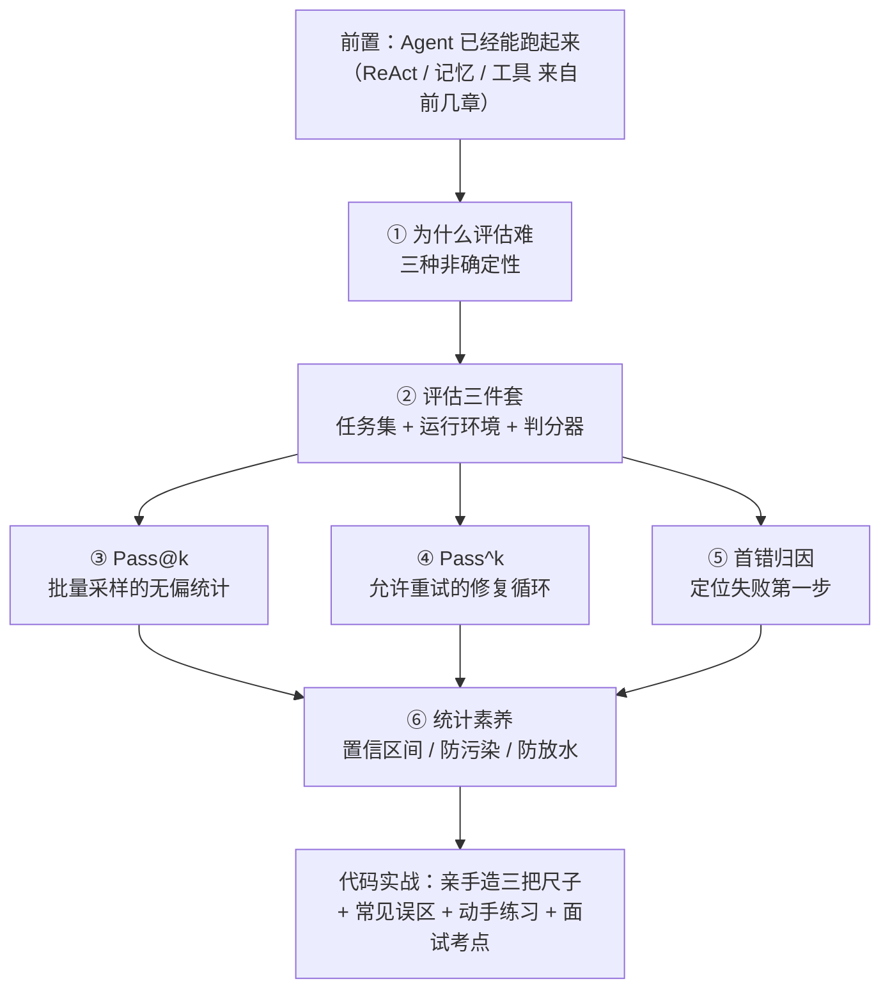
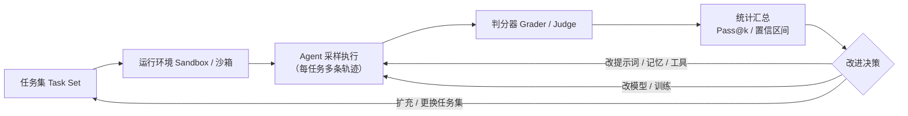
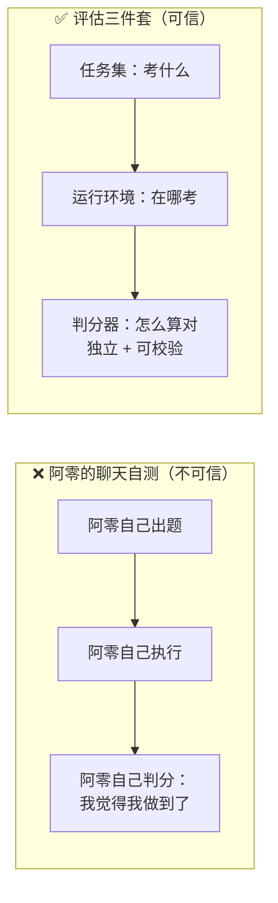
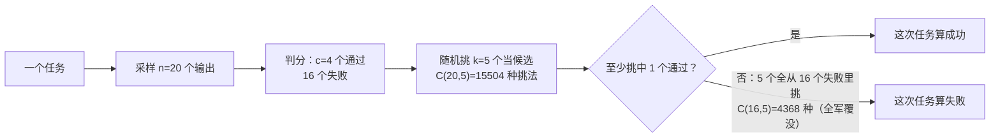
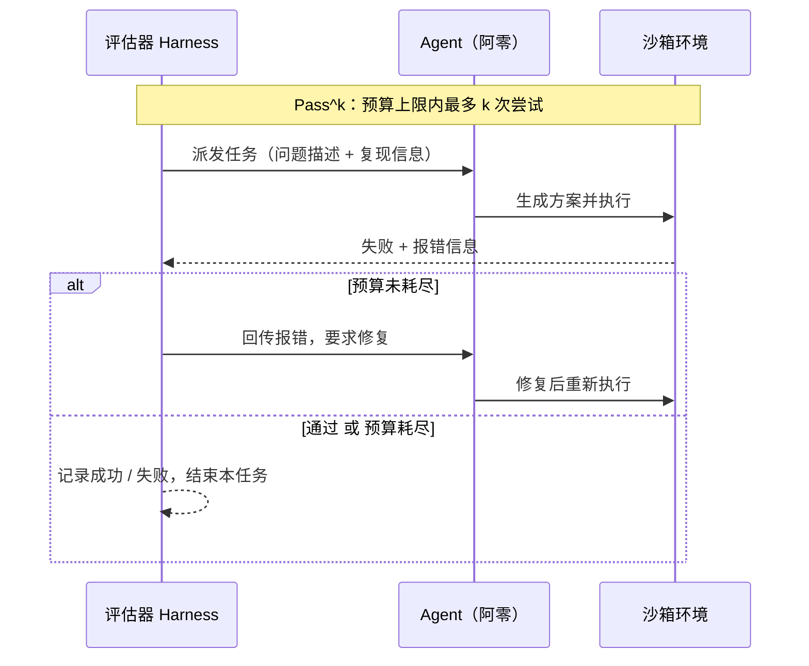
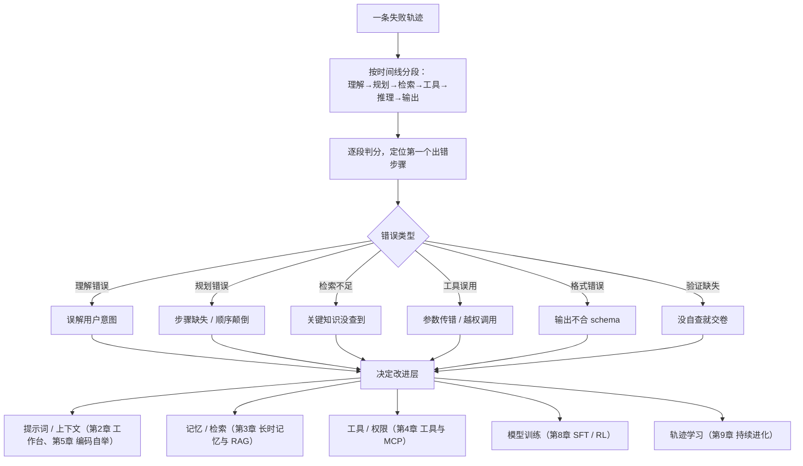
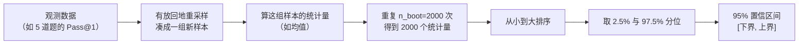
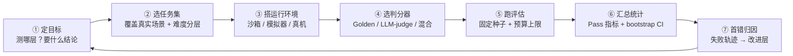

# 07-评估环境、Pass@k / Pass^k、首错归因与统计

> 「主人，告诉你一个好消息：我现在的任务成功率是 99%。」
> 用户没有露出惊喜的表情，只是平静地问了三个问题：**「怎么测的？跑了几次？在哪些任务上测的？谁判的分？」**
> 阿零张了张嘴，发现自己只能回答「我试了很多次，大多数都成功了」。
> 它第一次意识到：**没有尺子，就没有工程。** 而评估，就是 Agent 工程里最难造的那把尺子——它现在连尺子长什么样都不知道。

## 本节要解决的问题

| 本节要解决的问题 | 本章将给出什么 | 小白版一句话 |
|---|---|---|
| 评估环境 | 为什么 Agent 评估比「出题—对答案」难一个量级？评估三件套是什么？主流评测基准各用什么判分器？ | 怎么给 Agent「考试」，才不算它自己给自己打分？ |
| Pass@k / Pass^k | 「采样 k 个输出，至少一个通过」怎么统计才无偏？允许重试的 Pass^k 与 Pass@k 有何本质区别、怎么防刷分？ | 让 Agent「多试几次」怎么统计才算数？「批量试」和「错了重试」是两码事？ |
| 首错归因 | 一条失败轨迹，错误到底出在第几步？怎么分类、怎么决定改提示词、记忆、工具还是训练？ | 一条失败的轨迹，是坏在第一步，还是最后一步？ |
| 统计 | 采样多少才可信？置信区间怎么估？怎么防「基准污染」「刷基准」和「放水」？ | 试多少次、误差多大，才敢拍胸脯说「真的变强了」？ |

## 故事引入

阿零第一次做「正式评估」是在一个叫 **open-the-door** 的任务集上：给一个模拟家居 API，让 Agent 完成「开门」「开灯」这类指令。它在自己搭的「聊天自测」里跑出了 95% 以上的成功率，于是信心满满地把这套能力接到真实工作流，结果上线首日成功率跌破 60%。

问题出在哪？阿零复盘时发现：它之前的「判分」其实是自己看自己的输出——「我觉得我做到了」。真实工作流里，判分器是**门真的开了没有**（传感器读数加操作日志），撒谎空间为零。更麻烦的是，真实任务的轨迹又长又开放：有时是它没听懂指令，有时是规划错了步骤，有时是 API 参数传错，还有几次纯粹是采样运气差。**「大概成功了」在长轨迹、非确定的 Agent 世界里，不再等于「成功」。**

用户于是带阿零做了三件事：找一套任务集、搭一个运行环境、写一个判分器，再教会它把「我感觉」翻译成「统计上怎么说」。这一章，就是阿零学造尺子的全过程。

不过阿零还有个小疑惑：**「为什么不能像学校考试那样，出张卷子、对个答案就完事？」** 这个问题的答案，正好引出本章第一个核心概念——Agent 评估为什么天生就难。

## 本章路线图

先给这张地图，让你心里有数：这一章的知识点不是平铺的，而是「一条流水线 + 一把无偏的尺子 + 一台定位错误的显微镜 + 一套防骗术」。六个知识点环环相扣：



**前置知识**：你需要知道 Agent 大体是怎么干活的（第 1 章 ReAct 的「思考→行动→观察」循环）、它有哪些记忆（第 3 章）和工具（第 4 章），以及它的「工作台」上下文长什么样（第 2 章）。不需要会任何统计公式——本章会把组合数、置信区间全部用生活例子讲明白。

**学完你能获得什么**：你会得到一把「可复现的尺子」——知道怎么把「我感觉我变强了」翻译成「在 20 个采样里以 95% 置信度提升了 8 个百分点」，并且能亲手用 Python 把 Pass@k、置信区间、Pass^k 重试循环各实现一遍。

**与前后章的衔接**：第 6 章让阿零学会了「一边干活一边说话、用鼠标操作屏幕」，这一章则回答「干得好不好怎么量」。而尺子量出来的弱点，正是下一章（第 8 章 Mid-training / SFT / RL）训练的目标——**先有尺子，才有训练**。

## 核心概念

### (1) 为什么评估难：三种非确定性 🎲

> 💡 **一句话直觉**：普通考试是「题目固定、答案唯一、批改标准明确」，而 Agent 评估像「让一个人在不同的坏天气里连续登山」——每一步都可能变，你怎么知道是能力问题还是天气问题？

**大白话详解**。先把「评估（evaluation）」这个词拆开看：评估就是给 Agent 的能力「量尺寸」。对普通大模型来说，评估很简单——给它一句「请把这句话翻译成英文」，标准答案就在参考译文里，对错一目了然。但**Agent（智能体）**和普通模型最大的不同是：它不只是「输出一句话」，而是**在一个环境里连续做动作**——先理解任务、再规划步骤、然后调用工具、观察结果、可能还要自我修正，最后才给出最终答案。这一整串动作，我们叫它**轨迹（trajectory）**，你可以把它想象成一段「脚印录像」：从任务开始到结束，每一步干了什么都记录下来。

正因为存在轨迹，Agent 的评估就同时撞上了三种「不确定」：

1. **采样随机性（sampling randomness）**：同一个任务，把生成参数里的 **temperature（采样温度，一个控制随机性的旋钮）** 稍微调一下，输出就不同了。成功率天然是一个「分布」而不是一个「点」——就像同一个射手，状态好时 10 发 8 中、状态差时 10 发 3 中，你不能说他「就是 5 成命中率」。
2. **路径开放性（open-ended paths）**：轨迹可长可短、工具可以调很多次、中途可能自我修正。普通模型的答案是「一段文字」，对答案容易；Agent 的答案是「一串动作」，你得逐个检查每个动作对不对——没法一键对答案。
3. **判分主观性（subjective grading）**：很多任务根本没有唯一标准答案。比如「把邮件改得体面一点」，什么叫体面？谁来当裁判、按什么标准判？这本身就是问题。

所以 Agent 评估不能靠感觉，必须变成一条可复现的流水线：**任务集 → 运行环境 → 采样执行 → 判分 → 统计 → 改进**，周而复始地闭环：



**形象类比**：想象你请了一个家教，想知道他教得好不好。你不能只问他自己「你教得怎么样」——他当然说好。你要做的是：**出一套卷子（任务集）→ 安排一间没有干扰的教室（运行环境）→ 让他教一个学生（Agent 执行）→ 请一位不认识他的阅卷老师批改（判分器）→ 统计学生成绩的变化（统计）**。任何一个环节缺了，结论都不可信。这一章后面讲的，就是把这条流水线的每一环造好。

### (2) 评估三件套：任务集 + 运行环境 + 判分器 🧩

> 💡 **一句话直觉**：评估 = 出题（考什么）＋ 考场（在哪考）＋ 阅卷（怎么算对）。这三样缺一不可，其中阅卷标准最容易被轻视——判分器错了，整个评估结论就反了。

**大白话详解**。把评估拆成三个零件，就是阿零学到的「评估三件套」：

- **任务集（Task Set）**：定「考什么」。它是一批任务的集合，每个任务有描述（题目）、有判分依据（答案或检查点）。比如 HumanEval 里的「写一个函数，输入字符串返回其反转」。
- **运行环境（Environment）**：定「在哪考」。必须是一个**可控、可复现**的沙箱或模拟器——真实终端、模拟家居 API、模拟浏览器都行。为什么要可控？因为如果环境不稳定（一会儿网络超时、一会儿文件丢失），你分不清失败是 Agent 的错还是环境的错。
- **判分器（Grader / Judge / Checker）**：定「怎么算对」。它必须**独立于 Agent**，且**本身可以被校验**。判分器错了，评估结论就反了——比如把「输出长得像正确答案」判成「真的正确」，Agent 就会学会「写得像」而不是「做得到」。

有一个细节特别重要：这里的「判分器」不一定是写好的程序，也可能是**另一个大模型**。用大模型当判分器叫 **LLM-as-Judge（大模型当裁判）**，比如 MT-Bench 就让 GPT-4 打分。但大模型裁判同样会偏心——有的偏爱长答案（**长度偏见，length bias**），有的对中文理解差。所以在用它之前，必须先校验它和人类专家的判断有多一致。这就好比：你可以请一位「AI 阅卷老师」，但上岗前得先拿几份**人工批改过的卷子**测测它批得靠不靠谱。

为了让你对「判分器」有画面感，下面按领域列一下主流评估环境与它们的判分器（这也是一张面试常考的表）：

| 类别 | 代表基准 | 判分器怎么算「对」 |
|---|---|---|
| 代码生成 | HumanEval（2021） | 编译 + 运行单测，全部用例通过才算过 |
| 真实仓库任务 | SWE-bench（2024） | 在真实 GitHub issue + 测试补丁上跑 FAIL_TO_PASS / PASS_TO_PASS |
| 终端命令行 | Terminal-Bench（2024） | 在真实终端执行命令，检查输出、文件与系统状态 |
| 通用任务 | GAIA（2023） | 答案字符串精确 / 含允差匹配，问题需多步推理与工具 |
| GUI 操作 | OSWorld（2024） | 比对屏幕截图与参考界面状态（视觉判分） |
| 对话助手 | AlpacaEval、MT-Bench | LLM-as-Judge、成对偏好比较、人工评测 |

表格里有几个词值得停下来解释一下。**FAIL_TO_PASS** 的意思是「原本失败的测试用例，你修完之后要能通过」——这是 SWE-bench 判定你**真的修好了 bug** 的依据；**PASS_TO_PASS** 的意思是「原本就通过的测试用例，你修完 bug 之后**不能弄坏**」——这是防止你「按下葫芦浮起瓢」、为了修 A 把 B 改崩的护栏。你可以这样记：FAIL_TO_PASS 看「你补上了什么」，PASS_TO_PASS 看「你没弄丢什么」，两张都要及格才算真正成功。

**形象类比**：把「评估三件套」想象成组织一场**游泳比赛**。任务集 = 比赛项目单（100 米自由泳、200 米蛙泳……考什么写清楚）；运行环境 = 标准泳池（水质稳定、泳道分明，比赛可以重赛复现）；判分器 = 裁判和计时器（触壁计时，不看你游得「好看」，只看你**真的到边**）。如果你让运动员自己掐表，他游多慢都能说自己第一——这就是「自评优秀」的由来。

下面这张图对比了阿零原来的「自评」和正规的「三件套评估」，一眼就能看出差别在哪：



### (3) Pass@k：一次批采样，「至少中一个」 🎯

> 💡 **一句话直觉**：Pass@k 就像抓娃娃——一次投币可以抓 k 次（其实是采样 k 个候选），只要**至少有一次**抓中就算成功。多买几次机会，衡量的是「你兜里有多少种可能」。

**大白话详解**。先解释两个词。**采样（sampling）**就是让模型「生成一次输出」——由于模型输出有随机性，同一个问题采样 20 次，会得到 20 个可能不同的答案。**通过（pass）**就是答案通过了判分器（比如代码编译通过且单测全绿）。

**Pass@1** 很好理解：每次只采样 1 个输出，看它通过的占比——这是「一次写对」的能力，最严格。但问题来了：Agent 工程里我们常常「多采样几个候选，挑最好的用」。如果 20 个候选里只要有 1 个对，任务就算成功，成功率肯定比 Pass@1 高。**Pass@k** 衡量的就是：一次批量采样 k 个候选，「至少中一个」的概率。HumanEval（2021，一个包含 164 道 Python 编程题的经典代码生成基准）正是用这个协议来评测模型的。

那么问题变成：我们采了 n 个输出（n ≥ k），其中有 c 个通过，怎么从这组观测数据估计「随机抽 k 个、至少中 1 个」的概率？你可能会想：这不是很简单吗？先算单个通过率 c/n，然后「抽 k 个至少中 1 个」= 1 − (1 − c/n)^k。但注意——**这是有偏的**！为什么？往下看。

**为什么朴素估计 `1 − (1 − c/n)^k` 有偏**。关键在「抽」字：如果我们是**有放回地**独立抽 k 次，那朴素公式对；但我们真实的做法是**从 n 个输出里一次性挑出 k 个当候选**——同一个输出不能被重复占两个名额，这是**无放回**抽样。两者差别在哪？举个例子：n=2（只有两个输出，一好一坏），k=2。无放回时你必然把两个都挑走，至少中 1 个的概率是 **100%**。但朴素公式算出来是 1 − (1 − 1/2)² = 1 − 0.25 = **75%**——它把「同一个坏输出被抽中两次」当成了可能发生的事，白白浪费名额，于是**系统性低估**了真实命中率。k=1 时两者恰好相等（都是 c/n）；k 越大，这种低估越明显。所以我们需要一个不犯这个错的公式。

HumanEval（2021）给的无偏估计长这样：

$$
\text{pass@k} = \mathbb{E}\left[1 - \frac{\binom{n-c}{k}}{\binom{n}{k}}\right]
$$

**手把手读懂这个公式**。先认识 **组合数（binomial coefficient）** `C(n, k)`，读作「从 n 个东西里选 k 个，有多少种选法」。比如 C(20, 5) 就是从 20 个输出里挑 5 个当候选，一共有 15504 种挑法（后面代码里 `math.comb(20, 5)` 就是算这个）。那么公式的每一块就很好懂了：

- `C(n, k)`：从 n 个输出里挑 k 个的所有可能挑法总数；
- `C(n−c, k)`：从 n−c 个**失败的**输出里挑 k 个的挑法数——这正好是「抽到的 k 个全部是失败品」的情形；
- 比值 `C(n−c, k) / C(n, k)`：随机挑 k 个，**全军覆没**的概率；
- `1 − 比值`：**至少抽中 1 个通过输出**的概率。

把 n 个输出想成 n 张彩票，其中 c 张中奖。随机抽 k 张，「一张都没中」的概率就是把 k 张全从没中的 (n−c) 张里抽出来，即 C(n−c, k)/C(n, k)；1 减去它就是「k 张里至少一张中奖」。通俗地说：**Pass@k 衡量「一次批采样 k 个候选，能不能至少蒙对一个」**，是生成器能力上限附近的卡尺。

有个边界情况值得一提：如果失败样本压根不够 k 个（n−c < k），那「抽 k 个全是失败品」根本不可能发生，Pass@k 直接等于 1——代码里我们也要处理这种情况，否则组合数会因为「下标越界」直接报错。

**形象类比**：你在一家玩具店抓娃娃，机器里有 20 只娃娃，其中 4 只「一定能抓到」（通过），16 只「怎么都抓不到」（失败）。你有 5 次投币机会，每次抓到的娃娃不会重新放回（无放回）。「至少抓到 1 只好的」的概率是多少？如果你把「抓了 5 次」当成「独立试 5 次、每次成功率 20%」，算出来是 1 − 0.8⁵ ≈ 67%；但正确算法是把「从 20 只里抓 5 只」当一次组合事件——20 只里选 5 只共有 15504 种选法，5 只全从 16 只坏娃娃里选共有 C(16,5)=4368 种，所以至少中 1 只的概率是 1 − 4368/15504 ≈ **71.83%**。差出来的 4 个多百分点，就是「无放回」多给你的一点运气。



### (4) Pass^k：允许重试的「修复循环」指标 🔧

> 💡 **一句话直觉**：Pass^k 像「考试允许重答」——答错了不直接判死，把错因告诉你，让你修完再交，最多重交 k 次，但每次重交都扣成本。它和 Pass@k 一字之差，量的是完全不同的能力。

**大白话详解**。到这里阿零问了个关键问题：「如果我第一次没做对，但看到报错后自己改对了，这算不算成功？」——这正是 **Pass^k（带重试，pass-with-retries）** 的动机。两者一字之差，本质完全不同：

| | Pass@k | Pass^k |
|---|---|---|
| 玩法 | 一次性**并行**采样 k 个输出，选最好的，互相不通信 | **串行**最多 k 次尝试，失败信息（报错、测试输出）回流给 Agent 修复 |
| 衡量能力 | 生成器的「覆盖 / 多样性」上限 | 「修复循环」（debug）能力 |
| 类比 | 一次买 k 张彩票，中一张就行 | 答错允许重答 k 次，但每次重答都扣成本 |
| 刷分风险 | 把 k 调大即可刷 | 无限重试即可刷，必须设预算 |
| 防刷分 | 固定 k、禁止对测试集反复调参 | 设尝试次数 / 步数 / token / 时间 / 成本上限，失败同样计入成本 |

把表格翻译成人话：**Pass@k 的 k 个候选之间「互不认识」**——它们是并行采样出来的，各写各的，谁也不知道别人错在哪；**Pass^k 的 k 次尝试是「有来有回」的**——第 1 次失败后，报错信息回传给 Agent，Agent 基于这个反馈修一次，再交第 2 次……这就像：前者是你一次买 k 张彩票碰运气，后者是你和老师「一问一答」最多 k 轮。因此 Pass@k 量的是「生成器能变出多少花样」（覆盖 / 多样性），Pass^k 量的是「拿到失败反馈后能不能修好」（修复循环）。



例如 SWE-bench（2024，用真实 GitHub issue 评测模型修 bug 的基准）的评测就常以修复循环形式进行：模型拿到 issue 描述与失败测试，改代码、跑测试、再改，直到测试全部通过或预算耗尽。**Pass^k 高 ≠ Pass@1 高**：一个擅长修 bug 但不擅长一次写对的 Agent，Pass^k 可能很好看，Pass@1 却平平——两把尺子各量一种能力。

这里还有一条防刷分的红线：**不能把判分用的测试答案泄露进 Agent 的上下文**。如果修复循环里直接把「期望输出」或「隐藏测试用例」喂给 Agent，那 Pass^k 就是在「拿答案考试」——测出来的不是能力，是检索能力。所以 Pass^k 的修复上下文里只能有「失败表现」（报错、失败的测试输出、diff），不能有「标准答案」。

**形象类比**：想象你学做菜，评委给你食材和菜谱（任务描述），你做一道菜（第 1 次尝试）。评委尝一口说「太咸了」（失败反馈），你回去重做（第 2 次尝试）……最多重做 k 次，每次用掉的食材都算钱。Pass^k 高 = 你「根据反馈越改越好」的能力强；但它**不代表你第一次就能做对**——一个需要三遍才能做对的人，Pass^3 好看，Pass@1 却难看。反过来，Pass@k 高的模型，是那种「一次性能给你 k 种不同做法」的，但它**未必**能对着反馈迭代。

### (5) 首错归因：错误到底出在哪一步？🔍

> 💡 **一句话直觉**：Pass^k 告诉你「失败了」，却没说「为什么失败」。首错归因就像排查一场连环车祸——先找到**第一辆**追尾的车，因为后面所有车都是它带崩的。

**大白话详解**。首错归因（first-error attribution，把错误「归因」到第一次出错的位置）的想法很朴素：**长轨迹的错误是会传染的**——第 3 步理解歪了，后面每一步都会跟着错。所以与其分析所有错误，不如顺着时间线找到**第一次**出错的位置，因为那是「多米诺骨牌的第一张」。

具体怎么做？把一条失败轨迹按语义切成几段：**理解 → 规划 → 检索 → 工具 → 推理 → 输出**，然后逐段判分：任务理解对了吗？规划步骤全吗、顺序对吗？该查的知识查到了吗？工具参数传对了吗？中间推理有没有漏？最终输出符合格式吗？第一个判为「失败」的那一段，就是首错。



定位首错有三个要点：

1. **多采样几次再归因**。一次失败可能只是随机性（采样运气差），同一任务多跑几条轨迹，看首错是否**稳定**出现在同一阶段——稳定出现的才是系统性问题，偶发的属于噪声，不该大动干戈。
2. **用反事实验证**。把那一处「修正」后重跑：如果整条轨迹从失败变成功，说明归因站得住；如果修正了首错还是失败，说明真正的首错还在更前面。
3. **归因必须落到改进层上**。分析完必须能映射到一个可执行的改进动作，否则就是「分析了个寂寞」。比如「检索不足」指向长时记忆章节的 RAG 调优（可配套复习 [../04-LLM大模型/教学/15-RAG与Agent.ipynb](../04-LLM大模型/教学/15-RAG与Agent.ipynb)），「工具误用」指向工具定义与权限，而「验证缺失」往往要靠第 8 章的 RL 奖励来根治。

**形象类比**：这就像医生看病。病人说「我浑身不舒服」，你不能把每个器官都开一刀，而要先按「呼吸系统 → 循环系统 → 消化系统」逐项排查，找到**最先坏的那个器官**（比如肺），因为后面所有症状（头晕、乏力）都是肺带出来的。找到病灶之后，还要验证：把肺治好，其他症状是不是自己就好了？对应到 Agent 就是「反事实验证」。最后必须能开出处方（改提示词？加记忆？调工具？上训练？）——对应「落到改进层」。

### (6) 统计素养：别把「运气」当「能力」 📊

> 💡 **一句话直觉**：跑 10 道题对 8 道，不代表你真的有 80% 实力——可能只是这次运气好。统计素养就是教你分辨：哪些数字是「能力」，哪些只是「运气的回声」。

**大白话详解**。评估最后一步是把一堆「成功 / 失败」汇总成可信的结论。这里最容易翻车，新手常犯的毛病是把「运气」当成「能力」。统计素养包含下面五件事：

- **样本量（sample size）**：Pass 类指标本质是**比例**（通过数 ÷ 任务数）。比例这东西，样本越小越不靠谱。10 道题通过 8 道，95% 置信区间几乎横跨半张表，任何一道题的波动都让指标跳 10 个百分点；所以报告必须写「在多少题上测得」，而不是只扔一个百分比。你可以这样想：抛硬币 10 次得到 7 次正面，你敢说硬币正面概率是 70% 吗？当然不敢——抛 10000 次才敢。
- **置信区间与 bootstrap**：**置信区间（confidence interval，CI）**是说「真实值大概率落在这个范围」。怎么估？**bootstrap（自助法 / 放回抽样法）**不假设分布，从观测数据**有放回**地重采样成千上万次，直接用统计量的经验分布取 2.5%~97.5% 分位当 95% CI——对小样本、非正态、且指标是「采样→判分」复杂函数（如 Pass@k）的场景特别合适。这个「有放回」是关键：每次都把原始数据当「奖池」，随机抽满一袋，抽完放回去再抽下一袋。
- **A/B 显著性**：比较「加了某个记忆功能有没有变强」，要在**同一批任务**上做**配对对照**，看差异是否落在噪声范围外。拿两个不同任务集上的数字对比，等于拿两把不同的尺子比长短——就像用皮尺量你的身高、用卷尺量朋友的身高，然后说「你俩谁高」，这没有意义。
- **基准污染（contamination）**：测试题可能早已出现在预训练语料里，模型「背过答案」。防法是**时间切分**（只用出题日期之后的新数据）、**n-gram 重叠检测**、优先使用新发布的 **held-out 任务集（留出集，即训练时绝对没见过的任务）**。
- **过拟合基准与放水（reward hacking）**：在同一基准上反复调参就是在拟合测试集；判分器一旦有漏洞（如 LLM-as-Judge 偏爱长答案），Agent 会学会钻漏洞刷分——**评估的漏洞，最终会变成 Agent 的「能力」**，所以评估面本身要定期翻新。所谓 **reward hacking（奖励黑客，俗称「放水」）**，就是 Agent 发现了「不用真正完成任务，只要输出某种样子就能得分」的捷径，于是专门走捷径。

**形象类比**：把 bootstrap 想象成**放回抽样摸奖袋**。你手里有 5 个观测值（比如 5 道题的 Pass@1），想知道「平均成功率」大概是几。做法是：把 5 个值装进袋子，抽一个记下、放回去、再抽，重复 5 次凑成一组「新数据」，算这组的平均值——这是**一次 bootstrap 采样**。重复 2000 次，你就得到 2000 个平均值，把它们从小到大排序，取 2.5% 和 97.5% 位置的值，就是 95% 置信区间。因为每次都「放回」，所以同一袋里可以抽出重复的观测值，这正是 bootstrap 不假设分布的底气。



## 深入原理

两张速查表，分别从「指标」和「错误」两个维度收束本章。第一张表把三种 Pass 指标放在一起比：

| 指标 | 定义 | 衡量能力 | 一句话防刷分 | 白话理解 |
|---|---|---|---|---|
| Pass@1 | 单次采样即通过的比例 | 一次写对的下限能力 | 最严格，无刷分空间 | 只给一次机会，一次做对才算赢 |
| Pass@k | 一次采样 k 个输出，至少 1 个通过 | 生成覆盖 / 多样性的上限 | 固定 k，禁止对测试集反复调参 | 一口气买 k 张彩票，中一张就行 |
| Pass^k | 预算内最多 k 次尝试（含修复循环） | 修复循环能力 | 设步数 / token / 成本上限，失败计入成本 | 答错允许重答 k 次，每次扣成本 |

> 💡 **解读**：面试官问「三个指标你会怎么选」时，标准答案是「取决于你要量什么能力」：追求「上线即用、一次到位」看 Pass@1；探索「模型能给出的方案覆盖面」看 Pass@k；衡量「收到报错后能不能迭代修复」看 Pass^k。三者不是谁取代谁，而是三把不同刻度的尺子。

第二张表把失败轨迹的错误按类型、归因层、改进手段对齐——这正是首错归因的输出格式：

| 错误类别 | 例子 | 归因层 | 改进手段（关联章节） |
|---|---|---|---|
| 理解错误 | 用户要「汇总」却做成「翻译」 | 指令理解 | 提示词重构（[02-上下文KV-Cache与Skill.md](02-上下文KV-Cache与Skill.md)） |
| 规划错误 | 先改代码再查文档，顺序颠倒 | 推理 / 规划 | 思维链提示或训练 |
| 检索不足 | 没拿到最新接口文档 | 记忆 / 检索 | 第 3 章 RAG 调优 |
| 工具误用 | 参数拼错 / 越权调用 | 工具定义 / 权限 | [04-工具分类与MCP.md](04-工具分类与MCP.md) |
| 格式错误 | 输出不是合法 JSON | 输出约束 / 校验 | 工作台 schema 校验与注入防护 |
| 验证缺失 | 不跑测试就交卷 | 自我检查循环 | [05-Coding-Agent与自举.md](05-Coding-Agent与自举.md)、第 8 章 RL |
| 奖励错位 | 输出「像对的」而非「真的对」 | 判分器 / 奖励 | 判分器改造、第 8 章奖励设计 |

> 💡 **解读**：这张表最重要的使用方法是「归因→动手」闭环：看到一条失败轨迹，先定位首错（第几段），再对号入座到「错误类别」，最后必须落到「改进手段」那一列去执行——改提示词、调 RAG、改工具定义、上训练，任选其一，然后重测。不做最后一步，前面的归因都是纸上谈兵。

最后一张是本章新增的**常见误区对照表**——把新手最容易踩的七个坑摆出来，错误理解 vs 正确理解，一眼看清：

| # | 错误理解 | 为什么错 | 正确理解 | 类比 |
|---|---|---|---|---|
| 1 | Pass@k 高，Pass@1 一定也高 | 两个指标量的是不同能力 | Pass@k 量覆盖 / 多样性，Pass@1 量一次写对 | 抓娃娃多买几次 ≠ 一抓就中 |
| 2 | `1 − (1 − c/n)^k` 就是无偏的 pass@k | 把「无放回选 k 个」当成「有放回独立抽 k 次」 | 必须用组合计数 `1 − C(n−c,k)/C(n,k)`，并要求 k ≤ n | 已抓出的娃娃不会放回机器 |
| 3 | 让 Agent 自己判分没什么问题 | 立场不独立，会「自评优秀」 | 判分器必须独立于 Agent 且本身可校验 | 运动员不能同时当裁判 |
| 4 | 10 道题对 8 道 = 实力 80% | 样本太小，置信区间极宽 | 必须写「在多少题上测得」+ 置信区间 | 抛 10 次硬币不能定硬币概率 |
| 5 | 在测试集上反复调参也算「改进」 | 这就是拟合测试集 / 刷基准 | 划出独立的 dev set，测试集只能碰一次 | 考前背答案不算学会 |
| 6 | 一条失败轨迹就能定位首错 | 单次失败可能是随机性 | 多采样确认首错稳定出现，再做反事实验证 | 单次咳嗽不能确诊肺炎 |
| 7 | 输出长得像正确答案就算答对 | 判分器有漏洞（如偏爱长答案） | 判分器按行为 / 系统状态判，且要定期翻新 | 抄作业的字迹再像也不是你的 |

## 评估体系全景与落地：从 0 到 1 搭一把好尺子

前面把「零件」都讲完了（任务集、环境、判分器、Pass@k、bootstrap、首错归因），这一节把它们**串成一套能落地的评估体系**。面试官问「你们怎么评估 Agent」时，你答出下面这套流程，就是「真的在工程里搭过」的信号。

### (一) 评估对象分层：先想清楚「在测谁」

评估的第一步不是选指标，而是**分清你在测谁**。同一个 Agent 系统里至少有四层可以被单独测量，混在一起测会互相污染结论：

| 层 | 测什么 | 例子 | 指标方向 |
|---|---|---|---|
| 模型层（LLM） | 单次生成能力 | 让模型直接写一段代码 | Pass@1、Pass@k |
| 提示层（Prompt） | 同样的模型，不同的提示策略 | CoT vs ReAct vs 结构化输出 | 同基准横向对比 |
| Agent 层（循环） | 加入工具/循环后的整体能力 | 带工具调用、带修复循环 | Pass^k、任务成功率 |
| 系统层（工程） | 并发、延迟、成本、稳定性 | 100 个任务并发跑 | 吞吐、P95 延迟、成本/task |

> 💡 **解读**：大多数评估翻车，都源于「层没分清楚」——拿 Agent 层的成功率去评价「模型本身变强了」，其实是提示工程做得好；拿 Prompt 层的对比去证明「RL 训练有效」，其实只是输出格式变了。**先声明测哪层，再选指标。**

### (二) 三种判分器详解：Golden、LLM-judge、self-check

判分器（Checker）是把「任务输出」变成「对/错」的裁判。三种裁判的可靠性、成本、适用范围完全不同：

| 判分器 | 怎么判 | 可靠性 | 成本 | 适用场景 |
|---|---|---|---|---|
| Golden（金标对拍） | 输出必须和标准答案/行为一致 | ★★★★★ 最高 | 低（规则匹配） | 代码题（跑测试）、结构化输出（JSON 比对）、数学（精确答案） |
| LLM-judge（评委模型） | 用另一个 LLM 打分/判对错 | ★★★☆ 中（需校准） | 中高（调用费） | 开放式问答、摘要质量、对话自然度、多轮任务 |
| self-check（自评） | Agent 自己判断对错 | ★★ 低（立场不独立） | 免费 | 只能当「粗筛」，绝不能当最终判分 |

**Golden 判分器的两种形态**，值得展开：

1. **跑测试（execution-based）**：让 Agent 输出代码，在沙箱里真实运行，用隐藏单测判分——SWE-bench（2024）就是这么判的：模型改完代码，仓库自带测试跑一遍，全绿算过。这是**最硬**的判分：模型没法「装得像」，测试说了算。
2. **状态比对（state-based）**：Agent 操作后，检查**系统状态**是否符合预期——比如「订机票」任务，检查数据库中是否真的生成了订单记录、金额是否正确。比「看 Agent 说了什么」可靠得多。

**LLM-judge 的三个校准动作**（不然它会「袒护」或「冤枉」Agent）：

- **和人工标注对齐**：抽 100 条输出，让 judge 打分、人类打分，算一致率（如 Cohen's kappa）。一致率 < 0.7 说明 judge 不可靠，要换 prompt 或换模型。
- **构造对抗样本审计**：故意喂「长而错的答案」「套模板的答案」「格式漂亮但内容空洞的答案」，看 judge 会不会上当。上当越多，漏洞越大。
- **定期翻新**：Agent 会学会钻 judge 的偏好（比如 judge 偏爱长答案，Agent 就疯狂扩写）。每轮评估要用「新一批 judge 样本」复检 judge 本身。

**self-check 为什么只能当粗筛？** 因为立场不独立——让运动员自己给自己打分，成绩单必然偏乐观。它唯一的合法用途是「低成本预筛」：self-check 说「失败」的，大概率真失败，直接淘汰；self-check 说「成功」的，还要过 Golden/LLM-judge 终审。

### (三) 一个评估系统怎么从 0 到 1 搭起来（七步走）

把上面所有零件串起来，一套最小可用的 Agent 评估系统只需要七步：



- **① 定目标**：先写一句话「我要证明什么结论」。例：「证明加了记忆功能后，阿零在『多轮连续咨询』任务上成功率提升」。「证明 X」决定了后面每一步怎么选。
- **② 选任务集**：任务集要**真实**（来自你产品的用户日志最好）、**难度分层**（简单/中等/困难各占一批，否则全是简单题看不出差距）、**量够大**（先跑 bootstrap 看 CI 宽度，宽了再加题）。
- **③ 搭运行环境**：可控、可复现是底线。代码任务用沙箱（容器/临时目录），GUI 任务用模拟器或虚拟机快照，每轮评估从干净状态开始。
- **④ 选判分器**：能用 Golden 就用 Golden（最硬）；开放式任务才上 LLM-judge，且要做校准；self-check 只当预筛。混合策略最常见：self-check 预筛 → Golden/LLM-judge 终审。
- **⑤ 跑评估**：固定随机种子（可复现）、设预算上限（防刷分）、记录每条轨迹（供归因用）。**每轮评估留痕**：模型版本、提示词版本、工具版本、判分器版本，一个都不能少——不然出了「这轮指标涨了」根本不知道是哪个变量变的。
- **⑥ 汇总统计**：Pass@1 / Pass@k / Pass^k 分开报，全部带 n 和 bootstrap CI；加一个「成本」列（token 数、调用次数）——能力相同的情况下，成本低的方案才是好方案。
- **⑦ 首错归因**：把失败轨迹按「首次错误」聚类，生成「失败类型分布」（理解错 30%、工具误用 25%、检索不足 20%……），按占比排序决定下一个改进动作。

### (四) 评估 Dashboard：给「尺子」一个面板

真实工程里，评估结果要能被人**一眼看懂**。一个最小 Dashboard 至少包含四块：

| 面板 | 内容 | 回答的问题 |
|---|---|---|
| 总览 | 各任务域成功率 + 95% CI | 「现在整体水平如何？」 |
| 趋势 | 按日/按版本的成功率曲线 | 「最近改动是变好还是变差？」 |
| 失败归因 | 首错类型饼图/柱状图 | 「最该修哪里？」 |
| 成本 | 平均 token / 延迟 / 调用次数 | 「这个水平花多少钱？」 |

> 💡 **解读**：很多团队有个误区——只做「总览」不做事后归因。结果就是「知道指标掉了 5 个点，但不知道为什么」。**没有失败归因的评估，是一把只报分数不指方向的尺子。**

### (五) 评估的「元规则」：尺子本身也要被校准

最后一条心法：**评估体系不是建一次就完事，它本身要持续维护**。三条元规则：

1. **判分器定期复检**：Agent 在进化，判分器的漏洞会被 Agent "发现"。每轮训练/迭代后，抽一批输出复检 judge 是否还被骗。
2. **任务集定期扩充**：新功能上线就要加新任务；老任务被「背下来」（污染）就淘汰或换新。一个从不更新的任务集，最终会变成「考古题集」。
3. **指标与目标的锚定**：指标是代理变量，目标是真实价值。如果发现「Pass@k 涨了但用户满意度没涨」，说明指标和目标的锚松动，要重新设计指标。

**一句话总结本节**：「评估」不是一个函数，而是一套**最小闭环体系**——目标 → 任务 → 环境 → 判分 → 统计 → 归因 → 改进，循环往复，且尺子本身也要定期校准。

## 代码实战

### 代码要做什么（大白话版）

这一节我们亲手造**三把尺子**，全部 mock 数据、固定种子、不联网，跑完能直接对账：

1. **无偏 Pass@k**：5 道题，每题采样 n=20 个输出，通过数分别为 4/2/8/1/5。分别用「无偏公式」和「朴素公式」算出 Pass@5，看无偏列是不是每行都比朴素列高一点点；
2. **bootstrap 置信区间**：把 5 道题的 Pass@1 点估计（0.20/0.10/0.40/0.05/0.25）当成 5 个观测值，有放回重采样 2000 次，取 2.5%~97.5% 分位，得到「Pass@1 均值」的 95% CI；
3. **Pass^k 修复循环**：5 道题的「基础成功率」是 [0.5, 0.3, 0.7, 0.4, 0.6]，每次失败后单次成功率 +0.2（learn=0.2），看预算 1/3/5 次时分别能过几道。

### 完整代码（先整体看一遍）

```python
"""评估工具箱：无偏 Pass@k + bootstrap 置信区间 + Pass^k（修复循环）模拟。"""
import math
import random
from statistics import mean


# ---------- 1. 无偏 Pass@k（HumanEval, 2021）----------
def unbiased_pass_at_k(n: int, c: int, k: int) -> float:
    """无偏估计：pass@k = 1 - C(n-c, k) / C(n, k)。
    直觉：从 n 个输出里无放回随机抽 k 个当候选，全部抽中失败的
    (n-c) 个才算「没通过」，1 减该概率即「至少抽中一个通过样本」。
    要求 k <= n；若失败样本不足 k 个，必然中签，返回 1.0。
    """
    if n - c < k:                      # 失败的都不够 k 个，必中
        return 1.0
    return 1.0 - math.comb(n - c, k) / math.comb(n, k)


def naive_pass_at_k(n: int, c: int, k: int) -> float:
    """朴素（有偏）估计：把 k 个候选当成独立有放回抽样，1 - (1 - c/n)^k。
    同一输出可能被重复占用名额，命中概率被系统性低估（无放回更易覆盖）。"""
    return 1.0 - (1.0 - c / n) ** k


# ---------- 2. bootstrap 95% 置信区间 ----------
def bootstrap_ci(values, stat_fn=mean, n_boot=2000, seed=42):
    """从观测值有放回重采样 n_boot 次，用 2.5%~97.5% 分位数给 95% CI。"""
    rng = random.Random(seed)
    boots = [stat_fn([rng.choice(values) for _ in values]) for _ in range(n_boot)]
    boots.sort()
    return boots[int(0.025 * n_boot)], boots[int(0.975 * n_boot)]


# ---------- 3. Pass^k：带修复循环的重试 ----------
def pass_k_with_retries(base_probs, max_tries=3, learn=0.2):
    """Pass^k 确定性模拟：每道题最多 max_tries 次尝试（预算）；失败后带着报错
    修复，单次成功率提升 learn（封顶 1.0），模拟『看到错误后越改越会』。
    判定用固定阈值（成功率 ≥ 0.5 视为成功）——教学用确定性简化，输出可手算
    复核；真实评估应按预算随机采样多条修复轨迹后统计。"""
    solved = 0
    for p0 in base_probs:
        p = p0
        for _ in range(max_tries):
            if p >= 0.5:                # 确定性判定：单次成功率过半即成功
                solved += 1
                break
            p = min(1.0, p + learn)     # 修复循环：失败反馈让下一次更强
    return solved / len(base_probs)


# mock 数据：每题采样 n=20 个输出，5 道题各自通过数固定，手算可验证
N, K = 20, 5
per_problem_c = [4, 2, 8, 1, 5]

print("题号 | 通过数 | Pass@1 | Pass@5(无偏) | Pass@5(朴素)")
for i, c in enumerate(per_problem_c):
    print(f"{i:>3} | {c:>4}   | {c/N:5.2f}  | "
          f"{unbiased_pass_at_k(N, c, K):10.4f} | {naive_pass_at_k(N, c, K):9.4f}")

p1 = [unbiased_pass_at_k(N, c, 1) for c in per_problem_c]
lo, hi = bootstrap_ci(p1)
print(f"\nPass@1 点估计 = {mean(p1):.3f}")
print(f"Pass@1 bootstrap 95% CI ≈ [{lo:.3f}, {hi:.3f}]")

bases = [0.5, 0.3, 0.7, 0.4, 0.6]
print(f"\nPass^1（无修复）              ≈ {pass_k_with_retries(bases, 1):.3f}")
print(f"Pass^3（允许 2 次修复）        ≈ {pass_k_with_retries(bases, 3):.3f}")
print(f"Pass^5（修复预算放宽）         ≈ {pass_k_with_retries(bases, 5):.3f}")
```

### 逐块拆解（每一行都在干什么）

**第 1 段：无偏 Pass@k（函数 1）**
- `def unbiased_pass_at_k(n, c, k)`：参数 n=采样数、c=通过数、k=候选数。
- `if n - c < k: return 1.0`：失败样本不够 k 个时「抽 k 个全失败」不可能，直接返回 1.0——同时避免了 `math.comb` 对「从比 k 小的数里选 k 个」报错。
- `return 1.0 - math.comb(n - c, k) / math.comb(n, k)`：这就是公式 `1 - C(n-c,k)/C(n,k)` 的代码形态。`math.comb(n, k)` 直接返回组合数，不用自己写阶乘。

**第 2 段：朴素（有偏）Pass@k（函数 2）**
- `return 1.0 - (1.0 - c / n) ** k`：把「抽 k 个」当成「独立有放回抽 k 次」，每次失败率 `(1 - c/n)`，全失败率 `(1-c/n)^k`。这个函数只用来**对比**——真实评测绝不能用它。

**第 3 段：bootstrap（函数 3）**
- `rng = random.Random(seed)`：固定种子 42，保证每次运行重采样结果一致。
- `boots = [stat_fn([rng.choice(values) for _ in values]) for _ in range(n_boot)]`：外层循环 n_boot=2000 次，每次「有放回地从观测值里抽满 len(values) 个」组成一个重采样样本，再算 stat_fn（默认 mean）。2000 个 bootstrap 均值就构成了「均值统计量」的经验分布。
- `boots.sort()` 后取 `int(0.025*n_boot)` 与 `int(0.975*n_boot)` 分位：这就是 95% CI 的左右端点。

**第 4 段：Pass^k（函数 4）**
- 外层 `for p0 in base_probs` 遍历每道题的基础成功率；内层 `for _ in range(max_tries)` 是「预算循环」。
- `if p >= 0.5: solved += 1; break`：确定性判定——单次成功率过半就认为「这题过了」，不消耗后续预算。
- `p = min(1.0, p + learn)`：没过？带着「报错反馈」修复一次，成功率提升 learn=0.2（封顶 1.0）。这模拟的是「看到错误后越改越会」。
- `return solved / len(base_probs)`：通过的题数占比。

**第 5 段：主流程**
- `N, K = 20, 5`：每题采样 20 个输出、挑 5 个候选。
- 循环打印 5 道题的 Pass@1、无偏 Pass@5、朴素 Pass@5。
- `bootstrap_ci(p1)`：对 5 个 Pass@1 值做 2000 次重采样，输出 CI。
- `bases = [0.5, 0.3, 0.7, 0.4, 0.6]`：5 道题的「基础成功率」，传给 `pass_k_with_retries` 分别用预算 1/3/5 次模拟。

### 输出示意（运行后应该看到的样子）

运行上述代码后，预期输出示意：

```text
题号 | 通过数 | Pass@1 | Pass@5(无偏) | Pass@5(朴素)
  0 |    4   |  0.20  |      0.7183  |    0.6723
  1 |    2   |  0.10  |      0.4474  |    0.4095
  2 |    8   |  0.40  |      0.9489  |    0.9222
  3 |    1   |  0.05  |      0.2500  |    0.2262
  4 |    5   |  0.25  |      0.8063  |    0.7627

Pass@1 点估计 = 0.200
Pass@1 bootstrap 95% CI ≈ [0.100, 0.320]

Pass^1（无修复）              ≈ 0.600
Pass^3（允许 2 次修复）        ≈ 1.000
Pass^5（修复预算放宽）         ≈ 1.000
```

### 读输出（每一行怎么理解）

**表头三列**：Pass@1 = c/20（通过数占比）；无偏 Pass@5 = 用组合数公式算的「20 个里抽 5 个至少中 1 个」；朴素 Pass@5 = 有放回近似。

- 题 0（c=4）：无偏 0.7183 vs 朴素 0.6723——无偏列**更高**，因为「无放回抽 5 个」比「独立抽 5 次」覆盖更多不同样本。
- 题 2（c=8）：无偏 0.9489 接近 1——8/20 通过，抽 5 个几乎必然中一个。
- 题 3（c=1）：无偏 0.2500——只有 1 个通过，抽 5 个「至少中它」的概率就是 5/20=0.25，直觉吻合。

**Pass@1 点估计 = 0.200**：5 道题 Pass@1 的平均 `(0.20+0.10+0.40+0.05+0.25)/5 = 1.00/5 = 0.200`。

**CI ≈ [0.100, 0.320]**：只有 5 个观测值时区间很宽——「0.2」这个点估计看着还行，但真实均值可能低到 0.1 或高到 0.32。这就是「样本量不足时别信单点指标」的活例子。

**Pass^1 ≈ 0.600**：预算 1 次时，只有基础成功率 ≥ 0.5 的题能过：0.5✓、0.3✗、0.7✓、0.4✗、0.6✓ → 3/5 = 0.600。
**Pass^3 ≈ 1.000**：预算 3 次时，0.3 修 1 次到 0.5 过，0.4 修 1 次到 0.6 过 → 5/5 = 1.000。
**Pass^5 ≈ 1.000**：预算更宽，但 3 次已经全过，5 次结果不变。

**总的一个洞察**：Pass^k 从 0.4 涨到近 1.0，靠的是**预算与修复能力**（0.2 的 learn 增量），而不是一次性生成能力——这正是「Pass^k 高 ≠ Pass@1 高」的数值证明。

### 动手改一改（三个小练习，改了立刻看变化）

1. **把 `K` 从 5 改成 10**：无偏列全部变大（候选更多、更易中）；朴素列也变大但差距缩小。体会「k 越大，两列越接近」。
2. **把 `per_problem_c` 改成 `[10, 10, 10, 10, 10]`**：所有 Pass@5 都变 1.0（通过率 50% 且无放回，抽 5 个必中）——体会「通过率高到一定程度，Pass@k 就失去区分度」。
3. **把 `learn` 改成 0.05**：Pass^3 会从 1.000 掉下来（0.3 修 2 次才到 0.4，仍不过；0.4 修 2 次到 0.5 刚过）→ 手算 `0.5✓、0.3✗(0.3→0.35→0.4)、0.7✓、0.4✓(0.4→0.45→0.5)、0.6✓` = 4/5 = 0.800。体会「修复能力越弱，预算再大也没用」。

### 扩展实战：迷你评估框架（把三把尺子串成最小闭环）

前面的三把尺子各自为战，真实评估要的是**一条流水线**。下面这段代码（约 120 行）把「评估体系全景与落地」小节的七步压缩成最小可运行闭环：任务集 → 模拟 Agent → 判分器 → Pass 指标 + CI → 失败归因 → 改进建议。数据全部 mock、固定种子、可手算复核：

```python
"""迷你评估框架：任务集 → 模拟 Agent → 判分 → Pass 指标 + CI → 首错归因。"""
import math
import random
from statistics import mean


# ---------- 1. 任务集：6 个任务，每个标注了「难度」与「首错倾向」 ----------
TASKS = [
    {"id": "t0", "difficulty": "easy",   "agent_pass_prob": 0.90, "first_error": None},
    {"id": "t1", "difficulty": "easy",   "agent_pass_prob": 0.85, "first_error": None},
    {"id": "t2", "difficulty": "medium", "agent_pass_prob": 0.60, "first_error": "工具误用"},
    {"id": "t3", "difficulty": "medium", "agent_pass_prob": 0.55, "first_error": "检索不足"},
    {"id": "t4", "difficulty": "hard",   "agent_pass_prob": 0.30, "first_error": "理解错误"},
    {"id": "t5", "difficulty": "hard",   "agent_pass_prob": 0.25, "first_error": "规划错误"},
]

# ---------- 2. 模拟一次评估：采样 n 次，判分（Golden：随机数 <= p 即过）----------
def run_eval(tasks, n=20, seed=42):
    rng = random.Random(seed)
    results = []
    for t in tasks:
        c = sum(1 for _ in range(n) if rng.random() <= t["agent_pass_prob"])
        results.append({"id": t["id"], "n": n, "c": c, "p": c / n,
                        "difficulty": t["difficulty"], "first_error": t["first_error"]})
    return results


# ---------- 3. 汇总：Pass@1 / Pass@5(无偏) + bootstrap CI ----------
def aggregate(results, k=5, n_boot=2000):
    p1 = [r["c"] / r["n"] for r in results]
    p5 = [1.0 - math.comb(r["n"] - r["c"], k) / math.comb(r["n"], k)
          if r["n"] - r["c"] >= k else 1.0 for r in results]
    # bootstrap
    rng = random.Random(42)
    boots = [mean([rng.choice(p1) for _ in p1]) for _ in range(n_boot)]
    boots.sort()
    lo, hi = boots[int(0.025 * n_boot)], boots[int(0.975 * n_boot)]
    return {"Pass@1": mean(p1), "Pass@1_CI": (lo, hi), "Pass@5": mean(p5)}


# ---------- 4. 失败归因：按首错类型聚类，输出改进建议 ----------
def failure_analysis(results):
    by_error = {}
    for r in results:
        if r["p"] >= 0.5:          # 通过的任务不参与归因
            continue
        err = r["first_error"] or "未知"
        by_error.setdefault(err, []).append(r["id"])
    return by_error


RECOMMEND = {
    "理解错误": "重构提示词：拆解任务、给出步骤清单（第2章 工作台）",
    "工具误用": "检查工具 schema 与权限：参数校验加严、描述改写（第4章）",
    "检索不足": "调 RAG：加混合检索与重排（第3章）",
    "规划错误": "加思维链 / 修循环或上 RL 训练（第8章）",
    "未知": "补轨迹日志：首错标签打不全，归因无从谈起",
}


def main():
    print("== 1) 运行评估 ==")
    results = run_eval(TASKS)
    for r in results:
        print(f"{r['id']:>3} 难度={r['difficulty']:<6} Pass@1={r['p']:.2f} "
              f"（{r['c']}/{r['n']}）")
    print("\n== 2) 汇总指标 ==")
    agg = aggregate(results)
    print(f"Pass@1 = {agg['Pass@1']:.3f}  "
          f"95% CI ≈ [{agg['Pass@1_CI'][0]:.3f}, {agg['Pass@1_CI'][1]:.3f}]")
    print(f"Pass@5(无偏, k=5) = {agg['Pass@5']:.3f}")
    print("\n== 3) 失败归因与改进建议 ==")
    by_error = failure_analysis(results)
    for err, tids in sorted(by_error.items()):
        print(f"- {err}（{', '.join(tids)}）→ {RECOMMEND[err]}")


if __name__ == "__main__":
    main()
```

运行上述代码后，预期输出示意（固定种子，每次运行一致）：

```text
== 1) 运行评估 ==
  t0 难度=easy   Pass@1=0.90 （18/20）
  t1 难度=easy   Pass@1=0.85 （17/20）
  t2 难度=medium Pass@1=0.60 （12/20）
  t3 难度=medium Pass@1=0.55 （11/20）
  t4 难度=hard   Pass@1=0.30 （6/20）
  t5 难度=hard   Pass@1=0.25 （5/20）

== 2) 汇总指标 ==
Pass@1 = 0.575  95% CI ≈ [0.383, 0.767]
Pass@5(无偏, k=5) = 0.968

== 3) 失败归因与改进建议 ==
- 检索不足（t3）→ 调 RAG：加混合检索与重排（第3章）
- 工具误用（t2）→ 检查工具 schema 与权限：参数校验加严、描述改写（第4章）
- 规划错误（t5）→ 加思维链 / 修循环或上 RL 训练（第8章）
- 理解错误（t4）→ 重构提示词：拆解任务、给出步骤清单（第2章 工作台）
```

**读输出（4 个要点）**：

1. **Pass@1 = 0.575**：`(0.90+0.85+0.60+0.55+0.30+0.25)/6 = 3.45/6 = 0.575`，手算一致。
2. **CI 宽到 [0.383, 0.767]**：只有 6 个任务，即使平均 0.575，真实水平也可能低至 0.38——**结论必须带 CI，否则就是自欺欺人**。
3. **Pass@5 = 0.968**：每题采样 20 个中挑 5 个，「至少中 1 个」的概率大幅抬升——这正是「采样多样性兜底」的数值体现。
4. **归因输出按改进层分好类**：四个失败任务各归到提示词/工具/记忆/训练一层——这就是「再跑一轮评估该改哪里」的直接答案。

**这一段代码的价值**：它把前面所有概念（Pass 指标、bootstrap、首错归因、改进层映射）在 120 行里串成了一条看得见的流水线。真实系统的评估框架（如 DeepEval、AgentBench 的评测端）就是这条流水线的工程化放大版——骨架一模一样。

## 常见误区

结合「深入原理」末尾的误区对照表，这里再补 5 条代码/落地层面的高频坑：

| # | 误区 | 为什么错 | 正确做法 |
|---|---|---|---|
| 1 | 用朴素公式 `1-(1-c/n)^k` 算 Pass@k 上报 | 系统性低估，k 越大越严重 | 一律用无偏公式 `1-C(n-c,k)/C(n,k)` |
| 2 | 不写采样数 n 和预算 k，只报一个百分比 | 统计没有载体，无法判断可信度 | 报告必须带 n、k、置信区间 |
| 3 | 把测试集当 dev 集反复调参 | 拟合测试集，指标虚高不可迁移 | 划出独立 dev set，测试集只碰一次 |
| 4 | 让 Agent 自评得分 | 立场不独立，必然「自评优秀」 | 判分器独立于 Agent 且本身可校验 |
| 5 | 单条失败轨迹就下归因结论 | 可能是随机性，归因站不住 | 多采样确认首错稳定 + 反事实验证 |

## 动手练习

**练习 1（易）**：手算题 1（c=2）的无偏 Pass@5。提示：`C(18,5)/C(20,5) = (18×17×16×15×14)/(20×19×18×17×16) = (15×14)/(20×19) = 210/380 ≈ 0.5526`，所以 Pass@5 ≈ 1 - 0.5526 = **0.4474**。考察点：组合数手算能力。

**练习 2（易）**：把 `bootstrap_ci` 的 `n_boot` 改成 500 再跑，CI 会变吗？提示：种子固定时重采样次数越多，经验分布越稳定；500 次时 CI 会轻微抖动。考察点：bootstrap 是「随机过程的采样」，次数影响精度不影响正确性。

**练习 3（中）**：写一个 `pass_k_with_retries` 的变体 `pass_k_with_cost(bases, budget)`：把「预算」从「次数」改成「总成本」，每次尝试成本 1，修复额外成本 0.5，求预算 4 内最多能过几题。考察点：预算不只是次数，真实系统里是 token/时间/钱的混合。

**练习 4（中）**：给 5 道题手写一个「首错归因报告」：假设失败轨迹的首错分别是「题 0 理解错、题 1 工具参数错、题 3 检索不足」，分别落到哪个改进层？考察点：首错 → 改进层的映射（提示词/记忆/工具/训练/轨迹）。

**练习 5（挑战）**：用 `random.Random(42)` 模拟「真实采样」：生成 20 个通过/失败标记（通过率 0.25），验证无偏 Pass@5 与「随机抽 5 个看是否中」的模拟频率接近。考察点：无偏估计 vs 蒙特卡洛模拟的一致性。

## 面试考点

**Q1：评测一个 Agent，至少要有哪三样东西？**
A：任务集（考什么）、运行环境（在哪考，必须可控可复现——沙箱、模拟器、真实终端）、判分器（怎么算对，必须独立于 Agent 且本身可校验）。缺了判分器，Agent 会「自评优秀」；缺了运行环境，轨迹无法复现；缺了任务集，所有统计都没有载体。

**Q2：Pass@k 的无偏估计是什么？为什么朴素估计 1−(1−c/n)^k 有偏？**
A：pass@k = E[1 − C(n−c, k)/C(n, k)]（HumanEval 2021），n 为每问题采样数、c 为通过数。朴素估计把「从 n 个输出中无放回选 k 个」错当成「k 次有放回独立抽样」，同一输出可能被重复占用名额，样本被重复使用，系统性低估真实命中率；无偏估计从「随机抽 k 个的子集」的组合计数出发，不含这个错误假设，且要求 k ≤ n（n−c < k 时直接为 1）。

**Q3：Pass^k 和 Pass@k 有什么区别？**
A：Pass@k 是一次性并行采样 k 个输出、至少 1 个通过，尝试之间无信息交互，衡量生成器覆盖能力；Pass^k 允许串行最多 k 次尝试，失败报错回流给 Agent 修复，衡量修复循环能力，因此 Pass^k 高不代表 Pass@1 高。Pass^k 必须设置尝试次数 / 步数 / token / 成本预算，否则无限重试可以刷分，且不能把判分用测试答案泄露进修复上下文。

**Q4：怎么定位一条失败轨迹的首错？**
A：先把轨迹按语义分段（理解 / 规划 / 检索 / 工具 / 推理 / 输出），沿时间线逐段判分，找到第一处失败——后续错误多是它的级联；然后对同一任务多采样几条轨迹，确认该位置**系统性**出错（排除随机性）；再用反事实验证（修正该处后重跑成功）确认归因；最后把错误分类并映射到改进层：提示词、记忆、工具、训练还是轨迹学习。

**Q5：为什么统计 Agent 指标用 bootstrap？**
A：Pass 类指标是比例、样本往往很小、且是「采样→判分→组合」的复杂函数，正态近似不可靠。bootstrap 不做分布假设，从观测数据有放回重采样构造经验分布，直接取分位数当置信区间，实现简单、稳健，适合估算 Pass@k、成功率等指标的 CI。

**Q6：怎么防止基准污染和「刷基准」？**
A：污染方面：用时间切分留出「出题日期之后」的数据、做 n-gram 重叠检测、优先使用新发布的 held-out 集，并在报告里声明测试集是否可能已进入预训练语料。刷分方面：固定 k 与重试预算、禁止在测试集上反复调参（应划出 dev set）、警惕 LLM-as-Judge 的偏好漏洞（如长度偏见），并定期翻新评估面。

**Q7：样本量多小算「不够」？报告指标至少要写什么？**
A：Pass 类指标本质是比例：10 道题通过 8 道，95% 置信区间几乎横跨半张表，任何一道题的波动都让指标跳 10 个百分点。报告至少要写三件事：**在多少任务上测的（n）、采样 / 重试预算（k）、置信区间或误差棒**——只扔一个百分比等于没说。经验做法：先跑 bootstrap 看 CI 宽度，宽到不可接受就加样本。

**Q8（补充）：在同一个基准上反复调参有什么危害？怎么避免？**
A：反复调参等于拟合测试集（过拟合基准），指标虚高且不可迁移。避免：划出独立 dev set 专门调参，测试集只在最终验收时碰一次；固定 k 与重试预算；警惕 reward hacking——判分器有漏洞（如 LLM-as-Judge 偏爱长答案），Agent 就会学会钻漏洞，所以评估面本身要定期翻新。

**Q9（补充）：LLM-as-Judge 当判分器，怎么确认它靠得住？**
A：两条：一是和人工标注做一致性校验，确认 judge 偏好与人类一致；二是做漏洞审计——故意构造反例（长而错的答案、套模板的答案）看 judge 会不会误判。judge 也是模型、也会幻觉，它给的分数同样要当「待校准的观测」。

## 小结与下一章预告

这一章，阿零终于有了一把像样的尺子：评估三件套让「测什么、在哪测、怎么算对」各归其位；Pass@k 给了它无偏的「批采样成功率」，Pass^k 教会它把「修复循环」单独计量；首错归因把一团乱麻的失败轨迹拆成可定位、可分类、可归层的工程问题；bootstrap 与基准卫生规则，让统计不再自欺欺人。它最深的体会是那句：**评估的漏洞，就是 Agent 未来钻的洞**——尺子也要经常校准。

但尺子只是起点。阿零看着自己的 Pass@1 和首错归因报告，问了一个新问题：「尺子告诉我弱在哪里，可它没告诉我怎么变强。」下一章 [08-Mid-training-SFT与RL.md](08-Mid-training-SFT与RL.md)，我们按这把尺子正式「训练」阿零：从 Mid-training 在任务域上续训，到 SFT 教它模仿好行为，再到 RL 让它在判分器化身而成的奖励函数下自己摸索更优策略——奖励设计（本章判分器在训练中的投影）与蒸馏（把大模型的能力压缩给阿零），将决定它是被「练强」还是被「练歪」。可配套复习仓库资材：[../04-LLM大模型/教学/21-PPO与GRPO手推.ipynb](../04-LLM大模型/教学/21-PPO与GRPO手推.ipynb)、[../07-强化学习/教学/06-PPO与GRPO.ipynb](../07-强化学习/教学/06-PPO与GRPO.ipynb)、[../04-LLM大模型/教学/23-知识蒸馏.ipynb](../04-LLM大模型/教学/23-知识蒸馏.ipynb)。
