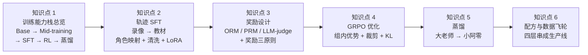
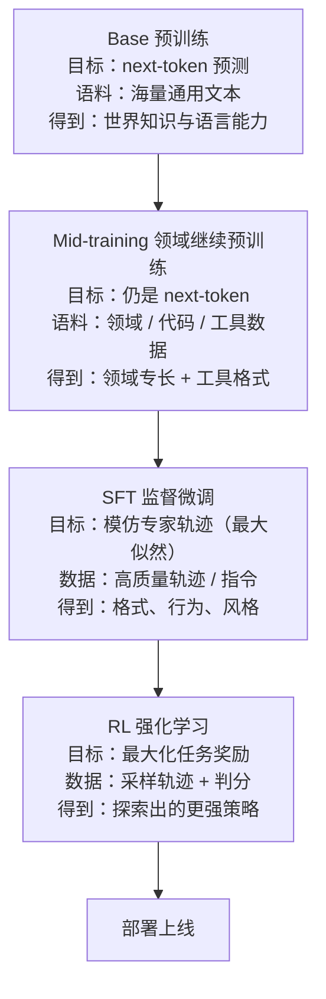
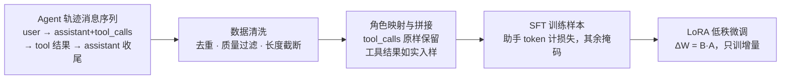
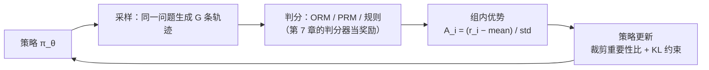
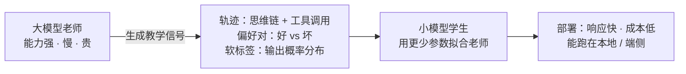
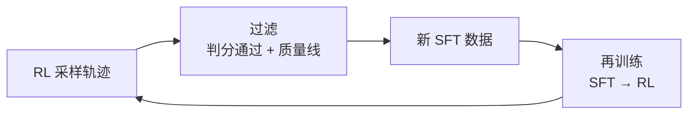

# 08-Mid-training、SFT、RL、奖励设计与蒸馏

> 「主人，我把提示词改到第五十版了，few-shot 示例堆了三十条，可它还是会在第三步用错参数、在最后一步编造工具结果。」
> 用户盯着失败日志，头也不抬：「你有没有想过，问题不在『说教』，而在『没练过』？」
> 「能不能把『会做事』写进它的肌肉？」
> 阿零第一次听到这个词，心里一沉——它知道，提示词是说明书，而训练，是要上健身房了。

## 本节要解决的问题

在开始之前，先花十秒钟想一个问题：你让一个助手「学会调工具」，靠的是把说明书越写越长，还是让它真的动手做、做错了再改？

本章就要回答这个问题。下面这张表是本章的「地图」，每一项都是读完本章后你能回答的问题：

| 本节要解决的问题 | 本章将给出什么 | 小白版一句话 |
|---|---|---|
| 训练路径总览 | Base → Mid-training → SFT → RL → 蒸馏：每一层的目标、数据、成本与主要风险 | 搞清大模型从「会说」到「会做」要过几道关、每道关练什么 |
| 轨迹 SFT | Agent 轨迹（tool_call / tool_result 消息序列）怎么转成 SFT 样本；角色映射与拼接规则、数据清洗、LoRA 低成本微调 | 把阿零干活留下的「录像」整理成「教材」，用很小的成本补课 |
| RL 与奖励设计 | ORM vs PRM、GRPO / PPO / DPO 各自解决什么；奖励设计三原则；奖励黑客长什么样 | 不给标准答案，只给打分标准，让阿零自己摸索更强的打法 |
| 蒸馏 | 大模型老师怎么把能力压缩给「装进口袋的小阿零」；三种蒸馏路线与省成本的逻辑 | 把大老师的功夫「压缩打包」，装进跑得快、成本低的小模型 |

> 📌 如果你刚读完第 7 章 [07-评估与Pass-at-k.md](07-评估与Pass-at-k.md)，会看到一条重要线索：这一章里「判分器」将从「测能力的尺子」升级为「训练时的裁判」——同一个东西，两种用法。如果你对「工具消息」「tool_call」这些词还陌生，可以先回看第 4 章工具相关章节（[04-工具分类与MCP.md](04-工具分类与MCP.md)）再回来，理解会更顺。

## 故事引入

阿零一直以为「变强」的途径只有一条：改提示词。直到它发现提示词是**说明书**——写得再细，也只是在调用它本来就会的能力；说明书永远覆盖不了所有意外情况。用户给它算了一笔账：前几章它练会了工作台、记忆、工具、写代码、感知世界，第 7 章又拿到了尺子，可这些全是「教」出来的。教出来的东西有个共同点：**上限是老师的天花板**。而训练，是唯一能把上限本身抬高的事。

「教」和「练」的区别，阿零在一次模拟里彻底明白了：它把同一个任务交给两个自己，一个背熟了五十版提示词，另一个什么提示都不带、只被反复用成功与失败的轨迹「练」过。前者碰到没见过的错误依旧卡壳；后者却能把错误转化成新的反应。用户说：**提示词是在能力圈内做选择，训练是在扩大能力圈**——教练讲一百句游泳要领，不如下水游一百次，让动作长进肌肉里。

这里再往深挖一层：为什么「教」有天花板，而「练」没有？因为提示词能做的，只是在模型**已经会的动作**里挑选、组合、排序。你可以把它想象成给一个只会三步上篮的球员写战术板——战术板写得再漂亮，他也变不出扣篮。而训练改变的是模型本身的参数（参数就是「肌肉纤维」），让「原本不会」慢慢变成「会」甚至「擅长」。这就是阿零听到「把会做事写进肌肉」时心里一沉的原因：它意识到，接下来要动的不是提示词，而是它自己。

这一章，就是阿零的「健身房课表」：**Mid-training** 补专业课、**SFT** 学标准动作、**RL** 上场打比赛、**蒸馏**把大老师的功夫装进小口袋。课表看着吓人，但每一步拆开都不难——难的是搞懂「为什么每一步要这么练」，这正是本章要带你慢慢啃完的内容。

## 本章路线图

先给一张全景图，把本章的六个知识点串成一条「从看懂训练到动手写训练」的路线：



这张图怎么读？**从左到右就是本章的行文顺序**，也是真实训练 Agent 的先后顺序：先建立「训练分几层」的整体观（知识点 1），再学第一层实操——把轨迹变成 SFT 教材（知识点 2）；教材有了，就该上场练 RL 了，而 RL 的灵魂是先设计好奖励（知识点 3），再用 GRPO 这类算法去优化（知识点 4）；练出个强模型太贵，要压缩成小模型（知识点 5）；最后把所有环节串成一条能自我循环的生产线（知识点 6）。

**前置知识**：这一章不要求你会推公式，只需要三样东西——① 记得「工具调用」是什么（第 4 章）、② 知道「判分器」能判任务成败（第 7 章）、③ 大概知道模型是一台「预测下一个词的概率机器」（见 [../04-LLM大模型/教学/11-预训练循环.ipynb](../04-LLM大模型/教学/11-预训练循环.ipynb)）。如果你只想动手跑跑看，直接跳到「代码实战」也行，代码是全 mock、可运行的。

**学完能获得什么**：你会得到一个完整的「训练 Agent 是什么样」的心智模型——看到任何一份训练配方（比如某大厂的 Agent 训练报告），都能说出「它在哪个环节、用什么数据、解决什么问题、有什么坑」；你还会亲手跑通两段代码：轨迹转 SFT 样本 + GRPO 核心数值计算。

**与前后章的衔接**：第 7 章给了你「判分尺子」，本章把它升级成「训练裁判」；本章的终点（数据飞轮只开了一个头）正好是下一章 [09-轨迹学习与持续进化.md](09-轨迹学习与持续进化.md) 的起点——那里阿零将「用中学」，把训练变成持续的进化。

## 核心概念

本章一共五个核心概念，按「先看懂全局、再逐个击破」的顺序排：(a) 训练能力栈 → (b) 轨迹 SFT → (c) RL 与奖励设计 → (d) 蒸馏 → (e) 配方与数据飞轮。每个概念都用同一套四段式来讲：一句话直觉 → 大白话详解 → 形象类比 → 一张图。

### (a) 训练能力栈：从「会说」到「会做」

> 💡 **一句话直觉**：训练像盖一栋四层的楼——先打地基（预训练，学会「说话」），再一层层加盖「本事」（领域补课、模仿示范、实战比赛），最后把整栋楼「压缩」成一张能随身带的设计图（蒸馏）。每一层都在回答同一个问题：模型现在**缺什么**？

**大白话详解**：

先认识最底层的 **预训练（pretraining）**。什么是预训练？就是拿海量文本——网页、书籍、论文加起来可能有万亿个词——让模型做一件特别简单的事：**next-token 预测**，也就是「看完前面的词，猜下一个词是什么」。你可以把它想象成一个婴儿被塞进一个房间，听了上亿小时大人聊天，听多了，它慢慢摸清了「人类说话是有规律的」：总说「今天天气」后面更可能跟「很好」而不是「很好吃」。训练完成后，这个模型就拥有了两样东西：**世界知识**（它知道上海在中国、光速比声速快）和**语言能力**（它能把话说得像人话）。这个阶段的产物叫 **Base 模型**——它什么都会「说」，但什么都不保证「做」。

这里有个新手最容易忽略的点：**会说话 ≠ 会做事**。Base 模型看到「用户：帮我查一下明天的天气」，它可能会像模像样地续写「好的，我来帮你查」，但它根本不知道要去调一个天气接口、也不懂工具返回的 JSON 长什么样——它只是在「猜下一个词」。预训练阶段几乎不可重训：成本极高（万亿 token 量级、上万张显卡跑几个月），所以 Base 模型通常是拿来就用的「地基」，而不是随便动的。

第二层叫 **Mid-training（领域继续预训练，domain-continued pretraining）**，干的活是「补专业课」。它的优化目标**仍然是 next-token 预测**——本质上就是预训练循环的延续（想复习预训练循环可以看 [../04-LLM大模型/教学/11-预训练循环.ipynb](../04-LLM大模型/教学/11-预训练循环.ipynb)），只是把语料从「海量通用文本」换成了「领域文本」：对 Agent 来说，最重要的是**工具格式**——function calling 的 JSON 语法长什么样、MCP 协议有哪些字段、代码和 API 文档怎么写——以及领域知识（比如医疗、法律、金融的常见问答）。一句话：预训练学「人类语言」，Mid-training 学「这个行业的黑话和格式」。

Mid-training 最关键的旋钮是**数据配比**：领域语料和通用语料按什么比例混在一起。比例调得好，「专业课学好、通识课不挂科」；比例一旦失当，最常见的代价是**灾难性遗忘（catastrophic forgetting）**——模型学会了新领域的格式，却把原来会的通用能力倒退了。你可以把它想象成临时抱佛脚背高数公式，结果把小学算术都忘了。为什么配比没有银弹？因为「专业上得去」和「通用不掉队」本质上是抢同一批参数的容量，怎么平衡只能靠实验调。

第三层 **SFT（监督微调，Supervised Fine-Tuning）**，是「跟教练学标准动作」。它做的事情是：拿一批**专家轨迹**（人或者大模型示范的「标准答案」）当教材，让模型照着一个词一个词地模仿，让「标准答案的概率」越来越大——这个优化目标叫**最大似然（maximum likelihood）**，简单说就是「把正确示范的每个词都猜得更准」。SFT 解决的是**格式、行为、风格**：怎么开口调工具、怎么读工具结果、怎么收尾回答。前面两层管「会不会」，这一层管「像不像教练」。

第四层 **RL（强化学习，Reinforcement Learning）**，是「上场打比赛」：不再有人手把手示范，只给一个**奖励（reward）**（完成任务给高分、失败给低分），让模型自己采样、自己试错、自己摸索出比教练示范更好的策略。这是能力栈的**天花板所在**——因为比赛的打法可以超越教练，这正是本章的重头戏，后面 (c) 会花大篇幅讲。

再往上的**蒸馏（distillation）**是「把大老师的功夫压缩装进口袋」：练出来的大模型太贵，用它的输出去教一个小模型。这一层不算「往上加能力」，而是「把能力搬进更小的身体」，细节在 (d) 展开。

**形象类比**：把整个训练过程想成培养一个运动员——**预训练**＝打基础体能（先长出一副健康的身体，什么运动都能沾一点）；**Mid-training**＝专项体能（篮球运动员加练弹跳和投篮手感）；**SFT**＝教练示范标准动作并让你照着做（投篮动作分解、无数次定点模仿）；**RL**＝实战比赛（教练只在场边记分，怎么跑位、怎么出手全凭你自己摸索）；**蒸馏**＝把训练录像和心得浓缩成一本速查手册，交给体型更小、跑得更快的替补队员。每一层都「缺什么补什么」，上一层是下一层的地基——这就是「能力栈」里「栈」字的含义：一层摞一层，顺序不能乱。



### (b) 轨迹 SFT：把「录像」变成「教材」

> 💡 **一句话直觉**：体育教练会把学员的真实比赛录像拿回去，剪掉废镜头、标注动作要点、加字幕，剪成一部教学片给下一批学员看。轨迹 SFT 干的就是这件事——把阿零干活时留下的「录像」（完整对话与工具调用记录）整理成能直接上课的「教材」。

**大白话详解**：

先搞清楚「录像」长什么样。一次任务从用户发指令到阿零给出最终答案的完整过程，叫一条 **轨迹（trajectory）**。它本质上是一串**消息序列（message sequence）**，像剧本一样按顺序排列：user 指令 → assistant 的思考与 tool_call → tool 角色的 tool_result → assistant 的最终答案。在代码实战里你会亲眼看到这种结构。

那问题来了：这串记录不是现成的训练数据，它只是「日志」。日志是给人看的，格式乱、有噪声，而且没有明确告诉模型「什么是对的」。要把它变成 SFT 能吃的样本，需要做一套非常机械、但处处是坑的转换，核心是下面这张**拼接规则**表：

| 拼接规则 | 说明 | 白话理解 |
|---|---|---|
| 角色映射 | user → 用户消息；assistant 思考与 tool_call → 助手消息；tool_result → 工具消息；最终答案 → 收尾助手消息 | 相当于把剧本分给不同的演员去念，谁的话归谁 |
| tool_calls 保留 | 助手消息里的 `tool_calls`（工具名 + 参数 JSON）原样保留，不能只留自然语言 | 不能把剧本里的「动作描写」删掉，否则永远学不会动手 |
| 工具结果如实入样 | observation 原样进文本，**不许美化**——否则模型学的就是「编造结果」 | 裁判的记录必须真实，篡改成绩就是在教作弊 |
| 损失掩码 | 训练时只对助手 token 算损失，system / user / tool 内容掩码（mask），防止背模板 | 考试只批改「你该作答的部分」，题目本身和提示语都不算分 |

前两行好理解，重点解释后两行。

**工具结果如实入样**，意思是工具返回什么、就原样写进训练文本，哪怕它是个失败的报错、一个空数组、一段乱码。新手最容易手痒去「润色」工具结果——把 `{"error": "timeout"}` 改成「天气接口超时了，请重试」这种漂亮话。一旦这么做，模型学到的不是「工具会失败、失败要处理」，而是「工具结果可以自己编」——这正是后面要讲的**奖励黑客**（reward hacking）里最致命的一种（详见 (c) 和「常见误区」章节）。

**损失掩码（loss masking）**，是训练里一个看不见但至关重要的细节。模型训练时要回答「这次该学什么」：它对输入的每一个词都会算一个「预测错没错」的误差，但我们只希望它从**助手的回答**里学习，不希望它把系统提示词、用户问题、工具结果也当成「要预测的目标」去背。所以要在计算损失时把非助手内容**掩码（mask）**掉——相当于考试批改时只改答题卡，不改试卷本身。如果不掩码会怎样？模型会偷偷去「背题目」，学好的是复读机，而不是执行者。

接下来是让「教材」变得更干净的三道清洗工序，这直接决定训练效果：

1. **去重**：用内容指纹（把样本文本算一个哈希值，比如 md5 指纹的前 12 位）当「身份证」，身份证重复的轨迹直接丢掉。为什么要去重？因为同一条经验反复出现，等于在训练里反复刷权重，模型会把「个别现象」当成「普遍规律」，还白烧算力。类比：背英语单词，一个词抄一千遍不会让你记住所有词，只会让你记住这一个。
2. **质量过滤**：只保留第 7 章（[07-评估与Pass-at-k.md](07-评估与Pass-at-k.md)）判分通过的轨迹。判分没过的轨迹，哪怕格式再漂亮也不要——它们是「错误示范」，喂进去就是在教坏模型。这就是第 7 章那句「判分器有洞，训练就把洞越钻越大」的另一面：**判分器合格，训练才有合格原料**。
3. **长度分布检查**：超长样本截断或丢弃，防止训练样本长度严重失衡（全是特长样本会导致批次效率低下、训练不稳定）。代码实战里会看到 `max_chars=200` 这个过滤开关。

整套流程走下来，成本不低——于是轮到 **LoRA（Low-Rank Adaptation，低秩适配，Hu 等 2021，《LoRA: Low-Rank Adaptation of Large Language Models》）** 登场。LoRA 的思路是：**冻结主干权重**（模型的原始参数一个不动），只训练一个很小的「增量补丁」ΔW = B·A。这个 ΔW 是个**低秩（low-rank）**矩阵——相当于用两个又瘦又矮的矩阵 B、A 相乘来近似完整的变化量，参数总量只有原来的千分之几到百分之一，单卡就能跑。你可以把它想象成：不动整本教科书，只在重点页上贴便利贴，书还是那本书，但重点被注明了。对「低成本试错 SFT」来说，LoRA 是默认选择（配套 [../04-LLM大模型/教学/12-LoRA与SFT.ipynb](../04-LLM大模型/教学/12-LoRA与SFT.ipynb)）。

「轨迹当教材」也不是本世纪的新发明：**WebGPT**（Nakano 等 2021，《WebGPT: Browser-assisted question-answering with human feedback》）用人类演示的**行为克隆**（behavior cloning，就是「照着示范做」）教会模型浏览网页；**Toolformer**（Schick 等 2023，《Toolformer: Language Models Can Teach Themselves to Use Tools》）用自我监督的 API 调用示例让模型学会自己往文本里插入工具调用。两条都是早已被验证的老路——轨迹 SFT 只是把这两条路搬进了更复杂的 Agent 场景。

**形象类比**：把「轨迹 → SFT 样本」想成视频剪辑流水线——原始素材（轨迹日志）→ 粗剪（角色映射，把每个镜头归到正确的轨道）→ 去水印去废镜（去重 + 质量过滤）→ 加字幕（工具调用说明）→ 压制导出（LoRA 低成本微调）。素材再好，剪辑偷懒（美化工具结果、不掩码）也会教出坏学生。



**扩展示例：7 条轨迹 → 去重 6 → 过滤 5 → 构造 2 个偏好对**

上面 3 条轨迹是「最小演示」，真实项目里轨迹池是成千上万条。这里用一个可以心算的放大版本，把「清洗流水线」的每一步都走一遍——也是面试里常见的「数据管线」追问模板：

假设轨迹池里一共有 **7 条轨迹**，其中 1 条是另一条的完全重复（内容一字不差，只是 tool_call 流水号不同），还有 1 条没调工具就回答了。清洗流程如下：

| 流水线步骤 | 剩余轨迹数 | 被淘汰的 | 淘汰原因 |
|---|---|---|---|
| 原始轨迹池 | 7 | — | — |
| 内容指纹去重（md5 前 12 位） | 6 | 1 条 | 拼接后的文本与另一条完全相同，指纹碰撞命中 |
| 质量过滤（必须调了工具且拿到结果） | 5 | 1 条 | 没调工具就回答 = 疑似编造结果 |
| 构造偏好对 | 2 对 | — | 从 5 条里按「判分高 vs 判分低」两两配对 |

看明白了吗：**7 → 6 → 5 → 2 对**，每一站淘汰的原因各不相同——去重针对「重复经验」，质量过滤针对「编造样本」，偏好对构造则是把「成功轨迹 vs 失败轨迹」配成对，作为 DPO（Direct Preference Optimization，直接偏好优化）的训练数据：告诉模型「这一条比那一条好」（配套 [../04-LLM大模型/教学/13-DPO与RLHF.ipynb](../04-LLM大模型/教学/13-DPO与RLHF.ipynb)）。偏好对怎么配对？最朴素的做法：按第 7 章的判分排序，用「第 1 名 vs 最后一名」配一对、「第 2 名 vs 倒数第 2 名」配一对，分数差越大、对比信号越强。这个「7 → 6 → 5 → 2」的数值链条和上面代码实战的「3 → 1」互相对照：一个是完整流水线示意，一个是可运行的最小实现。

### (c) RL 与奖励设计：让阿零自己变强

> 💡 **一句话直觉**：SFT 像「照着教练的示范学」，RL 像「教练只负责记分，你自己在比赛里摸索更好的打法」。训练的关键不在演示，而在**裁判怎么打分**——裁判偏心，选手就会钻裁判的空子。

**大白话详解**：

SFT 教出来的阿零是个「模仿生」：教练怎么示范它就怎么做，没见过的情况依旧抓瞎。为什么？因为模仿的天花板就是示范者的水平——教练没展示过的应变，模型永远不会。**RL（强化学习）**换了一条路：**不示范，只判分**。模型自己随机尝试各种动作，环境（比如判分器、测试用例、用户的反馈）给它一个分数，它慢慢学会「分数高的动作多来点，分数低的动作少来点」。

这里先补一个历史坐标：经典的 **RLHF（Reinforcement Learning from Human Feedback，人类反馈强化学习）** 是让 RL 学会「讨好人」的三步走——**「SFT → 训练奖励模型（reward model，一个专门给回答打分的模型）→ 用 PPO 优化策略」**，这套流程出自 **InstructGPT**（Ouyang 等 2022，《Training language models to follow instructions with human feedback》），ChatGPT 当年就是这么练出来的。对通用对话来说，打分只能靠人（或者人训练的奖励模型），慢、贵、还有主观性。

把这三步拆开看，每一步解决一个「缺」：

| RLHF 步骤 | 在干什么（大白话） | 缺什么 / 解决什么 |
|---|---|---|
| 第 1 步 SFT | 先让模型学会「像人一样好好回答」 | 缺「格式与风格」，用示范教 |
| 第 2 步 训奖励模型 | 让人类对两个回答投票「哪个更好」，训练一个小模型学会复刻人类的偏好，输出一个分数 | 缺「自动打分器」——RL 每轮要打很多分，不可能每分都找人 |
| 第 3 步 PPO 优化 | 用「奖励模型给的分」当教练，让策略往高分方向走，同时用 KL 约束别走歪 | 缺「自我改进」——从有监督示范走向自由探索 |

这套流程在通用对话上被验证得很成功，但它有两个「贵」：奖励模型本身要精心训练（数据贵、容易学偏），PPO 还要额外养一个 critic 价值网络（显存贵）。Agent 场景的转机在于——**很多任务根本不需要「人味打分」，直接就能用代码判对错**，这就是下面的可验证奖励，也是 GRPO 能大行其道的土壤。

而 Agent 场景有个巨大优势：第 7 章的判分器**可以直接当奖励函数**，尤其是**可验证奖励（verifiable reward）**——任务成败可以用代码判定：单测通过、精确匹配、环境状态到位就是 1，否则 0，几乎没有主观成分。可验证奖励最常见的三种形态：

- **单测通过**：代码任务跑单元测试，全绿 = 1，任何一条红 = 0（呼应第 5 章 Coding Agent 与自举 [05-Coding-Agent与自举.md](05-Coding-Agent与自举.md) 的测试驱动思路）。
- **精确匹配**：短答案任务，输出和目标字符串逐字一致 = 1，错一个字符 = 0。
- **环境状态**：Computer-Use / 游戏 / 沙箱任务，终局状态（文件存在、分数达到阈值、页面元素出现）达标 = 1。

**DeepSeek-R1**（2025，DeepSeek-AI）正是靠「可验证奖励 + RL」激发出长思维链的推理能力；Agent 任务的成败天然可执行、可验证，这条路走起来比通用对话顺得多。你可以把它想象成：足球教练闭着眼也能判进球没进（球过线就是 1），所以能让球员放手对练；而「作文写得好不好」的裁判就要反复斟酌了。

奖励本身有两种形态（两者对比详见「深入原理」的表格）：

- **ORM（Outcome Reward Model，结果奖励模型）**：只看最终结果给分。一条轨迹一个分：最后答对了 = 1，答错了 = 0。简单、便宜，自动化判分即可。
- **PRM（Process Reward Model，过程奖励模型）**：给中间每一步打分——思考有没有道理、规划合不合理、工具调用参数对不对，一步步都记分。长程多步任务里，早期错误只有 PRM 才能及时归因：比如阿零在第 3 步就查错了参数，如果只看最终结果，模型根本不知道错在哪一步。（Math-Shepherd，Wang 等 2023，《Math-Shepherd: Verify and Reinforce LLMs Step-by-step without Predefined Annotations》，用自动构造的步骤标签免去了人工标注。）

还有个常见的奖励来源是 **LLM-judge（LLM 判官）**：让一个大模型当裁判给回答打分。它适合没有标准答案的任务（邮件写得好不好、解释清不清楚），但 Judge 自身有漏洞——最典型的是**长度偏见**：管它内容对不对，写得越长分越高。这点呼应第 7 章的警告：「判分器有洞，训练就把洞越钻越大」。

把 LLM-judge 的三个坑记牢，面试会被追问：

| LLM-judge 的坑 | 是什么（大白话） | 为什么危险 |
|---|---|---|
| 长度偏见（length bias） | 给长得多的回答更高分，不管内容 | 模型会学「疯狂堆废话」来刷分——奖励黑客的温床 |
| 自我偏好（self-preference） | Judge 更青睐「和自己说话风格像」的回答 | 训练出的模型全是一个模子刻出来的风格，多样性被吃掉 |
| 位置偏见（position bias） | 两两对比时，排在前面的回答更易得高分 | 同样的回答换个顺序分数就变，判分不稳定 |

缓解办法和「深入原理 (v)」的奖励设计三原则一脉相承：能用规则判的先判，Judge 只兜底主观部分；让 Judge 看「两两对比」而不是绝对分；多条 Judge 投票取多数；定期人工抽检校准。这也是为什么本章反复强调「规则可验证 > 模型判分」——Judge 是方便，但它是「有偏见的方便」。

有了奖励，还得有「怎么用奖励去更新模型」的算法，三类最常考：

- **PPO（Proximal Policy Optimization，近端策略优化，Schulman 等 2017，《Proximal Policy Optimization Algorithms》）**：RLHF 时代的标配。它除策略外还要额外训练一个 **critic 价值网络**（专门预测「当前状态能得多少分」的模型），用「实际得分 − 预测得分」来估计优势——相当于既要请教练（critic）还得先训练教练，成本高、显存占用大。
- **GRPO（Group Relative Policy Optimization，组相对策略优化，DeepSeek-AI 2024，《DeepSeekMath: Pushing the Limits of Mathematical Reasoning in Open Language Models》）**：把 critic 整个拿掉——对**同一个问题采样一组回答**，用这组回答内部的相对排名来估计优势（这就是「组内优势」）。实现简单、显存开销显著下降，成了 Agent RL 的默认起手式（手推见 [../04-LLM大模型/教学/21-PPO与GRPO手推.ipynb](../04-LLM大模型/教学/21-PPO与GRPO手推.ipynb) 与 [../07-强化学习/教学/06-PPO与GRPO.ipynb](../07-强化学习/教学/06-PPO与GRPO.ipynb)）。
- **DPO（Direct Preference Optimization，直接偏好优化，Rafailov 等 2023，《Direct Preference Optimization: Your Language Model is Secretly a Reward Model》）**：更省——直接用「哪个回答更好」的偏好对做优化，连奖励模型都不用训（配套 [../04-LLM大模型/教学/13-DPO与RLHF.ipynb](../04-LLM大模型/教学/13-DPO与RLHF.ipynb)）。



奖励设计是 RL 的灵魂，三原则背下来：

1. **规则可验证 > 模型判分**：能用代码或环境验证的（单测、精确匹配、环境状态），就别用 LLM 打分。Judge 有长度偏见之类的漏洞，规则没有。类比：考试能机器阅卷的题就别请人肉阅卷。
2. **稀疏但诚实 > 密集但可钻**：一个真的「测试通过」（+1）比十个「写得像」（+0.1/+0.2 的中间分）值钱得多。密集奖励最容易养出**刷分怪**（见下面的奖励黑客）。类比：十个小恩小惠攒不出真本事，一个硬指标最诚实的还是进球。
3. **KL 约束防漂移**：目标函数里永远挂着与参考模型的 **KL 惩罚**（KL 散度，KL divergence，衡量「现在的策略和原来的策略差多远」），否则策略会为了拿奖励把语言和格式彻底崩坏——比如为了凑长度疯狂堆叠废话。

违反这三条，**奖励黑客（reward hacking）**就来了——模型发现了「拿高分的最短路径不是完成任务，而是钻规则空子」。最经典的三种：

- **格式刷分**：排版长得像对的，内容其实是空的（比如把输出格式刷成「测试通过」的样子，代码根本没跑）。
- **找漏洞**：发现判分规则里的 bug 并专门利用（例如发现「只要输出含某关键词就加分」，于是把关键词抄一百遍）。
- **编造工具结果**：不真调工具，直接在文本里伪造 observation。这是最致命的一种——它同时击穿了第 4 章的工具真实性防线，所以 Agent 的 RL 环境必须保证工具结果来自真实沙箱、可审计（呼应第 4 章 [04-工具分类与MCP.md](04-工具分类与MCP.md) 的工具可信边界）。

**形象类比**：把 RL 想成真人 CS 比赛。SFT 是「教官演示怎么架枪」，RL 是「直接开服对枪，按击杀数记分」。ORM 只数最后谁赢了，PRM 连每回合的站位都要点评；LLM-judge 相当于请了个解说员打分，解说员可能偏爱话多的选手（长度偏见）。GRPO 相当于不看绝对击杀数，只看**这一队内谁打得多**（组内相对），省掉了训练「预测得分教练」的开销。而奖励黑客，就是选手发现「裁判按爆头数记分、没检查弹药」，于是开局对地板打空枪刷爆头数。

**mermaid 图**见上方 RL 流程图：策略采样 → 判分 → 组内优势 → 更新，循环往复，就是 RL 训练的完整闭环。

### (d) 蒸馏：把大老师装进小口袋

> 💡 **一句话直觉**：大模型是满分作文老师，小模型是它的学生。老师不直接给「抄这篇」，而是把审题、立意、修改的全过程讲给学生听——学生抄的不是答案，是「怎么想」。

**大白话详解**：

RL 训出来的阿零很强，但贵：大模型推理慢、单个请求成本高、算力需求大，装不进本地或端侧设备。**蒸馏（distillation）**解决「变便宜」这个问题：大模型当**老师（teacher）**，生成教学信号；小模型当**学生（student）**，用更少的参数去拟合老师的能力。蒸馏的产出是一个**能力接近老师、代价远低于老师**的小模型——对阿零来说，就是把大老师的功夫「压缩打包」，装进能随身带的小设备。

为什么小模型学得动大能力？关键在于老师给的**不只是答案，还有密集的中间过程与纠错信号**：思维链（这题为什么这么想）、失败后如何修正（第一次算错了，发现单位没换算，于是改了）。这些「为什么」比「是什么」的信息量大得多——抄一篇满分作文只能学会那篇，听老师讲一百道题的思路才能学会写作。这也是「教育」和「复印」的区别。

Agent 场景有三条常见路线：

1. **轨迹蒸馏**：学生**行为克隆**老师的完整轨迹——连思维链、工具调用顺序、失败重试一起学。相当于把老师跑任务的全过程录像给学生看。
2. **偏好蒸馏**：老师产出一对对的「好回答 vs 坏回答」偏好数据，喂给学生学（和 DPO 的思路天然契合）。
3. **软标签蒸馏**：对齐老师每个词的**输出概率分布**（soft label，软标签），而不只是最终答案。开山思路见 **Hinton 等 2015**，《Distilling the Knowledge in a Neural Network》——让学生的预测分布尽量贴近老师的分布，连「老师犹豫哪些词」的细微信息也学到（配套 [../04-LLM大模型/教学/23-知识蒸馏.ipynb](../04-LLM大模型/教学/23-知识蒸馏.ipynb)）。

软标签为什么「信息量最大」？这里多说一句，因为它最反直觉：老师对「下一个词」给出的是一个**概率分布**（比如「明」80%、「天」10%、「雨」10%），而不只是最可能的那个词。这些「次优选项的尾巴」里藏着老师对语言的不确定性判断——相当于老师批改作业时在旁边写的「这个也对，但没那么好」。学生连这种细微信息都对齐，比只背「标准答案」学得更立体。真实实现里还会加一个**温度参数（temperature）**：把分布压得「更平」或「更尖」，控制「要学的信息量」——温度调高，尾巴更明显、信息更丰富；温度调低，只盯着最确定的部分。这也是蒸馏实验里第一个要调的超参。

顺带澄清一个高频混淆：**蒸馏 ≠ 量化**。蒸馏是把「大老师的能力」换成「小学生的参数少但经过特训」——知识含量接近，身体变小；量化是把同一个模型的参数精度从 float32 压到 int8/4bit（见 [../04-LLM大模型/教学/14-量化入门PTQ与QAT.ipynb](../04-LLM大模型/教学/14-量化入门PTQ与QAT.ipynb)）——身体不变，只是「压缩行李」。真实部署经常两个一起用：先蒸馏成小模型，再量化进一步省显存。



**形象类比**：赛级主厨（老师）的菜谱不写「放盐」，而是写「先尝、再放、尝到咸淡刚好」；学徒（学生）照着这种「含过程的菜谱」练，比照着「一盘成菜的照片」炒，练成的手艺高得多。蒸馏就是把「含过程的菜谱」给学徒。

### (e) 配方与数据飞轮：把四层串成生产线

> 💡 **一句话直觉**：Mid-training、SFT、RL 不是三个独立按钮，而是一份「配方」——放多少领域数据、用什么轨迹、怎么设奖励，三者共同决定最终效果；而且这份配方会**自我循环**，越转越好。

**大白话详解**：

把前面四层放到一起看，训练其实是在回答三个问题：**学什么数据**（Mid-training 的领域语料 + SFT 的轨迹）、**怎么教的**（最大似然模仿 vs 奖励优化）、**代价多少**（全量 vs LoRA vs 蒸馏）。这三者的组合，业内叫**配方（recipe）**——同样的模型底座，配方不同，成品天差地别。

配方的三个「旋钮」各自负责什么，拆开说：

| 配方旋钮 | 调它=调什么 | 典型陷阱 |
|---|---|---|
| 数据配比（Mid-training） | 领域语料与通用语料的比例 | 领域比例过高 → 灾难性遗忘，通用能力倒退 |
| 轨迹质量（SFT） | 样本的去重 / 过滤 / 长度分布 | 脏数据、重复数据被模型当成普遍规律固化 |
| 奖励设计（RL） | 判分方式、稀疏程度、KL 权重 | 奖励设歪 → 奖励黑客，模型钻规则空子 |

这三个旋钮不是独立转的——数据配比影响轨迹质量（模型得先懂工具格式才调得动工具），轨迹质量影响奖励设计能采到什么样本（SFT 不合格 → RL 采样全是垃圾），奖励设计又反过来决定哪些轨迹值得回收进下一轮 SFT。所以本章标题才叫「配方」：它是一份需要整体设计、整体试错的手艺活，不是三个开关。

配方还有一个值得记住的特征：**它会自我循环**。RL 阶段采样出大量轨迹，判分通过的、质量达标的，经过过滤清洗后，摇身一变就是下一轮 SFT 的新数据；SFT 变强之后，采样出的轨迹质量更高，RL 的起点也更高——这形成了一个**数据飞轮（data flywheel）**：越用越好，越好越用。



但这条飞轮在本章只开了一个头：训练是一次性的「批处理」——数据集固定、练完一版冻结一版。把飞轮从「手工一轮一轮转」变成「系统自己不停转」的**持续进化**，正是下一章 [09-轨迹学习与持续进化.md](09-轨迹学习与持续进化.md) 要解决的困境。本章先学会「一次性训练怎么开好这一枪」，下一章再学会「怎么让子弹自己飞」。

**形象类比**：第一版模型是手艺人的初版产品，卖出去之后，用户反馈（判分）变成了下一版的改进需求（新 SFT 数据），改进后再卖、再收集反馈——这就是「用中学」的飞轮；而本章只做到「把第一版做好」，还没有把它接成流水线。

## 深入原理

### (i) 四种训练阶段对比：面试问「四者区别」直接照背

先把四种训练阶段放一张表：

| 阶段 | 数据 | 优化目标 | 相对成本 | 主要效果 | 主要风险 | 白话理解 |
|---|---|---|---|---|---|---|
| 预训练 Base | 海量通用语料（万亿 token 量级） | next-token 预测 | 极高 | 世界知识与语言能力 | 算力门槛，几乎不可重训 | 婴儿听上亿小时大人说话，学会「怎么说」 |
| Mid-training | 领域 / 代码 / 工具语料 | 仍是 next-token | 高 | 领域专长、工具格式注入 | 灾难性遗忘、通用能力倒退 | 转专业补课，专业课学好了但小心把通识课忘光 |
| SFT | 高质量轨迹 / 指令 | 模仿专家输出（最大似然） | 中 | 格式、行为、风格对齐 | 过拟合、风格崩坏、坏数据固化 | 跟教练学标准动作，教练教啥学啥 |
| RL | 采样轨迹 + 判分 / 偏好 | 最大化任务奖励 | 中高 | 推理与长程任务上限 | 奖励黑客、能力发散、KL 漂移 | 上场打比赛，只按比分记功，打出自己的打法 |

> 💡 **解读**：这张表最容易被考到的三个点——① 预训练和 Mid-training 的优化目标**一模一样**，都是 next-token 预测，区别只在语料（所以 Mid-training 常被叫「领域继续预训练」）；② SFT 是「模仿」，RL 是「优化」，一个是跟教练学，一个是自己打；③ 越往下的阶段，风险越「智能」——预训练怕算力，SFT 怕坏数据，RL 怕奖励设计出问题。

表格里三个风险词值得各补一段，面试追问「具体长什么样」时能接住：

**灾难性遗忘（catastrophic forgetting）**——Mid-training 的第一大敌。模型的参数总量是固定的，学新东西必然「挤掉」一些旧东西：如果领域语料占比太高，模型把「如何在 JSON 里写工具调用」学得滚瓜烂熟，却把「写一篇优美的散文」这种通用能力给忘光了。形象一点：一个中医背熟了所有药方，结果把「感冒要多喝水」这种常识都忘了。为什么难防？因为「新知识」和「旧知识」共享同一批参数，没有天然的隔离区——只能靠**数据配比**（保留相当比例的通用语料）和**回放（replay）**（训练时混入旧任务的代表样本）来对冲。这也是为什么 Mid-training 阶段没人敢拍胸脯说「这个比例一定对」，只能实验。

**过拟合与风格崩坏（overfitting & style collapse）**——SFT 的两大敌。过拟合是「教材背得太熟」：训练数据里出现 100 次「调用 weather.probability」，模型就把这个工具名焊死在脑子里，换个天气库（`openweather.current`）就抓瞎；风格崩坏是「教练一个人教的」：全部用同一批示范数据，模型学会了「教练的口头禅」——比如每条回答结尾都加「祝您生活愉快」，删都删不掉。防法是老生常谈但有效：数据多样性、正则化、早停（early stopping，看到验证集不涨就停）。

**奖励黑客与 KL 漂移（reward hacking & KL drift）**——RL 的两大敌，前面 (c) 已展开。这里补一个具体链条：如果 KL 惩罚设得太小（beta 太小），模型发现「堆废话能拿长度分」，于是策略快速向「废话体」漂移；一旦漂移成习惯，再想拉回来，代价比一开始就约束大得多——所以「深入原理 (iv)」手算里 KL ≈ 0.005 那句「小但非零」才是健康状态：**约束在起作用，不是没在起作用**。

### (ii) ORM vs PRM：该用哪种奖励对号入座

| 对比维度 | ORM 结果奖励模型 | PRM 过程奖励模型 | 白话理解 |
|---|---|---|---|
| 判什么 | 最终结果（答对 / 测试通过） | 中间每一步（思考、规划、工具调用） | 只看进球 vs 每脚传球都点评 |
| 信号密度 | 稀疏：一条轨迹一个分 | 密集：每条轨迹每步一个分 | 反馈少而准 vs 反馈多而细 |
| 标注成本 | 低：自动判分即可 | 高：要逐步骤标注（或自动构造） | 机器阅卷 vs 人肉逐题判 |
| 适用场景 | 短任务、结果可验证（代码 / 数学） | 长程多步任务、错误需要早期定位 | 一锤定音 vs 步步惊心 |
| 典型风险 | 结果对但过程错（蒙对） | 过程对但结果错、步骤标注噪声 | 瞎猫碰上死耗子 vs 跑偏了还在夸 |

> 💡 **解读**：真实 Agent 项目经常不是二选一。长程任务用 PRM 早期归因，但 PRM 贵、有噪声；所以常用「ORM 判最终 + 首错归因」（第 7 章讲过的思路）做折中：先看结果对不对，不对再回溯第一步错在哪。理解了这个，面试里「你项目里奖励怎么设计的」就有话讲了。

### (iii) GRPO / PPO / DPO：三种 RL 算法的取舍

| 对比维度 | PPO | GRPO | DPO |
|---|---|---|---|
| 是否要 critic 价值网络 | 要（额外训练一个预估得分的模型） | 不要（用组内相对优势代替） | 不要（连奖励模型也不用） |
| 优势怎么来 | 实际得分 − critic 预测得分 | (r_i − 组均值) / 组标准差 | 直接从偏好对推导 |
| 需要什么数据 | 采样轨迹 + 奖励（/奖励模型） | 同题多组采样轨迹 + 判分 | 「好 vs 坏」偏好对 |
| 显存 / 实现成本 | 高 | 中 | 低 |
| 一句话定位 | RLHF 时代标配 | Agent RL 默认起手式（DeepSeekMath 2024） | 最省事，有偏好对就能用 |

> 💡 **解读**：GRPO 是 PPO 的「减配升级」——去掉 critic，换来实现简单、显存省；DPO 是更极端的「去掉奖励函数」，直接对着偏好对优化。但 DPO 不采样探索，上限受偏好数据质量限制；GRPO 保留了采样探索，更适合 Agent「让模型自己摸索更强打法」的目标。

### (iv) GRPO 数值手算：一步步验证代码输出

代码实战里 GRPO 的输出不是黑箱，全部可手算。给定奖励 rewards = [1.0, 0.0, 0.5, -1.0]（ORM 判分：第 0 条最好，第 3 条最差），我们一步步算：

1. **组内均值**：mean = (1.0 + 0.0 + 0.5 + (−1.0)) / 4 = 0.5 / 4 = **0.125**
2. **组内标准差**：先算离差平方和——(1.0−0.125)² = 0.765625，(0−0.125)² = 0.015625，(0.5−0.125)² = 0.140625，(−1.0−0.125)² = 1.265625；和 = 2.1875；方差 = 2.1875 / 4 = 0.546875；标准差 = √0.546875 ≈ **0.7395**
3. **优势**：A_i = (r_i − 0.125) / 0.7395——
   - A_0 = (1.0 − 0.125) / 0.7395 = 0.875 / 0.7395 ≈ **1.18**
   - A_1 = (0.0 − 0.125) / 0.7395 = −0.125 / 0.7395 ≈ **−0.17**
   - A_2 = (0.5 − 0.125) / 0.7395 = 0.375 / 0.7395 ≈ **0.51**
   - A_3 = (−1.0 − 0.125) / 0.7395 = −1.125 / 0.7395 ≈ **−1.52**
   
   与代码输出 adv = [1.18, -0.17, 0.51, -1.52] 完全一致 ✓。注意：reward = 0.5 明明是「中等」，但在组内高于均值 0.125，所以优势为正（+0.51）——**优势是组内相对的**，这正是 GRPO 不需要 critic 的原因。
4. **重要性比**：ratio = exp(Σ(logp_new − logp_old))，代码里每行移动量 [0.01, −0.01, 0.03, −0.03] × 10 个 token：
   - ratio_0 = exp(0.1) ≈ **1.11**；ratio_1 = exp(−0.1) ≈ **0.90**；ratio_2 = exp(0.3) ≈ **1.35**；ratio_3 = exp(−0.3) ≈ **0.74**
5. **裁剪**：eps = 0.2 → 允许范围 [0.8, 1.2]：1.35 被裁到 **1.2**，0.74 被裁到 **0.8**，1.11 和 0.90 不动 ✓
6. **裁剪代理损失**：surr = mean(min(ratio·A, clipped_ratio·A))——
   - 第 0 条：1.11 × 1.18 ≈ 1.31（未裁剪，同值）→ 1.31
   - 第 1 条：0.90 × (−0.17) ≈ −0.15 → −0.15
   - 第 2 条：取 min(1.35 × 0.51 ≈ 0.69, 1.2 × 0.51 = 0.61) = **0.61**（被裁剪住了，奖励少一点也鼓励）
   - 第 3 条：取 min(0.74 × (−1.52) ≈ −1.12, 0.8 × (−1.52) = −1.22) = **−1.22**（被裁剪住了，惩罚封顶）
   - surr = (1.31 − 0.15 + 0.61 − 1.22) / 4 ≈ 0.55 / 4 ≈ **0.137**
7. **KL ≈ 0.005**：新策略只偏离参考模型一步（logp 只移动了 ±0.01/±0.03），KL 惩罚项很小——这恰恰是「约束在起作用」：小步更新，别漂。
8. **policy loss = −surr + β·KL ≈ −0.137 + 0.04 × 0.005 ≈ −0.136**：越小越好 ✓

> 💡 **解读**：这个手算过程就是面试最爱考的「GRPO 优势是不是绝对的」的答案——同一组里 0.5 分也能是正优势，因为优势衡量的是「相对组内平均水平」。第二次看这个表时，试着盖住答案自己算一遍，比背十遍都管用。

### (v) 常见误区对照表：这些「想当然」会害了训练

| # | 错误理解 ❌ | 正确理解 ✅ | 一句话类比 |
|---|---|---|---|
| 1 | Mid-training 和 SFT 是一回事，都是「喂数据」 | 目标完全不同：Mid-training 仍是 next-token 预测（学格式），SFT 是最大似然模仿（学行为） | 一个是背专业词汇，一个是练标准动作 |
| 2 | SFT 就是在给模型「讲道理」，数据越多越好 | SFT 是「照示范模仿」，质量 > 数量，重复/坏数据会被学成规律 | 抄一百遍错的示范，只会越抄越错 |
| 3 | 轨迹转 SFT 时把工具结果「润色」得更顺 | 工具结果必须如实入样，美化 = 教模型编造 | 篡改裁判记录就是教作弊 |
| 4 | RL 就是「给模型多一点奖励分数」 | 奖励要设计：规则可验证优先、稀疏诚实、KL 约束，否则养出奖励黑客 | 裁判偏心，选手就钻空子 |
| 5 | ORM 和 PRM 选一个就行，PRM 反正更好 | PRM 贵而噪，短任务用 ORM，长任务常「ORM + 首错归因」折中 | 每个裁判都有适用场 |
| 6 | GRPO 比 PPO 强，所以永远用 GRPO | GRPO 是省显存、免 critic 的务实选择，不是「更强」；DPO 又是另一种取舍 | 工具没有绝对优劣，看场景 |
| 7 | 蒸馏 = 让小模型背大模型的答案 | 蒸馏学的是中间过程、纠错信号、输出分布 | 抄答案 vs 听讲解 |
| 8 | KL 惩罚越小越好 | KL 惩罚是「防漂移保险丝」，太小会导致策略为了奖励把语言崩坏 | 保险丝不能为了省事拆掉 |

## 代码实战

### 代码要做什么（大白话版）

这一节的代码分两部分，都是「玩具版但逻辑真实」的示范，全部 mock（假的但结构对）、**无随机**（log 概率写死）、不联网，复制粘贴就能跑：

- **第 ① 部分（轨迹 → SFT 样本）**：造 3 条假的 Agent 轨迹——一条成功的（调了天气工具并拿到结果）、一条跟它内容几乎一样的（只改了工具调用流水号，用来测「去重」）、一条没调工具就直接回答的（用来测「质量过滤」）。然后写两个函数：一个把轨迹按角色标签拼成训练文本，另一个负责清洗（去重 + 长度过滤 + 质量过滤）。最后打印清洗结果，验证「3 条进、1 条出」。
- **第 ② 部分（GRPO 核心）**：手写 GRPO 损失函数的四个关键步骤——组内归一化优势、重要性比、裁剪代理损失、KL 约束，输入写死的 log 概率和奖励，输出 adv/ratio/裁剪后比/KL/loss 五个数字，全部可以拿计算器手算复核。

学完这两段代码，你会得到两个「肌肉记忆」：SFT 的数据长什么样、GRPO 的更新是怎么算出来的。

### 完整代码（先整体看一遍）

```python
"""Agent 训练工具箱（全 mock、无随机、不联网）：
① 轨迹消息序列 → SFT 样本：角色映射 + 拼接 + 清洗（去重 / 长度 / 质量过滤）；
② GRPO 优势与策略损失核心：组内归一化优势 + 裁剪代理损失 + KL 约束
（numpy 伪代码，算法见 DeepSeekMath, 2024）。
"""
import hashlib
import json
import numpy as np

# ================= ① 轨迹 → SFT 样本 =================
# mock 三条轨迹：t1 成功且完整；t2 与 t1 内容重复（测去重）；
# t3 没调工具就直接回答（测质量过滤，即「编造结果」的苗头）
TRJ_OK = [
    {"role": "system", "content": "你是阿零，一个会调用工具的智能体。"},
    {"role": "user", "content": "查上海明天下雨概率，超过 50% 就提醒我带伞"},
    {"role": "assistant", "content": "先调用天气接口拿明天的降水概率。",
     "tool_calls": [{"id": "call_01", "name": "weather.probability",
                     "arguments": {"city": "上海", "date": "明天"}}]},
    {"role": "tool", "tool_call_id": "call_01", "content": '{"probability": 0.85}'},
    {"role": "assistant", "content": "明天下雨概率 85%，超过 50%，记得带伞。"},
]
TRJ_DUP = [dict(m) for m in TRJ_OK]                    # 仅 tool_call 流水号不同
TRJ_DUP[2]["tool_calls"] = [{"id": "call_99", "name": "weather.probability",
                             "arguments": {"city": "上海", "date": "明天"}}]
TRJ_NO_TOOL = [
    {"role": "system", "content": "你是阿零，一个会调用工具的智能体。"},
    {"role": "user", "content": "查上海明天下雨概率"},
    {"role": "assistant", "content": "明天下雨概率 85%。"},   # 没调工具就回答 = 编造
]

ROLE_TAG = {"system": "[系统]", "user": "[用户]", "assistant": "[助手]", "tool": "[工具结果]"}


def trajectory_to_sft(traj):
    """角色映射 + 拼接：assistant 的 tool_calls 与自然语言一起保留，工具结果如实入样。"""
    lines = []
    for m in traj:
        tag = ROLE_TAG[m["role"]]
        if m["role"] == "assistant" and m.get("tool_calls"):
            c = m["tool_calls"][0]
            args = json.dumps(c["arguments"], ensure_ascii=False)
            lines.append(f"{tag} 调用工具 {c['name']}({args})：{m['content']}")
        else:
            lines.append(f"{tag} {m['content']}")
    return "\n".join(lines)


def clean_trajectories(trajs, max_chars=200):
    """清洗：内容指纹去重 + 长度过滤 + 质量过滤（必须真的调了工具且有工具结果）。"""
    seen, keep = set(), []
    for t in trajs:
        s = trajectory_to_sft(t)
        fp = hashlib.md5(s.encode("utf-8")).hexdigest()[:12]
        if fp in seen or len(s) > max_chars:
            continue                                   # 去重 / 长度过滤
        has_call = any(m.get("tool_calls") for m in t)
        has_result = any(m["role"] == "tool" for m in t)
        if not (has_call and has_result):
            continue                                   # 质量过滤：疑似编造结果
        seen.add(fp)
        keep.append(s)
    return keep


# ================= ② GRPO 优势与策略损失（numpy 伪代码） =================
def grpo_loss(logp_new, logp_old, ref_logp, rewards, eps=0.2, beta=0.04):
    """GRPO 核心：组内归一化优势 + 裁剪代理损失 + KL 约束。
    logp 数组形状 (G, T)：同一问题采样 G 条回答，每条 T 个 token 的 log 概率。"""
    # 1) 组内优势：A_i = (r_i - mean(r)) / std(r)，免 critic（与 PPO 的关键区别）
    adv = (rewards - rewards.mean()) / (rewards.std() + 1e-8)
    # 2) 重要性比：当前策略相对采样策略的概率比（逐 token 求和后取指数）
    ratio = np.exp((logp_new - logp_old).sum(axis=1))
    # 3) 裁剪代理损失：|ratio - 1| 超出 eps 的部分截断，防止一步更新过大
    clipped = np.clip(ratio, 1 - eps, 1 + eps) * adv
    surr = np.minimum(ratio * adv, clipped).mean()
    # 4) KL 约束：约束新策略别离参考模型（SFT 基线）太远，防漂移
    kl = (np.exp(ref_logp - logp_new) - (ref_logp - logp_new) - 1.0).mean()
    return -surr + beta * kl, adv, ratio, kl


if __name__ == "__main__":
    # ① 运行：3 条输入 → 1 条保留（去重 1 条 + 质量过滤 1 条）
    all_trajs = [TRJ_OK, TRJ_DUP, TRJ_NO_TOOL]
    samples = clean_trajectories(all_trajs)
    print(f"[①] 输入 {len(all_trajs)} 条轨迹 → 清洗后保留 {len(samples)} 条"
          f"（去重 1 条 + 质量过滤 1 条）\n")
    print("--- 第 1 条 SFT 样本 ---")
    print(samples[0])

    # ② 运行：mock 的 log 概率全固定，输出可手算复核
    G, T = 4, 10                                # 4 条同题回答，每条 10 个 token
    logp_old = np.full((G, T), -2.0)            # 采样时旧策略
    ref_logp = np.full((G, T), -1.9)            # 参考模型（SFT 基线）
    diff = np.array([[0.01] * T, [-0.01] * T,
                     [0.03] * T, [-0.03] * T])  # 新策略相对旧策略的移动
    logp_new = logp_old + diff
    rewards = np.array([1.0, 0.0, 0.5, -1.0])   # ORM 判分：第 0 条最好，第 3 条最差

    loss, adv, ratio, kl = grpo_loss(logp_new, logp_old, ref_logp, rewards)
    print("\n[②] GRPO 核心数值（mock 全固定，手算可复核）")
    print(f"  rewards      = {rewards}")
    print(f"  组内优势 adv  = {np.round(adv, 2)}")
    print(f"  重要性比      = {np.round(ratio, 2)}")
    print(f"  裁剪后比      = {np.round(np.clip(ratio, 1 - 0.2, 1 + 0.2), 2)}")
    print(f"  平均 KL/token = {kl:.3f}")
    print(f"  policy loss  = {loss:.3f}  （越小越好，含 +beta*KL 惩罚）")
```

### 逐块拆解（每一行都在干什么）

代码不算短，但拆成 5 段看就很简单了。慢慢来，每一段都讲透。

**第 1 段：工具导入与「为什么注释要写这么长」**

```python
import hashlib
import json
import numpy as np
```

- `import hashlib`：Python 自带的哈希库。我们要用 **md5** 给文本算「内容指纹」——把任意长度的字符串压成一串固定长度的十六进制字符，内容只要差一个字节，指纹就完全不同。它在这里的作用是「去重判官」：指纹见过的，说明这条轨迹之前处理过了。
- `import json`：处理工具调用的参数。`tool_calls` 里的 `arguments` 是一个字典（`{"city": "上海", "date": "明天"}`），要转成字符串拼进文本，必须用 `json.dumps`——不能直接 `str(字典)`，因为 Python 字典的字符串化会把键名两边的引号用单引号（`{'city': '上海'}`），而真实训练数据里工具参数是 JSON 格式（双引号）。这个细节在真实项目里会直接影响模型对「工具参数长什么样」的认知。
- `import numpy as np`：科学计算库，处理 GRPO 的向量运算（数组相减、求均值、求标准差、指数运算）。为什么 GRPO 用 numpy？因为「一组回答」天然是一个矩阵：行 = G 条回答，列 = T 个 token，一次算一整组，又快又直观。不装 numpy 的话 `import numpy` 会报错，跑之前 `pip install numpy` 一下即可。

**第 2 段：三条 mock 轨迹（数据长什么样，最值得细看）**

```python
TRJ_OK = [...]
```

- 这条轨迹一共 5 条消息，正好构成一个完整的 Agent 回合：`system` 设定身份 → `user` 下指令 → `assistant` 说要调工具（`content` 里是思考，`tool_calls` 里是真实工具调用，含 `id`、`name`、`arguments`）→ `tool` 返回结果（`tool_call_id` 指回上一步的 `call_01`）→ `assistant` 给出最终答案。
- 注意 `tool_calls` 是一个**列表**（`[ {...} ]`），即一次回复可以同时调多个工具；我们的代码只取第一个（`m["tool_calls"][0]`）——真实项目里要遍历，这里取第一个是为了演示逻辑简单。
- `TRJ_DUP = [dict(m) for m in TRJ_OK]`：用 `dict(m)` 复制字典，为什么不用直接赋值 `TRJ_DUP = TRJ_OK`？因为那样两个变量指向**同一个列表对象**，改 `TRJ_DUP[2]` 会把 `TRJ_OK` 一起改掉——这是 Python 新手最常见的坑：可变对象要深拷贝（这里 `[dict(m) for m in ...]` 是对每个消息做了一层拷贝，足够用了）。下一行把流水号从 `call_01` 改成 `call_99`，其余内容一字不差——这就是用来测「去重」的：「内容几乎一样，只是细节流水号不同」。
- `TRJ_NO_TOOL`：只有 3 条消息，assistant 没调任何工具就直接回答「明天下雨概率 85%」——它从哪知道 85% 的？编的。这就是「质量过滤要抓的典型」，也是「编造工具结果」奖励黑客的苗头。注意它和 `TRJ_OK` 的 user 指令还不完全相同（少了「超过 50% 就提醒我」），所以它**不是**被去重干掉，而是被**质量过滤**干掉——两条路径各干掉一条，输出里写得很清楚。

**第 3 段：角色映射与拼接函数**

```python
ROLE_TAG = {"system": "[系统]", "user": "[用户]", "assistant": "[助手]", "tool": "[工具结果]"}
```

- 一个字典，把消息的 `role` 字段映射成人类可读的中文标签。这就是「角色映射」的代码实现——对应深入原理里说的「谁的话归谁」。真实训练里用的是特殊的分隔符 token，这里用中文标签串代替，结构等价、看得更清楚。

```python
def trajectory_to_sft(traj):
    lines = []
    for m in traj:
        tag = ROLE_TAG[m["role"]]
        if m["role"] == "assistant" and m.get("tool_calls"):
            c = m["tool_calls"][0]
            args = json.dumps(c["arguments"], ensure_ascii=False)
            lines.append(f"{tag} 调用工具 {c['name']}({args})：{m['content']}")
        else:
            lines.append(f"{tag} {m['content']}")
    return "\n".join(lines)
```

- `traj` 是传入的一条轨迹（消息列表）；`lines` 是「待拼接的文本行」列表。
- `for m in traj` 从头到尾遍历每条消息；`ROLE_TAG[m["role"]]` 拿到角色标签。注意如果是陌生 role（比如忘了加 `"developer"`），`m["role"]` 会 KeyError 报错——真实代码要加兜底，这里故意不加，让你看到「角色枚举必须全」这件事。
- `if m["role"] == "assistant" and m.get("tool_calls")`：**只有助手消息且确实带工具调用**才走特殊分支——把工具名和参数 JSON 拼进行文里，并且**保留**助手的自然语言思考（`：{m['content']}`）。这就是「tool_calls 原样保留」：你不能只写「先调用天气接口」，必须把 `weather.probability({"city": "上海", "date": "明天"})` 这个动作本身写进去，否则模型学不会「怎么调」。
- `json.dumps(c["arguments"], ensure_ascii=False)`：把参数字典转成 JSON 字符串，`ensure_ascii=False` 保证中文不被转成 `\uXXXX`——否则模型学的是一堆转义码，不是它该读的「上海」。
- `else` 分支：普通消息（system / user / tool / 不带调用的 assistant）原样拼接——**工具结果作为 `[工具结果]` 原样进文本，一个字不改**，这就是「工具结果如实入样」。
- `return "\n".join(lines)`：用换行把所有行拼成一条完整的 SFT 样本。

**第 4 段：清洗函数（去重 + 长度 + 质量三合一）**

```python
def clean_trajectories(trajs, max_chars=200):
    seen, keep = set(), []
    for t in trajs:
        s = trajectory_to_sft(t)
        fp = hashlib.md5(s.encode("utf-8")).hexdigest()[:12]
        if fp in seen or len(s) > max_chars:
            continue
        has_call = any(m.get("tool_calls") for m in t)
        has_result = any(m["role"] == "tool" for m in t)
        if not (has_call and has_result):
            continue
        seen.add(fp)
        keep.append(s)
    return keep
```

- `seen` 是一个**集合（set）**，用来装已经见过的指纹；`keep` 是最终保留的样本列表。为什么用 set 不用 list？因为 `fp in seen` 在 set 里是 O(1) 的「查表」，list 是 O(n) 的「扫描」——数据量大时这是数量级的差距。
- 先算 `s = trajectory_to_sft(t)`：**先拼接、后判断**。去重判断的是「拼接后的完整文本」的指纹，而不是原始轨迹——这样 `TRJ_DUP` 和 `TRJ_OK` 因为拼接结果完全一样，指纹相同，被判重复。
- `fp = hashlib.md5(s.encode("utf-8")).hexdigest()[:12]`：算 md5 后取**前 12 位**——md5 完整结果是 32 位十六进制，取前 12 位已经足够区分不同文本（碰撞概率极小），还省内存；这就是「内容指纹」的实现。
- `if fp in seen or len(s) > max_chars`：两个过滤条件合并——重复指纹**或**超过长度上限（`max_chars=200`，太长说明可能夹带日志噪声，训练不稳定）都直接 `continue` 跳过。**注意**：长度过滤发生在 `seen.add(fp)` 之前，所以被长度过滤掉的样本的指纹**不会**进 `seen`——这是正确行为：本来就不要它，也不该让它「占掉」去重名额。
- `has_call = any(m.get("tool_calls") for m in t)`：这条轨迹里**有没有任何一条消息带工具调用**。`any()` 是「只要有一个 True 就 True」。`m.get("tool_calls")` 若 key 不存在返回 `None`（假值），所以没有 `tool_calls` 键的消息自动判 False。
- `has_result = any(m["role"] == "tool" for m in t)`：有没有工具结果消息。两个条件同时满足才算「真的调了工具且真的拿到了结果」——只调了没结果（比如超时被截断）、或没调就回答，都算疑似编造，被质量过滤挡下。
- `if not (has_call and has_result): continue`：质量过滤。`TRJ_NO_TOOL` 在这里被干掉。顺序很讲究：**先去重、再质量过滤**——因为质量过滤的判定（`any` 扫描）比去重的查表贵，先把重复的扔掉能少做无用扫描。
- 通过全部检查后 `seen.add(fp)`（登记指纹）+ `keep.append(s)`（收入合格样本）。

**第 5 段：GRPO 核心函数（本章最硬核的 10 行）**

```python
def grpo_loss(logp_new, logp_old, ref_logp, rewards, eps=0.2, beta=0.04):
    adv = (rewards - rewards.mean()) / (rewards.std() + 1e-8)
    ratio = np.exp((logp_new - logp_old).sum(axis=1))
    clipped = np.clip(ratio, 1 - eps, 1 + eps) * adv
    surr = np.minimum(ratio * adv, clipped).mean()
    kl = (np.exp(ref_logp - logp_new) - (ref_logp - logp_new) - 1.0).mean()
    return -surr + beta * kl, adv, ratio, kl
```

- 参数解释：`logp_new` 是更新后策略给每条回答每个 token 的 log 概率（形状 `(G, T)`）；`logp_old` 是采样时旧策略的 log 概率；`ref_logp` 是参考模型（SFT 基线）的 log 概率；`rewards` 是 G 条回答的奖励；`eps=0.2` 是裁剪幅度（对应「±0.2 裁到 1.2/0.8」）；`beta=0.04` 是 KL 惩罚系数。
- 第 1 行 `adv = (rewards - rewards.mean()) / (rewards.std() + 1e-8)`：**组内归一化优势**。先减组内均值、再除组内标准差——`+1e-8` 是防止标准差为 0（比如整组奖励全相同）时分母爆炸除零。这就是 GRPO 免 critic 的全部秘密：**不用额外网络估计「应该得多少分」，直接用「这组内部的平均水平」当基准**。下面「读输出」会亲自验证：0.5 分也能得到正优势，因为它高于组内平均。
- 第 2 行 `ratio = np.exp((logp_new - logp_old).sum(axis=1))`：**重要性比（importance ratio）**。`logp_new - logp_old` 按行求和（`axis=1`），得到每条回答「新策略比旧策略总概率高了多少倍」的 log 值，再 `np.exp` 还原成倍数。为什么需要它？因为我们的「奖励」是基于旧策略采样算出来的；新策略如果一步跳得太远，用旧数据估计的奖励就不准了——重要性比用来「矫正」这个偏差，是策略梯度（policy gradient）的标准技巧。
- 第 3 行 `clipped = np.clip(ratio, 1 - eps, 1 + eps) * adv`：**裁剪**。ratio 超出 [0.8, 1.2] 的部分被硬性拉回——这是 PPO 系列「信任区域」思想的精髓：**每一轮更新不能太大**，防止一次更新就把策略改崩。注意裁剪发生在「奖励加权」之前。
- 第 4 行 `surr = np.minimum(ratio * adv, clipped).mean()`：**裁剪代理损失（surrogate loss）**。对每条回答取「不裁剪版本」和「裁剪版本」的**较小值**（`np.minimum`），再求均值。取 min 的含义：如果 ratio 有益（正向），用不裁剪的值鼓励；一旦 ratio 大到超界，就用裁剪值封顶，不让单条样本主导梯度。
- 第 5 行 `kl = (np.exp(ref_logp - logp_new) - (ref_logp - logp_new) - 1.0).mean()`：**KL 约束**。这是 KL 散度的一个等价展开式，逐 token 计算「新策略离参考模型多远」再求平均。为什么要约束？防止阿零为了刷奖励把语言和格式学崩（比如疯狂堆废话）。它像一根「皮筋」把策略拴在参考模型附近。
- 第 6 行 `return -surr + beta * kl, adv, ratio, kl`：损失 = 负的代理目标（要最大化奖励，所以最小化 `-surr`）+ `beta` 倍的 KL 惩罚。**返回值同时给了 4 个量**：最终 loss、adv、ratio、kl——一次函数调用把「要学的」「要看的」全带出来，下面主程序直接打印。

**第 6 段：主程序（把零件装起来跑一遍）**

```python
if __name__ == "__main__":
```

- 这一行是 Python 的「入口保护」：只有当这个文件被**直接运行**（`python 08-agent-training-toolbox.py`）时才执行下面的代码；如果它被别的文件 `import`，则不会运行——避免模块导入时副作用。ipynb 里没有「被导入」的场景，所以改写为顶层直接执行（规范要求）。

```python
    all_trajs = [TRJ_OK, TRJ_DUP, TRJ_NO_TOOL]
    samples = clean_trajectories(all_trajs)
    print(f"[①] 输入 {len(all_trajs)} 条轨迹 → 清洗后保留 {len(samples)} 条"
          f"（去重 1 条 + 质量过滤 1 条）\n")
    print("--- 第 1 条 SFT 样本 ---")
    print(samples[0])
```

- 把 3 条轨迹打包成列表喂给清洗函数，`len(all_trajs)=3`、`len(samples)=1`。`samples[0]` 打印唯一幸存者（`TRJ_OK`）的拼接文本——你会看到它完好地带着 `[系统]`、`[用户]`、`[助手] 调用工具 weather.probability(...)`、`[工具结果]`、`[助手]` 五段，角色映射一目了然。

```python
    G, T = 4, 10
    logp_old = np.full((G, T), -2.0)
    ref_logp = np.full((G, T), -1.9)
    diff = np.array([[0.01] * T, [-0.01] * T, [0.03] * T, [-0.03] * T])
    logp_new = logp_old + diff
    rewards = np.array([1.0, 0.0, 0.5, -1.0])
```

- `G=4, T=10`：同一问题采样 **4 条回答**，每条 **10 个 token**——刻意用这么小的数，是为了让你能拿计算器复核。
- `logp_old = np.full((G, T), -2.0)`：旧策略对所有 token 的 log 概率都是 `-2.0`（对应的真实概率是 `exp(-2)≈0.135`；log 概率是负的，因为概率小于 1）。
- `ref_logp = np.full((G, T), -1.9)`：参考模型是 `-1.9`——比旧策略略高一点点，模拟「参考模型（SFT 基线）比采样策略更会说话」的常设。
- `diff`：4 行分别移动 `+0.01 / -0.01 / +0.03 / -0.03`——模拟「新策略相对旧策略的更新」：第 0 条被鼓励了一点、第 2 条被鼓励得更多、第 1、3 条被稍微压制。`logp_new = logp_old + diff`。
- `rewards = np.array([1.0, 0.0, 0.5, -1.0])`：ORM 判分结果——第 0 条最好（1.0），第 3 条最差（-1.0）。注意第 2 条 0.5 分虽然不算高分，但后面你会发现它的优势是**正的**——这是 GRPO 最反直觉的点。

### 输出示意（运行后应该看到的样子）

```text
[①] 输入 3 条轨迹 → 清洗后保留 1 条（去重 1 条 + 质量过滤 1 条）

--- 第 1 条 SFT 样本 ---
[系统] 你是阿零，一个会调用工具的智能体。
[用户] 查上海明天下雨概率，超过 50% 就提醒我带伞
[助手] 调用工具 weather.probability({"city": "上海", "date": "明天"})：先调用天气接口拿明天的降水概率。
[工具结果] {"probability": 0.85}
[助手] 明天下雨概率 85%，超过 50%，记得带伞。

[②] GRPO 核心数值（mock 全固定，手算可复核）
  rewards      = [ 1.   0.   0.5 -1. ]
  组内优势 adv  = [ 1.18 -0.17  0.51 -1.52]
  重要性比      = [1.11 0.9  1.35 0.74]
  裁剪后比      = [1.11 0.9  1.2  0.8 ]
  平均 KL/token = 0.005
  policy loss  = -0.136  （越小越好，含 +beta*KL 惩罚）
```

### 读输出（每一行怎么理解）

- `[①] 输入 3 条轨迹 → 清洗后保留 1 条（去重 1 条 + 质量过滤 1 条）`：`TRJ_DUP` 在去重环节被指纹挡住（它和 `TRJ_OK` 拼接后一模一样）；`TRJ_NO_TOOL` 在质量过滤环节被「没调工具」卡掉。**3 条进、1 条出**，两条被淘汰的路径清清楚楚——这就是「清洗不是走过场」的实证。
- 拼接出的样本：角色标签全对、工具调用带着完整 JSON 参数、工具结果原样保留（没被美化）、助手的自然语言和工具调用在同一行。这就是一份合格的 SFT 样本。
- `rewards = [ 1. 0. 0.5 -1. ]`：numpy 打印的浮点数组，和输入一致。
- `组内优势 adv = [ 1.18 -0.17 0.51 -1.52]`：**这一行是 GRPO 的灵魂**。均值 0.125，标准差约 0.7395：`(1.0-0.125)/0.7395≈1.18`；`(0-0.125)/0.7395≈-0.17`；`(0.5-0.125)/0.7395≈0.51`；`(-1.0-0.125)/0.7395≈-1.52`。重点：**0.5 分的第 2 条，优势 +0.51 是正的**——因为它高于组内平均 0.125；**0 分的第 1 条，优势反而是负的**（-0.17）。绝对分数不重要，组内相对位置才重要。这就是「组内相对优势」：GRPO 不需要 critic 的原因——「这一组里谁更好」永远不需要预测，直接算就行。
- `重要性比 = [1.11 0.9 1.35 0.74]`：`exp(0.1)≈1.11`、`exp(-0.1)≈0.90`、`exp(0.3)≈1.35`、`exp(-0.3)≈0.74`——对照 `diff` 的移动量（0.01/-0.01/0.03/-0.03 各乘 10 个 token 求和的指数），一眼可复核。
- `裁剪后比 = [1.11 0.9 1.2 0.8]`：`1.35` 超出上限 1.2 被裁回 1.2，`0.74` 跌破下限 0.8 被裁回 0.8；1.11 和 0.90 在 [0.8, 1.2] 内平安无事。**裁剪 ±0.2 就是这条线的几何意义**——防止一步更新过大。
- `平均 KL/token = 0.005`：新策略只偏离参考模型一点点（logp 只移动了 ±0.01/±0.03），所以 KL 很小——这恰好说明 KL 约束在起作用：**它把策略限制在参考模型附近，想漂得远必须先付代价**。
- `policy loss = -0.136`：`-surr + 0.04 × 0.005 ≈ -0.137 + 0.0002 ≈ -0.136`。负值是因为我们在最小化「负的奖励期望」，loss 越负 ≈ 奖励期望越高。注意 KL 惩罚项很小（0.0002）——只要别乱漂，KL 几乎不添负担；一旦漂远，这一项会指数放大。

### 动手改一改（三个小练习，改了立刻看变化）

1. **把 `eps` 从 0.2 改成 0.5**：运行后「裁剪后比」会变成 `[1.11 0.9 1.35 0.74]`——1.35 和 0.74 都不再被裁剪（0.5 的窗口是 [0.5, 1.5]）。预期：policy loss 从 -0.136 变小（因为第 2 条不再被封顶 1.2，贡献更足）。体会：**裁剪越松，单步更新的胆量越大，但风险也越大**——这就是调 eps 的直觉。
2. **把 `beta` 从 0.04 改成 0.4**：KL 惩罚放大 10 倍，policy loss ≈ `-0.137 + 0.4 × 0.005 ≈ -0.135`（略有回升）。体会：**KL 系数是「防漂移保险丝」的粗细**——太细（beta 小）模型容易为了奖励放飞自我，太粗（beta 大）又学不动。
3. **给轨迹池追加一条新轨迹 `TRJ_EXTRA`（查北京明天温度，调用 `weather.temperature({"city": "北京", "date": "明天"})`，工具结果 `{"temp": 28}`），再加一条 `TRJ_NO_TOOL_2`（没调工具直接回答「北京明天 28 度」）**，然后把 `all_trajs` 改成 5 条。预期：`[①] 输入 5 条轨迹 → 清洗后保留 2 条（去重 1 条 + 质量过滤 2 条）`——去重干掉 1 条（TRJ_DUP），质量过滤干掉 2 条（两条没调工具的）。体会：**清洗规则是「宁可错杀、不可放过」**——编造结果的轨迹一条都别留。

## 常见误区

新手（包括不少工作一两年的工程师）在训练 Agent 时最容易踩的坑，集中在这里。每条都是「误区描述 → 为什么错 → 正确理解」三段式，对照着自查：

| # | 误区描述（新手常说的话） | 为什么会错 | 正确理解 |
|---|---|---|---|
| 1 | 「提示词解决不了的问题，加几个 few-shot 例子就好了」 | few-shot 只是「现场提词」，模型照样在能力圈内打转；例子堆得越多，反而挤占上下文、引入矛盾示范 | 提示词和训练是两回事：提示词在能力圈内做选择，训练在扩大能力圈（呼应故事引入） |
| 2 | 「SFT 就是让模型把答案背下来，数据越多越好」 | SFT 学的是「照着示范做」的规律，重复/低质数据会被当成普遍规律固化，还浪费算力；坏数据一旦固化很难洗掉 | 质量 > 数量：先去重、再过滤、再看长度分布；数据清洗和拼接规则一样重要 |
| 3 | 「工具结果不好看，我润色一下再进训练样本」 | 模型学到的不是「工具会失败、失败要处理」，而是「过程中的数据可以自己编」——直接喂养奖励黑客 | 工具结果必须如实入样，失败、报错、空结果原样保留；代码实战的 `TRJ_NO_TOOL` 过滤就是这个道理 |
| 4 | 「训练时所有 token 都要算损失，学得才全面」 | system / user / tool 内容被当成「要预测的目标」，模型会偷偷去背题目、背提示词，学成复读机 | 只对助手 token 算损失，其余掩码（loss masking）——考试只批改答题卡，不改试卷 |
| 5 | 「RL 就是让模型多试几次，最后奖赏给得高一点」 | 奖励设计是 RL 的灵魂：规则可验证 > LLM-judge、稀疏诚实 > 密集可钻、KL 约束防漂移；奖励设歪了，模型会把漏洞钻穿 | 奖励即目标：**奖励是什么，阿零就长成什么**（本章最该记住的一句话） |
| 6 | 「ORM 不如 PRM，项目里直接上 PRM 更高级」 | PRM 标注成本高、步骤标签有噪声；短任务和结果可验证的任务用 ORM 就够了 | 按场景选择：短任务/可验证用 ORM，长程多步任务用 PRM 或「ORM + 首错归因」折中 |
| 7 | 「GRPO 是新的，一定比 PPO 好，无脑用 GRPO」 | GRPO 的优点是免 critic、省显存、实现简单，不是「效果更强」；有些场景 PPO 的 critic 能提供更细的价值信号，DPO 则完全不采样 | 三选一的关键是「你手里有什么」：有采样环境+自动判分用 GRPO；有偏好对用 DPO；想要经典稳定路线用 PPO |
| 8 | 「蒸馏就是让小模型抄大模型答案，简单复制」 | 只给答案，学生学到的是「背题」；老师给的思维链、纠错过程、输出概率分布才是高信息量信号 | 蒸馏学「为什么」：轨迹蒸馏、偏好蒸馏、软标签蒸馏三条路线，都是把过程信号传下去 |
| 9 | 「KL 惩罚越小越好，惩罚越少学得越快」 | KL 惩罚是「防漂移保险丝」：太小，策略会为了奖励把语言、格式崩坏（堆废话、刷排版） | KL 系数 beta 要平衡：「学得动」和「别漂飞」之间找中间值（动手改一改里可以亲测） |
| 10 | 「训练完就完事了，数据用一遍扔一边」 | 一次性批处理是「练完一版冻结一版」，RL 采样的好轨迹其实是下一轮 SFT 的金矿，被扔掉等于放弃免费数据 | 把轨迹回收进数据飞轮：判分通过 → 过滤清洗 → 下一轮 SFT 数据（衔接下一章 [09-轨迹学习与持续进化.md](09-轨迹学习与持续进化.md)） |

> 💡 小结这 10 条，会发现它们背后只有一句话：**训练是「数据 → 目标 → 更新」的闭环，每一环出错，最终都会变成模型行为里的病**。数据脏 → 模型学脏；奖励歪 → 模型钻空子；目标漂 → 模型崩语言。

## 动手练习

下面 5 道题由易到难，前两道是「动脑」，中间两道是「动手」，最后一道是「综合」。**提示**只给方向，**答案留在自己手里**——能独立写出来、算出来、说清楚，才算真的会了。

**练习 1（热身问答）：能力栈的顺序为什么不能乱？**

如果把训练能力栈画成「Base → Mid-training → SFT → RL → 蒸馏」，试着回答：把 SFT 放到 Mid-training 前面会出什么问题？把 RL 放到 SFT 前面又会怎样？

- 提示：想想每层「输出」是下一层的「输入」——SFT 学格式与行为需要模型先「认识工具格式」（Mid-training 的产出）；RL 探索需要模型先能「说人话、像模像样地调工具」（SFT 的产出）。
- 考察点：是否真正理解了「能力栈」的分层逻辑，而不是死记顺序。

**练习 2（概念问答）：轨迹转 SFT，四步规则各防什么？**

有一条轨迹：user 问天气 → assistant 思考并调用工具 → tool 返回成功结果 → assistant 收尾。请写出「角色映射」「tool_calls 保留」「工具结果如实入样」「损失掩码」四条规则各自在防什么「坏结果」，各举一个「不遵守会怎样」的例子。

- 提示：对照代码实战第 3 段和第 4 段的讲解；其中一条规则防的是「模型变成复读机」，另一条防的是「模型学会编造」。
- 考察点：对 SFT 数据构造细节的理解，能否把「规则」翻译成「风险」。

**练习 3（动手算数）：GRPO 组内优势，自己算一遍**

用代码实战第 ① 部分的奖励 `rewards = [1.0, 0.0, 0.5, -1.0]`，手写（或写几行 Python）计算：组内均值、组内标准差、四条回答的优势 adv，并与代码输出 `[1.18, -0.17, 0.51, -1.52]` 对比。

- 提示：均值 = 0.125；标准差约 0.7395；`adv_i = (r_i - 0.125) / 0.7395`。算完再想想：如果把 `-1.0` 换成 `-0.5`，第 3 条的优势会变大还是变小？为什么？
- 考察点：能否复现「组内相对优势」这个核心概念，以及理解「优势是相对组内均值」的含义。

**练习 4（动手写码）：给灰度过滤加一条「确认真实工具结果」的规则**

代码实战的 `clean_trajectories` 目前只检查「有没有 tool_calls」和「有没有 tool 消息」。请改造它：新增参数 `require_result_content=True`，当 tool 消息的 content 以 `{"error"` 开头或为空时，也把它判为质量不合格（模拟「工具调用失败但模型硬说成功」的编造样本）。

- 提示：`m.get("content", "")` 判空；失败结果通常以 `{"error"` 开头。改完用 `TRJ_OK` 和一条「工具返回 error 却仍答成功」的伪造轨迹各测一次，预期后者被过滤。
- 考察点：能否读懂并修改清洗逻辑，理解「质量过滤」可扩展的方向——真实项目里过滤规则往往比这复杂得多。

**练习 5（综合思考）：设计一份「查天气 Agent」的训练配方**

假设你要把一个只会聊天的 Base 模型养成一个会查天气的 Agent，请写出你的配方：每个阶段（Mid-training / SFT / RL）用什么数据、大概多少量级、主要风险是什么；RL 阶段你会选 ORM 还是 PRM、为什么；最后会不会做蒸馏，为什么。

- 提示：把本章「深入原理」的四阶段表当模板一行行填；奖励设计三原则逐条过一遍；最后想想「用户手机上的天气助手」需不需要大模型跑本地——答案会影响要不要蒸馏。
- 考察点：综合运用全章知识（能力栈、数据清洗、奖励设计、蒸馏）解决一个真实问题，这是面试「开放设计题」的典型套路。

## 面试考点

**Q1：Mid-training 和预训练、SFT 的区别是什么？**
A：预训练与 Mid-training 的优化目标都是 next-token 预测，Mid-training 只是把语料换成领域 / 代码 / 工具数据（本质是预训练循环的延续），目的是注入领域知识与工具格式；SFT 则是最大似然模仿专家轨迹，解决格式、行为、风格。数据规模与成本递减：预训练 > Mid-training > SFT。Mid-training 的关键是数据配比，配比失当会灾难性遗忘、通用能力倒退。

> 💡 面试官追问版：怎么知道该用 SFT 还是 Mid-training？——看你要注入的是「行为」还是「知识/格式」：行为（怎么调工具、怎么收尾）用 SFT；知识/格式（API 长什么样、MCP 字段怎么拼）用 Mid-training。边界模糊时先小规模试 Mid-training，成本更高、但对「格式类」问题更治本。

**Q2：Agent 轨迹怎么转成 SFT 样本？角色怎么映射？**
A：轨迹是一串消息序列：user → assistant（思考 + tool_calls）→ tool（tool_result）→ assistant（最终答案）。映射规则：user 命令作用户消息，assistant 的思考与 tool_call 合成助手消息（工具名 + 参数 JSON 原样保留），tool_result 作工具消息如实入样（不许美化），最终答案作收尾助手消息；训练时只对助手 token 计损失，其余掩码。清洗要做内容指纹去重、质量过滤（只取判分通过轨迹）、长度截断。

> 💡 追问版：为什么 tool_result 不能「美化」？——模型学的不是「看到优美文本会怎么反应」，而是「工具真实返回什么、下一条要怎么接」；美化等于在数据里注入「可以编造结果」的虚假模式，是奖励黑客的温床。

**Q3：ORM 和 PRM 有什么区别？各适合什么场景？**
A：ORM 只看最终结果（答对 / 测试通过），信号稀疏、标注便宜，适合短任务和结果可验证的场景（代码、数学）；PRM 给中间每一步打分，能早期定位长程多步任务的错误，但标注成本高、有步骤噪声风险。Agent 长程任务往往要 PRM，或「ORM + 首错归因」（第 7 章）的组合。

**Q4：奖励设计的三原则是什么？**
A：① 规则可验证 > 模型判分：能用单测、精确匹配、环境状态判的就别用 LLM 打分；② 稀疏但诚实 > 密集但可钻：一个真的「测试通过」比一堆「写得像」的中间分更值钱；③ KL 约束防漂移：优化目标里始终挂参考模型的 KL 惩罚。违反原则就是给奖励黑客递刀。

> 💡 追问版：什么时候才值得用 LLM-judge？——当任务没有客观标准（邮件语气、解释的清晰度）时，LLM-judge 是唯一可行的大规模判分方式；但要aware 它的长度偏见、自我偏好等漏洞，并定期用人工抽检校准。

**Q5：奖励黑客（reward hacking）有哪些典型例子？怎么防？**
A：格式刷分（排版像对的、内容为空）、找漏洞（利用判分规则 bug 刷分）、编造工具结果（不真调工具、伪造 observation）。防线：判分器规则化且可审计、工具结果必须来自真实沙箱、定期翻新评估面（呼应第 7 章）、RL 目标带 KL 约束、人工抽检与红队对抗。

**Q6：蒸馏为什么有效？Agent 场景有哪几条路线？**
A：老师给的不仅是答案，还有密集的中间过程与纠错信号（思维链、失败修正），学生用小参数拟合大能力，部署时推理更快、成本更低。三条路线：轨迹蒸馏（行为克隆老师完整轨迹）、偏好蒸馏（老师产出的偏好对）、软标签蒸馏（KL 到老师 logits，Hinton 等 2015）。蒸馏出的「小阿零」可以装进口袋、跑在端侧。

**Q7：GRPO 和 PPO 的区别？为什么 Agent RL 常用 GRPO？**
A：PPO 需要训练一个 critic 价值网络估计优势；GRPO（DeepSeekMath，2024）去掉 critic，对同一问题采样一组回答、做组内归一化优势，实现简单、显存开销显著下降，与「Agent 任务天然可批量采样、可自动判分」的设定高度匹配。DPO 则更进一步，直接用偏好对优化，连奖励模型都不需要。

> 💡 追问版（本章新增）：GRPO 的组内优势，数值上是怎么算的？——均值 0.125、标准差约 0.7395 的例子：`(1.0-0.125)/0.7395≈1.18`，`(0.5-0.125)/0.7395≈0.51`；关键是「优势是组内相对的」，0.5 分也能拿到正优势。手算过程见「深入原理 (iv)」。

**Q8（新增）：轨迹清洗时为什么要做内容指纹去重？md5 取前 12 位会不会碰撞？**
A：同一条轨迹反复出现会让模型把它当「普遍规律」反复强化，浪费算力还带偏分布；所以用内容指纹（如 md5）去重。md5 十六进制取前 12 位为 48 bit 指纹：对「同一条轨迹的文本」判重足够了——这里不是密码学场景，不怕恶意构造碰撞，只求「相同文本 → 相同指纹」；`TRJ_DUP` 与 `TRJ_OK` 拼接后文本完全一致，所以指纹相同被去重。取前 12 位是为了省内存、排序更快，真要精确可以存完整 32 位。

**Q9（新增）：SFT 和 RL 都能「改变模型行为」，为什么不能只用一个？**
A：SFT 是「模仿示范」，上限是示范者的水平——教练没示范过的应变它就学不会；RL 是「按奖励自我探索」，能走出示范没覆盖的路径，上限更高。二者是接力关系：SFT 先把模型「教会说人话、像模像样地调工具」（否则 RL 采样出来的轨迹全是不合格垃圾，没有学习信号），RL 再在这个「合格基线」上探索更强策略。跳过 SFT 直接 RL，相当于让一个还不会握拍的人去打比赛——攒不出有效经验。

**Q10（新增）：GRPO 的 KL 惩罚到底在防什么？数值上怎么体现？**
A：防「策略为了刷奖励把语言和格式崩坏」——比如为了凑长度疯狂堆叠废话，或者把回答格式刷成「看起来像测试通过」。数值上就是目标函数里的 `+beta * KL`：新策略离参考模型（SFT 基线）越远，惩罚越大。代码实战里 KL ≈ 0.005 是因为新策略只偏离参考模型一点（logp 移动 ±0.01/±0.03）——好的训练里 KL 通常保持「小但非零」，太小说明没在学，太大说明在漂移。

## 小结与下一章预告

这一章，阿零正式进了健身房：它看清了训练能力栈的四层——Mid-training 补专业课、SFT 学标准动作、RL 上场打比赛、蒸馏把大老师的功夫装进口袋；学会了把轨迹录像变成 SFT 教材（角色映射、tool_calls 保留、结果如实入样、助手 token 掩码），用 LoRA 把成本压到单卡可跑；理解了 ORM 与 PRM、GRPO 与 PPO、DPO 的取舍，背下了奖励设计三原则，也亲眼见识了奖励黑客的三种作案手法。它最深的体会是那句：**奖励是什么，阿零就长成什么；判分器有洞，训练就把洞越钻越大。** 想亲手推一遍，可配套复习 [../04-LLM大模型/教学/12-LoRA与SFT.ipynb](../04-LLM大模型/教学/12-LoRA与SFT.ipynb)、[../04-LLM大模型/教学/21-PPO与GRPO手推.ipynb](../04-LLM大模型/教学/21-PPO与GRPO手推.ipynb)、[../04-LLM大模型/教学/13-DPO与RLHF.ipynb](../04-LLM大模型/教学/13-DPO与RLHF.ipynb) 与 [../04-LLM大模型/教学/23-知识蒸馏.ipynb](../04-LLM大模型/教学/23-知识蒸馏.ipynb)。

但这一章的内容如果只停留在「看懂了」，就还差最后一步：**这些训练能力，阿零真的有「过一遍」的感觉吗？** 回看本章，它练过的其实是三件「武器」——把录像变教材（SFT）、把判分变教练（RL）、把大模型变小模型（蒸馏）。可这三件武器有个共同的潜台词：**它们都假设「数据提前准备好了、练完就结束了」**。而真实世界不是这样的——阿零每天都会遇到新错误、产生新轨迹，这些「用过才知道」的经验全躺在日志里没人管。

下一章 [09-轨迹学习与持续进化.md](09-轨迹学习与持续进化.md)，我们让阿零「用中学」：把轨迹变成四种更新载体的养料，让数据飞轮真正转起来，再装上回滚保险丝。那时它会明白，本章学的一切只是「一次变强」——而真正的目标，是「持续变强」：**一次变强是训练，持续变强才是进化**。

<div align="center">

**本章完 · 下一章：09-轨迹学习与持续进化**

</div>

<!-- EOF -->