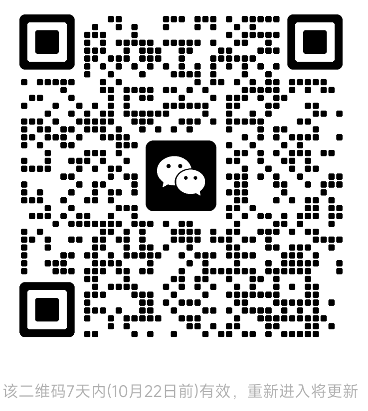

## 🤝 欢迎加入共建

这也是一个开放式学习项目，欢迎不同阶段的同学参与。你不需要一次性完成大型贡献，一个小修正也很有价值：

### 适合贡献的内容

- 修正公式、代码、错别字或过时表述；
- 补充容易理解的类比、反例和边界条件；
- 增加 NumPy 手写实现、数值验证或可视化；
- 补充面试追问、手撕题和真实项目经验；
- 更新论文、模型、工具链和工程实践；
- 改善 Notebook 顺序、排版、字体和可读性；
- 增加测试、验证脚本和复现说明；
- 分享适合不同基础的学习路线。

### 提交 Issue 时可以提供

```text
问题位置：文件名 / Notebook / cell 或行号
问题描述：哪里不准确、难理解或无法运行
复现环境：Python、主要依赖和操作系统
建议方案：如果已经有修复思路，可以一并说明
```

### 提交 Pull Request 的建议

1. 一个 PR 尽量聚焦一个主题；
2. 新增 Notebook 尽量包含直觉、公式、代码、输出和自测；
3. 代码应尽量离线可运行，并固定随机种子；
4. 绘图请显式调用 `plt.show()`，并注意中文字体；
5. 修改后运行对应模块的验证脚本；
6. 在 PR 描述中说明改了什么、如何验证、是否有已知限制。

无论是刚开始学习，还是已经有丰富工程经验，都欢迎参与。我们会尽量以开放、友善、尊重事实和鼓励讨论的方式交流。

---

## 🔄 持续更新计划

项目会围绕以下方向持续迭代：

- 补足基础模块之间的知识连接；
- 更新大模型、Agent、推理优化和多模态内容；
- 增加更多小型、可复现、无需大算力的实验；
- 完善 Notebook 的可执行性、断言和输出；
- 建立更清晰的学习路线、难度标记和先修关系；
- 收集社区反馈，定期清理过时内容和不准确表述；
- 逐步补充真实项目中的数据、部署、监控和故障排查案例。

技术会变化，知识体系也应该变化。这个仓库不会追求“一次写完”，而是希望在持续使用和持续反馈中逐步成长。

---

## 📚 相关文档

- [学习路线与阶段计划](ROADMAP.md)
- [项目许可证](LICENSE)
- 各模块目录下的 `README.md`
- 各模块目录下的 `高频面试题.md`、`专题笔记.md` 与 `教学/`
- [GitHub Issues](https://github.com/Akun-python/autumn-recruitment/issues)

---

## 🙏 免责声明

这也是一个个人发起、社区共建的学习资料仓库，内容主要用于学习、交流和面试准备，不构成任何岗位、课程或考试承诺。部分内容来自公开资料的整理与二次表达，引用或配图如有遗漏、错误或版权问题，欢迎通过 Issue 联系，我们会及时核查和修正。

项目中的示例代码以教学清晰和可复现为优先，不代表生产环境的完整方案。用于真实系统前，请结合具体场景进行安全、性能、稳定性和合规性评估。

---

## 📄 License

本项目遵循 [MIT License](LICENSE)。欢迎学习、引用、修改和贡献；使用时请保留原项目说明，并尊重各个子项目、论文和配图的原始许可。

<p align="center">
  <br/>
  <b>欢迎交流，欢迎纠错，欢迎共建。</b><br/>
  <sub>愿我们一起把“知道一个概念”，变成“能够解释、能够实现、能够验证、能够迁移”。</sub>
</p>

---

## 🗺️ 社区维护与交流

本仓库为**持续实时更新、迭代优化的开放求解方案**。我们深知任何模型与求解都不完美，真诚欢迎每一位读者、参赛者与评审提出任何意见、批评与建议——无论是解题思路、建模细节、算法实现、数据口径还是表述问题，都欢迎提出。我们会虚心接受每一条反馈，并据此不断重算、修订、更新仓库，把方案打磨得更严谨、更完善。

🎯 想一起交流解题思路、建模细节与迭代优化？**扫码加入微信群**，随时欢迎你的意见与讨论：



该二维码7天内(10月22日前)有效，重新进入将更新。